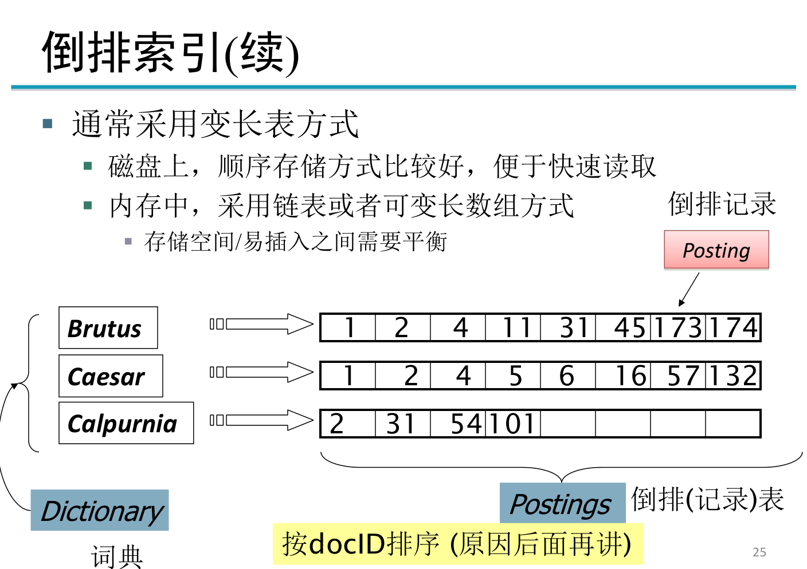
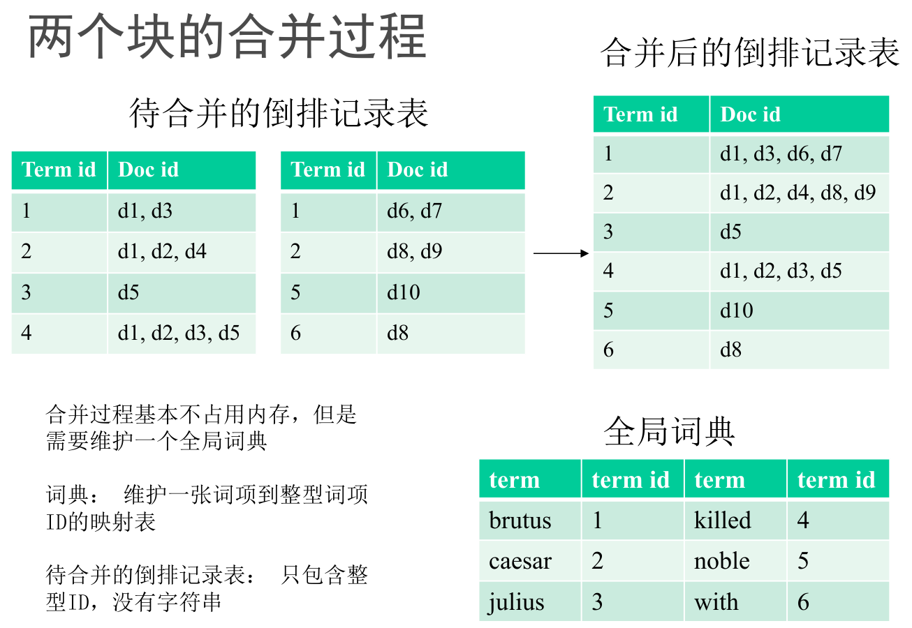
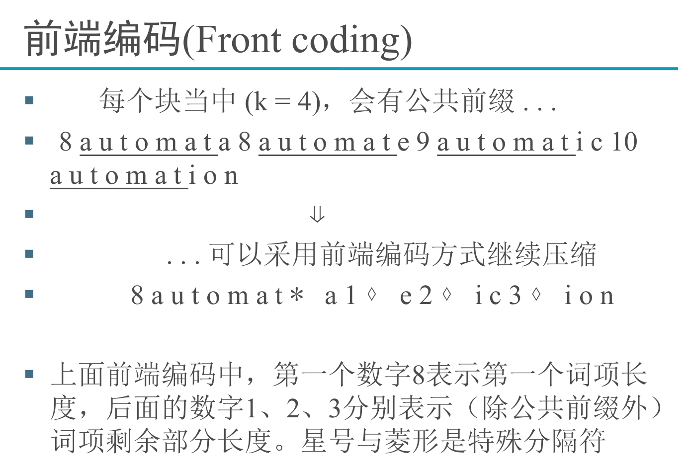
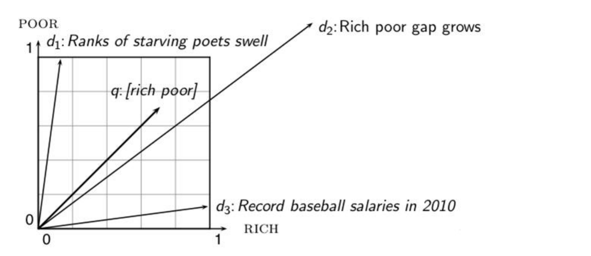
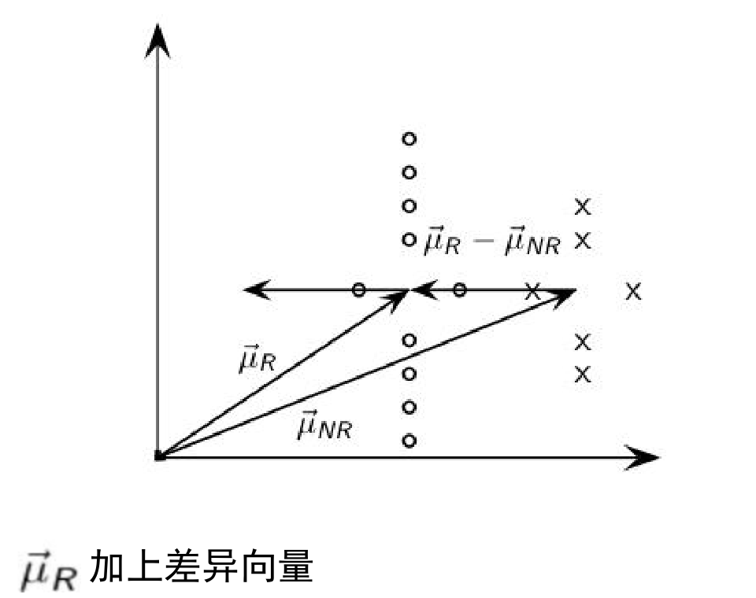
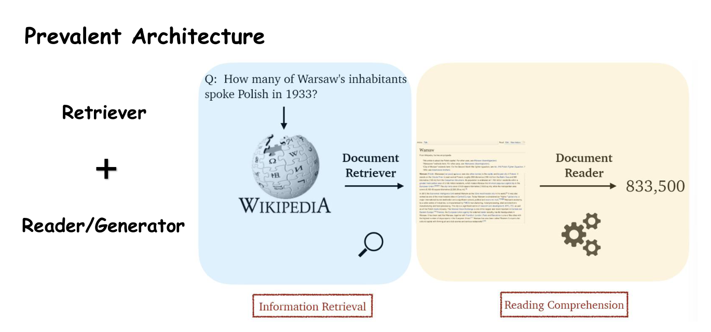

## 第1讲 布尔检索

布尔检索解决的是“哪些文档满足这些条件”。例如查找同时包含“检索”和“索引”、但不包含“广告”的文档，结果只有满足与不满足之分，模型本身不排列相关程度。

### 概念、索引与预处理

信息检索就是从大量资料中找到用户需要的内容。**非结构化资料**指正文、网页等不能直接用数据库固定字段完整表示的内容。信息需求是用户真正想解决的问题，查询只是其语言表达；查询词匹配并不必然意味着相关。同一篇资料对不同用户、不同任务的帮助可能不同，所以相关性要结合具体需求判断。

**词项**是索引中可以查询的词或其他检索单元，docID是文档的唯一编号。倒排索引有两部分：词典保存有哪些词、**每个词出现于多少篇文档（df）**、对应倒排表存在哪里；倒排表保存包含该词的文档编号，通常按编号从小到大排列。前向索引记录“文档→词项”，倒排索引记录“词项→文档”。布尔索引中同一词在同一文档内重复出现只保留一个docID；有评分需求时另存tf(**某个词在一篇文档中出现多少次**)，有短语需求时另存位置。



左边按词查找，右边列出包含该词的文档编号。例如Brutus对应的列表中有1和2，说明这两篇文档都出现过Brutus。查两个词是否同时出现，就对它们的编号列表求**交集**

文本进入索引前通常先经过以下处理：

- 分词（Tokenization）：把一段文字拆成词条。
- 规范化（Normalization）：统一大小写等写法，使不同形式能匹配到一起。
- 词干还原（Stemming）：把部分词形变化合并，如英语中不同的词尾形式。
- 停用词去除：删除“的”、the等出现很频繁、通常区分作用较小的词。

后三项可选，查询端与文档端必须采用一致规则。停用词去除节省存储和计算，但可能破坏短语语义，如“to be or not to be”。

### 布尔合并与优化

布尔合并解决的是：**用户提出几个搜索条件后，怎样从倒排表中找出同时满足条件的文档。** 优化则是在答案相同的前提下，选择通常更省计算的处理顺序。

假设系统中有5篇文档，建立倒排索引后，系统可以直接查到：

| 词   | 包含这个词的文档编号  |
| --- | ----------- |
| 苹果  | `[1, 2, 4]` |
| 华为  | `[3, 5]`    |
| 手机  | `[1, 3, 4]` |
| 维修  | `[4]`       |
搜索时，把这些编号列表拿来运算即可，不用临时打开所有文档重新找词。列表中的编号通常已经从小到大排好。
OR：并集去重
AND：交集
 1. AND NOT：交集取非
 2. 多个条件怎样一起计算更快，用户想查“``[1, 2, 4] or [3, 5] and [1, 3, 4] and not [4] ``，可写为：
倒排索引表从小到大：

```text
① 手机 AND NOT 维修      → [1, 3]
② 苹果 OR 华为          → [1, 2, 3, 4, 5]
③ 将两个结果求交         → [1, 3]
```

文档库很大、后面还有多个条件时，**较小的中间结果**通常能减少后续处理。

 5. 只有df时，怎样估计计算顺序
按照df大小，从小到大合并，有or就相加计算得到上界参与比较，具体见作业一第一题

 6. 先处理较短列表，不一定最快
例如A=`[1, 2]`，B=`[1, 2, 3]`，C=`[4, 5, 6, 7]`，要计算`A AND B AND C`：

- 按长度从小到大：先算A与B，得到`[1, 2]`；再与C求交，才得到空集。
- 先算A与C：第一次求交就得到空集，不必再处理B。

---

## 第2讲 索引构建

索引构建就是把一篇篇文档整理成可以按词查找的表。数据很大时，关键问题是内存放不下，因此要分批处理，再把各批结果合起来。

### 为什么不能直接把磁盘当内存

一个$(term,docID)$对表示“某个词出现在某篇文档中”。海量这样的记录无法全部装入内存；磁盘随机寻道比顺序传输昂贵。外部排序把随机小读写改成成块顺序读写，重点是降低I/O，而不是只减少CPU比较次数。

### BSBI与SPIMI

BSBI（Blocked Sort-Based Indexing）先攒记录，再通过排序把相同词的记录放到一起：

1. 解析文档，为词项分配整数编号termID。
2. 在内存中收集一批$(termID,docID)$记录。
3. 先按termID、再按docID排序，将同一词的记录合并并去重。
4. 将这一批形成的倒排索引写到磁盘。
5. 所有批次处理完后，同时读取多个有序结果，归并成最终索引。

同一词项来自各块的表需合并。若记录总数为T，排序的典型计算复杂度$O(T\log T)$，外存实现关注块数、内存容量和读写遍数。termID映射词典本身也可能成为内存瓶颈。

SPIMI（Single-Pass In-Memory Indexing）直接把记录放进各词对应的表：

1. 为当前批次新建一个词典。
2. 读取一个词条；词典中没有它时，建立词典项和空倒排表。
3. 将当前文档的docID追加到该词的表中。
4. 内存满后，按词项顺序输出各倒排表，只需要排序词典。
5. 继续处理下一批，最后合并所有批次。

它不必先给所有词项建立全局termID，也不必排序每一个词项—文档对；倒排表容量不足时可成倍扩展。输入按docID顺序处理，表内docID自然有序，重复出现需合并或更新tf。

BSBI先收集记录再排序成倒排表；SPIMI使用每块独立词典，边扫描边构造倒排表，最后排序词典并合并。SPIMI减少全局词典和记录排序压力，适于大规模实现；二者都通过分块和最终归并突破内存限制。多路归并比重复两两归并减少中间数据落盘次数。



图中先把两批文档各自建成索引，再把相同termID的文档列表合起来。词项1在第一块对应d1、d3，在第二块对应d6、d7，合并后就是d1、d3、d6、d7。

### 动态索引

主索引放磁盘，新增文档进入较小辅助索引；查询同时检索两者并合并。删除可用失效位图过滤，更新相当于删除旧版本并加入新版本。辅助索引过大后与主索引归并。归并太频繁会重复扫描大主索引，太少则查询辅助部分成本增加。

对数合并：内存缓冲满后产生小索引；同等级两个等规模索引合成上一级，类似二进制进位。T为累计记录数，活跃索引数量上界$O(\log T)$；每条记录参与$O(\log T)$次合并，总构建代价$O(T\log T)$。代价是一次查询要查多个索引。

---

## 第3讲 索引压缩

压缩索引是在保留查找能力的前提下，用更少的字节保存词典和文档编号。它既节省空间，也可能因为少读磁盘而加快检索。

### 动机和统计规律

压缩减少磁盘与内存占用，提高缓存命中率并减少I/O。解码需要CPU，但减少传输常使总检索时间下降；不必解压整个索引，只需访问相关倒排表或块。无损压缩可完全恢复原始数据；词干化、停用词去除改变可检索信息，属于有损处理。

Heaps定律：$M=kT^b$，T为词条总数，M为不同词项数，k、b由语料拟合，常见b约0.5。它预测词典随语料增长而增长，不能假设词汇表最终固定。拼写错误未纠正会引入新词项，自动纠正会减少这种膨胀。Zipf定律：词项按频率降序排列，第i名的集合词频$cf_i\propto1/i$；少数词很常见，多数词罕见。

### 词典压缩

定长词项字段浪费空间且限制最长词；将词典拼成一个字符串，用指针确定词边界，可节省空白。分块压缩：每k个词只留一个块指针，块内存词长和词串；节省指针，但查词需要块内扫描。前端编码：同块排序后的词共享前缀只存一次，各词保存不同后缀；块大通常更省指针、更可能影响访问速度，公共前缀长度也影响收益。



automata、automate、automatic、automation都以automat开头。把automat只保存一次，再分别保存a、e、ic、ion，就减少了重复字符。图中的长度和分隔符用于恢复每个完整单词。

### 间距、VB与γ的精确约定

升序docID为$d_1,\ldots,d_m$，编码$g_1=d_1$，$g_i=d_i-d_{i-1}$。还原时前缀累加。间距通常比docID小，更适合变长码；第一个docID也必须编码。

VB每字节最高位作标记，7位负载；**本课标记1表示最后一个字节**。算法先取模128再逆序输出，是高组在前；另一种存储约定是低7位组在前，最高组不足7位补0。不要把负载次序与标记定义混为一谈。若g>0，字节数$\lfloor\log_{128}g\rfloor+1$。1字节最大127，2字节最大$2^{14}-1=16383$；128必须用2字节。

本课γ编码：设$\ell=\lfloor\log_2g\rfloor$，先写$\ell$个1和一个0，再写g二进制去掉最高1的后缀。码长$2\ell+1$。例如5=101，length=110、offset=01，γ=11001；1的γ=0。它是前缀码，适于逐位唯一解码；位对齐更紧凑，但机器字节/字边界下解码常慢于VB。

编码示例：输入间距为5、7、18、47、53、130、240，VB采用高7位组在前。

|g|VB|γ|γ位数|
|---:|---|---|---:|
|5|10000101|11001|5|
|7|10000111|11011|5|
|18|10010010|111100010|9|
|47|10101111|11111001111|11|
|53|10110101|11111010101|11|
|130|00000001 10000010|111111100000010|15|
|240|00000001 11110000|111111101110000|15|

VB总计9字节；γ总计71位，若单独按字节存储需9字节，其中最后1位为填充。注意71是有效编码位数，不能把填充位计入γ码本身。

组变长编码：4个整数一组，控制字节用4个2-bit字段表示每个整数占1/2/3/4字节，通常字段00/01/10/11对应1/2/3/4；数据字节保存完整8位，不是VB的7位负载。上述7个数都小于256，所以第一块控制字段00 00 00 00、4个数据字节；第二块同样控制字段，可填一个0，保留有效整数数7以忽略填充项。填充方案总计10字节（2控制+8数据）。若容许尾块按有效数写，则需额外约定尾块长度。

Simple-9：每个32位字有4位selector与28位负载，selector选择若干整数的位宽组合；选择一个能装下接下来所有数的模式。不能因为某些位空闲就跨模式任意塞数；编码前检查每个整数均不超过相应位宽上限。

---

## 第4讲 通配查询与拼写矫正

用户可能只记得词的一部分，也可能把词打错。这两种情况都需要先找到可能的完整词，再用这些词查文档。

### 词典与通配查询

哈希表精确查词平均快，但不自然支持前缀/范围查找，动态扩容和冲突需要处理。树利用有序关系支持范围和前缀；B树多分支、树高低，适于按页存储、减少磁盘访问。

尾通配mon*可用词典前缀范围检索；首通配*mon可用逆序词典。m*nchen可交集“前缀m”和“后缀nchen”的候选，随后核验原模式。候选是词项，再把这些词项对应的文档倒排表求并；不要直接把候选词当成最终文档。

轮排索引：给词项加终止符`$`，存所有循环移位，如`hello$`、`ello$h`等，均映射回hello。查询X*Y旋转为`Y$X*`，作前缀查询。例如`m*nchen`→`nchen$m*`。代价是每个长度L的词存约L+1个旋转项，空间较大。

字符候选也可按Jaccard相似度筛选：$J(A,B)=|A\cap B|/|A\cup B|$，A、B为两词的字符k-gram集合；筛选后仍需核对编辑距离或原查询。

k-gram索引：把词项的字符k元组作为键，倒排表保存包含该字符片段的**词项**。查询提取必须出现的k-gram，求交生成候选，再用原通配表达式过滤假阳性。存在两级倒排：k-gram→词项、词项→文档。字符片段集合匹配只给必要条件，并不保证字符次序、位置或完整通配约束成立。

### 编辑距离与噪声通道

非词汇错误：输入不在词典；真实词错误：输入本身合法但上下文错误，不能只查词典发现。Damerau-Levenshtein允许插入、删除、替换、相邻字符交换；标准Levenshtein只包含前三种。编辑距离是从一个字符串变成另一个字符串的最少操作数。

前三种操作的动态规划：$D(i,0)=i,D(0,j)=j$；$D(i,j)=\min\{D(i-1,j)+1,D(i,j-1)+1,D(i-1,j-1)+[a_i\ne b_j]\}$。交换需要额外转移，不能把四操作模型只用三操作递推计算。

噪声通道：观察错误串x，选择原词$\hat w=\arg\max_wP(w\mid x)=\arg\max_wP(x\mid w)P(w)$。P(w)为语言模型先验，P(x|w)为正确词被打成x的错误模型。生成候选可遍历词典、枚举近距离编辑、利用字符索引；评分再结合频率、编辑操作概率。不能把P(x|w)写反为P(w|x)。

例如候选A的先验0.01、通道概率0.02，联合分数0.0002；候选B先验0.001、通道概率0.1，联合0.0001，因此选A，即使B更容易打成观察串。零计数可加一平滑：$(c+1)/(C+V)$，V必须为该条件下可能结果数，而不是随意取语料词数。

上下文敏感纠错将P(w)扩展为整句概率，可用二元模型$P(w_1)\prod_{i=2}^nP(w_i|w_{i-1})$。当只替换位置i时，主要改变前一词到候选、候选到后一词两条转移；真实词也应保留“不修改”候选，并给予较高无错误通道概率。上下文可区分minutes/minuets等合法词。

先用词典或上下文发现疑似错误，再用编辑距离/字符索引生成候选，最后以语言模型先验和噪声通道概率联合排序。独立词纠错依赖词频，真实词错误还需上下文；平滑避免低频或未见编辑被赋零概率。

---

## 第5讲 检索评价

评价检索系统时，可以先问两个问题：找出来的内容有多少是真的有用，叫查准；所有有用的内容中找回了多少，叫查全。排序评价还要看有用内容是否排在前面。

### 查准率、召回率和排序指标

假设资料库里有10篇真正相关的文档，系统返回5篇，其中4篇相关。查准率看“拿回来的有多少是对的”，所以是4/5；召回率看“应该找到的找回了多少”，所以是4/10。一个衡量结果里的杂质，一个衡量漏掉了多少。

可以把文档分成四组：TP是找出来且有用的文档；FP是找出来但没有用的文档；FN是有用却漏掉的文档；TN是没有用且没有返回的文档。查准率P以返回结果为分母，查全率R以全部相关文档为分母。$P=TP/(TP+FP)$，$R=TP/(TP+FN)$；$F_1=2PR/(P+R)$。更一般$F_\beta=(1+\beta^2)PR/(\beta^2P+R)$，β>1更强调召回。Accuracy=(TP+TN)/总数，IR中不相关文档极多，什么都不返回也可有高Accuracy，因此不合适。

$P@k=\#\text{前k篇相关}/k$，$R@k=\#\text{前k篇相关}/|Rel|$。R-Precision在$k=|Rel|$处取P。Hit@k指前k篇是否至少命中一篇相关（对多个查询取平均时为比例），不等于Recall；只命中1篇可能Hit=1但Recall很低。

未插值AP：$AP(q)=\frac1{|Rel_q|}\sum_{k=1}^{L}P@k\,rel(k)$，rel(k)为0/1。只在相关文档出现位置累加P，分母是所有相关文档数，未返回相关文档贡献0。MAP对查询AP作算术平均，每个查询同权，不能按相关文档数加权替代。插值曲线$P_{interp}(r)=\max_{r'\ge r}P(r')$；未插值AP不先做这一包络。

计算示例：查询q1共有5篇相关文档，返回10篇，相关位置2、4、6、10，精度分别1/2、2/4、3/6、4/10；第五篇未返回贡献0。$AP_1=(0.5+0.5+0.5+0.4)/5=0.38$。查询q2共有3篇相关文档，相关位置1、3、9，$AP_2=(1+2/3+3/9)/3=2/3$。$MAP=(0.38+2/3)/2=0.523333$。

查询q1的全部位置精度如下，注意“不相关位置也有P@k”，只是在AP求和时不累加该位置。

|k|1|2|3|4|5|6|7|8|9|10|
|---|---|---|---|---|---|---|---|---|---|---|
|P@k|0|1/2|1/3|2/4|2/5|3/6|3/7|3/8|3/9|4/10|

AP以全部相关文档数为分母，在每个被召回的相关文档处累计当前精度。每找回一篇相关文档，召回率增加$1/|Rel|$，故AP可看成对召回增加量加权的精度和；未召回文档贡献零。既奖励相关文档靠前，也惩罚漏召回。

### nDCG：同时考虑相关程度和排名位置

线性DCG：$DCG@k=G_1+\sum_{i=2}^kG_i/\log_2i$。第一项原样，第二项折扣也为1；这一版本与使用$\log_2(i+1)$的版本不同。$IDCG@k$是完整标注集合按gain降序形成理想序列后的DCG，$nDCG=DCG/IDCG$。不是将系统返回列表内部排序就算理想序列；未返回高相关文档也必须进入理想列表。

指数版同时使用增益$2^{G_i}-1$和折扣$\log_2(i+1)$：$DCG_{exp}@k=\sum_{i=1}^k(2^{G_i}-1)/\log_2(i+1)$，再除以同式计算的IDCG。两种定义分别计算自己的DCG和IDCG，不能交叉使用。

计算示例：返回文档的相关等级为3、0、2、1、0、2；完整集合中相关等级从高到低为3、3、2、2、1，其余均为0。理想前6位为3、3、2、2、1、0。$DCG@3=3+0+2/\log_23=4.261860$；$IDCG@3=3+3+2/\log_23=7.261860$；nDCG@3=0.587。$DCG@6=3+2/\log_23+1/2+2/\log_26=5.535565$；$IDCG@6=3+3+2/\log_23+2/2+1/\log_25=8.692536$；nDCG@6=0.637。

### 不完整标注、bPref和评测设计

Pooling：各参评系统每个查询取前若干名，合并去重后人工标注。比全库标注便宜，便于固定条件下比较系统，但未入池文档不等于真正不相关。完整相关总数难知，所以Recall尤其不可靠；P和AP在足够深池中通常比较稳定，但也可能偏向贡献池的系统。稀疏标注时bPref常比直接将未判定记0的MAP稳健。

bPref忽略未判定文档，对已判定相关文档统计排在其前的已判定不相关数。更新后的定义可记为$\frac1R\sum_r[1-\min(n_r,R)/\min(R,N)]$，使用时明确求和集合与计数截断规则；R为已判定相关文档数，N为已判定不相关数，n_r为r之前的不相关数。未判定不是不相关，不能把u计入n_r；未返回相关项不应当作排在所有不相关之前。

例如只看已判断的顺序“相关A、未判断X、不相关B、相关C”，X直接跳过。A之前有0篇已判断不相关文档，C之前有1篇，所以两篇相关文档的n_r分别为0和1。若全标注集合只有这两篇相关与这一篇不相关，则R=2、N=1，更新式得到(1+0)/2=0.5。X无论排在哪里都不增加惩罚。

bPref的小例子：共有2篇已标相关文档R1、R2和2篇已标不相关文档N1、N2。返回顺序是R1、u、N1、R2、N2，其中u表示没有人工判断。R1前面有0篇不相关，R2前面有1篇；u完全跳过。因此$bPref=[(1-0/2)+(1-1/2)]/2=0.75$。这里相关与不相关标注数相同，两种公式的分母相同。

GMAP：查询AP的几何平均，$\exp[\frac1Q\sum_q\log AP_q]$，对困难查询和接近零的AP更敏感，体现稳定性，零值实现需规定处理。Kappa：$\kappa=(P_o-P_e)/(1-P_e)$，Po为实际一致率，Pe为按两人边际标注概率计算的偶然一致率。

TREC评价需相同语料、查询、标注及指标；Topic可以有title、description、narrative，实验应说明用了哪些字段。训练集拟合参数，验证集调参，测试集最终报告，不能反复用测试集挑方法。报告多个数据集、合适baseline、统计显著性，防止只挑有利查询；A/B测试通过随机分组在真实用户环境比较单一变更。

网页搜索主要要求用户前几项看到好结果；RAG必须先检索到足以支持答案的证据，漏掉关键证据会使生成器无法作答或产生无依据内容。因此强调Recall和Hit；多证据问题中只命中一篇仍可能不足，需进一步检查证据覆盖与最终答案正确性。

---

## 第6讲 TF-IDF与向量空间模型

向量空间模型把每篇文档表示成一组数：每个位置对应一个词，数值表示这个词在文档中的重要程度。检索时比较查询与文档的这两组数是否指向相近的方向。

### 权重与相似度

词袋模型只保留词及频次，忽略词序。Jaccard：$J(q,d)=|q\cap d|/|q\cup d|$，按集合不区分重复次数，既不体现稀有词的重要性，也不能充分刻画文档长度和词频。

$tf_{t,d}$为词在某文档中出现次数；$df_t$为含词文档数；$cf_t=\sum_dtf_{t,d}$为集合总次数。df不能用cf替代。局部对数权重$l(tf)=1+\log_{10}tf$（tf>0），tf=0时权重0，不能计算log0。$idf_t=\log_{10}(N/df_t)$；$w_{t,d}=l(tf_{t,d})idf_t$。罕见词区分力强，idf较高；df=N时idf=0。只给tf不能凭空算idf，需N和df。

例如只考虑“检索”和“索引”两个词，词数为(2,1)与(4,2)的文档具有相同词数比例，向量方向相同；(1,4)的比例不同，方向也不同。余弦衡量这种方向接近程度，所以不会只因为一篇文档把相同比例的词重复一遍就认为它更相似。V是词典，|V|是不同词项的总数。把每个词看成一条坐标轴，文档在该轴上的坐标就是这个词的权重。两个向量方向接近，表示它们各个词的权重比例接近。把一篇文档完整复制一遍，词的比例没变，因此更适合比较夹角，而不只看两点的距离。这里$V$是词典，$|V|$是词典中的词数。

查询和文档同处$|V|$维空间：$\cos(q,d)=\frac{\sum_tw_{t,q}w_{t,d}}{\sqrt{\sum_tw_{t,q}^2}\sqrt{\sum_tw_{t,d}^2}}$。分母的文档模长包含文档所有非零维，不只查询词维。向量预先单位化后，余弦等于内积。单查询排序时查询模长是常数，可省而不改变顺序；报告真正余弦数值时仍需除它。零向量需规定相似度为0或跳过。



横轴和纵轴分别表示rich、poor两个词的权重。d2虽然离查询q较远，但方向很接近，说明两个词的比例接近；d1和d3的词频比例偏向某一边。余弦相似度看的是这个方向差别。

计算示例：N=100，df(a)=10、df(b)=1，idf分别1、2。查询a b的tf-idf为(1,2)。d1词频(10,1)，权重(2,2)，$\|d_1\|=\sqrt8$；d2词频(1,10)，权重(1,4)，$\|d_2\|=\sqrt{17}$；查询模$\sqrt5$。$cos(q,d_1)=6/\sqrt{40}=0.948683$；$cos(q,d_2)=9/\sqrt{85}=0.976187$，故d2在前。因为b稀有，同样词频增加在b维影响更大。

单词项查询下，同一词的idf对所有候选是公共因子，不直接改变基于该词权重的排序；但是文档向量的长度归一化仍会影响最终得分。不要将这一结论泛化为“idf在所有多词查询无用”。

### SMART记号与计算算法

三个字母分别表示tf处理、idf处理、归一化；常用n=原始或不处理（依所处位置），l=对数tf，t=idf，c=余弦归一。lnc.ltn表示文档l+n+c，查询l+t+n：文档用对数tf、不乘idf、做余弦归一；查询用对数tf乘idf、不做归一。左右分别为文档与查询，勿颠倒。

计算：①离线计算文档权重和模长；②查询转同一词典维度并算权重；③遍历各查询词倒排表，向文档累加$w_{t,q}w_{t,d}$；④除文档模长，必要时再除查询模；⑤选Top-k。不含查询词的维度虽不贡献分子，仍贡献文档模长。

余弦可使长短文档公平比较，但某些情形偏向短文档；回转归一化通过调整长度归一化曲线，使不同长度文档的预测相关概率更接近实际分布，不等于完全取消长度因素。

TF刻画词项对当前文档的重要性，IDF刻画其在全库的区分能力，长度归一化减少长文档因词多而天然获得高分的偏差。向量模型简单高效、易于倒排实现，但词袋忽略词序、语义与词依赖，同义词可能不匹配。

---

## 第7讲 相关反馈与查询扩展

初次查询常常不够准确。相关反馈利用已经找到的文档修正查询；查询扩展则加入原查询没有写出的词，让系统能找到更多表达方式不同的内容。

### Rocchio如何修改查询向量

矩心就是这些文档向量的平均位置：每一维分别相加，再除以文档数。例如(2,0)和(0,2)的矩心为(1,1)。理想情况下最优区分方向为相关集合矩心减不相关集合矩心。实际：$q_m=\alpha q_0+\frac\beta{|D_r|}\sum_{d\in D_r}d-\frac\gamma{|D_{nr}|}\sum_{d\in D_{nr}}d$。q0原查询；Dr已判定相关反馈文档；Dnr不相关反馈文档；α保留原需求，β强化正反馈，γ抑制负反馈。某集合为空时省略该项，不除零；通常负坐标截为0，正反馈往往更有价值，β通常大于γ。



圆点代表相关文档，叉号代表不相关文档。先求两组的平均位置，再朝“相关组平均位置减不相关组平均位置”的方向移动，可以拉开与不相关组的距离。实际Rocchio公式还会保留原查询，并设置各部分权重。

例：$q_0=(1,0,1)$，相关文档$(2,2,0),(0,2,2)$，不相关文档$(0,4,0)$，α=1、β=0.75、γ=0.15。相关矩心(1,2,1)，负矩心(0,4,0)，新查询$(1,0,1)+(0.75,1.5,0.75)-(0,0.6,0)=(1.75,0.9,1.75)$。第二维原查询为0，反馈后变正，因此同时实现重加权和扩展。之后如评分模型需要，再做归一化。

### 三种反馈、局部与全局扩展

显式反馈由用户标相关/不相关，信号明确但操作开销大。隐式反馈由点击、停留、鼠标等推断，采集方便但点击受位置和展示方式影响，点击不等于真实相关，未点击不等于不相关。伪相关反馈把初次返回的前k篇假定为相关，自动抽取词项、重加权再检索；无需人工但初次结果错误会放大偏差。

局部QE根据当前查询的反馈文档，取当前语境的扩展词；全局QE依靠语料共现、词典/同义词库、WordNet、查询日志等跨查询资源。扩展可缓解term mismatch，提高召回，但新增歧义词导致主题漂移。通过保留原查询权重、控制反馈文档和扩展词数量、选择性扩展以及使用外部高质量资源改善。语料较小导致反馈不足时，可用外部集合，但要注意领域差异。

反馈成立的条件：用户能提出一定有效的初始词；相关文档在词空间中足够相近。多子主题相关集不一定围绕单一矩心，过粗的Rocchio会遗漏不同簇。正确评价要用residual collection：移除用户已看过和标注过的文档，在剩余集上检查改进，避免把已知相关文档重新排前就当新收益；还应控制用户花费时间。

LLM扩展：Query2doc生成与查询相关的伪文档，用更丰富文本重构查询；GRF利用生成内容模拟相关反馈；AGR按分析、生成、精炼处理扩展。共同目标是补充词汇与上下文，但生成内容需要检索验证，不能将伪文档视为真实相关性标注。

相关反馈在初次检索后利用相关性证据修正查询，Rocchio把查询向相关文档矩心拉近、从不相关矩心推远。伪反馈自动把前列结果当相关，成本低但容易主题漂移；查询扩展是增加词项，既可来自局部反馈，也可来自全局资源，两者并非同义词。

---

## 第8讲 概率检索模型

概率检索希望把“更可能相关”的文档排在前面。由于真实概率无法直接知道，模型要根据词是否出现、出现多少次、文档多长等信息估计分数。

### 概率排序与Logistic

贝叶斯公式$P(A|B)=P(B|A)P(A)/P(B)$；条件独立是指先固定一个条件后，再把两个事件当作互不影响。例如先固定“文档相关”，BIM把各个词是否出现当作独立事件；这不表示真实语言中的词本来就互不关联。概率排序原理PRP：按文档满足当前信息需求的相关概率降序返回，在相应假设下得到最优效果。

Logistic用查询—文档特征$f_i(Q,D)$：$P(R=1|Q,D)=\sigma(z)$，$z=b+\sum_iw_if_i$，$\sigma(z)=1/(1+e^{-z})$。log-odds为z。先用标注数据学习w，线上提取同类特征再算分；σ单调，排序可直接用z。特征可包括匹配、tf、idf、长度等，不能把线性回归无界输出直接当概率。

### BIM与RSJ

BIM把文档表示成词项出现与否的二值向量，使用多元Bernoulli及给定相关性后的词项独立假设。它不保留词频，不是multinomial模型，也不是二重Poisson模型。令$p_i=P(t_i\text{出现}|R=1)$、$q_i=P(t_i\text{出现}|R=0)$，词权重$W_i=\log\frac{p_i(1-q_i)}{q_i(1-p_i)}$，$RSV(Q,D)=\sum_{t_i\in Q\cap D}W_i$。推导通过相关/不相关似然比、取对数、去掉给定查询下的常数得到。

N总文档数，R相关文档数，ni为含ti的文档数，ri为相关且含ti数。$p_i=(r_i+0.5)/(R+1)$，$q_i=(n_i-r_i+0.5)/(N-R+1)$。RSJ：$W_i=\log\frac{(r_i+0.5)(N-R-n_i+r_i+0.5)}{(n_i-r_i+0.5)(R-r_i+0.5)}$。这些计数可以放进同一张表。每个格子的数量来自相应行列的交集：

|文档类别|包含词ti|不包含词ti|合计|
|---|---:|---:|---:|
|相关|ri|R−ri|R|
|不相关|ni−ri|N−R−ni+ri|N−R|
|合计|ni|N−ni|N|

例如“不相关且不含词”的数量，要从全部不相关文档N−R中，再减去含词的不相关文档ni−ri。公式中的0.5用于平滑，避免某格为0时出现除零或无法取对数。

没有相关判定时，设pi=0.5、qi≈ni/N，可得$\log[(N-ni)/ni]$；0.5平滑后为$\log[(N-df+0.5)/(df+0.5)]$。若df>N/2，权重为负。BIM的局限是原始版本只有二值出现与全局权重，没有TF和长度信息。

### BM25：词频饱和与长度调整

：查询因子$qtf/(k_3+qtf)$、文档因子$k_1tf/[tf+k_1(1-b+bL/\overline L)]$与RSJ相乘求和；采用log2。常见的规范化版本如下。不同版本的常数倍率与对数底可能不同，计算时应保持统一：

$$
score(q,d)=\sum_{t\in q\cap d}idf(t)\frac{(k_1+1)tf(t,d)}{tf(t,d)+k_1(1-b+bL_d/\overline L)}.
$$

公式中，$q$是查询，$d$是文档，$tf(t,d)$是词t在文档中的次数，$L_d$是这篇文档的总词数，$\overline L$是平均文档词数。

令$K_d=k_1(1-b+bL_d/\overline L)$。k1调节tf饱和，固定长度下tf增大因子趋于k1+1，重复词不能线性无限加分。第一次出现通常说明文档涉及这个词；第十次出现仍有帮助，但新增的信息往往少于第一次。公式用分母中同样增长的tf压低后续增益，因此tf越大，曲线越平，逐渐靠近上限；k1趋于0时，tf>0的因子趋于1，变为近似二值匹配。

k1趋于∞时，因子趋于$tf/(1-b+bL/\overline L)$，是经长度归一化的线性tf，只有b=0才是原始tf。b控制长度归一化，b=0忽略长度，b=1完全按长度比调整；b增大对长于平均的文档惩罚更强。

计算示例：查询为cloud security，k1=1.2、b=0.75、平均长度100，idf(cloud)=2.19、idf(security)=0.85，忽略查询频次。d1长度60，两个词的词频为2、1；d2长度100，词频为4、2；d3长度300，词频为8、4。

|文档|L|K|cloud因子|security因子|总分|
|---|---:|---:|---:|---:|---:|
|d1|60|0.84|4.4/2.84=1.54930|2.2/1.84=1.19565|4.41|
|d2|100|1.20|8.8/5.2=1.69231|4.4/3.2=1.37500|4.87|
|d3|300|3.00|17.6/11=1.60000|8.8/7=1.25714|4.57|

不提前舍入后得分约4.409262、4.87490、4.57257，排序d2>d3>d1。最终两位小数依次为4.41、4.87、4.57。b=0时K均1.2，d1因子1.375、1，总分3.86125；d2不变4.87490；d3因子1.913043、1.692308，总分5.628026756，排序d3>d2>d1。取消长度惩罚后长文档的高tf优势显现。

二重Poisson为词频建模区分elite与一般文档，启发权重随tf单调增加、边际增益递减并饱和。高频停用词使相关/不相关区分弱，RSJ可能为负，还会破坏推导中的近似假设；饱和意味着重复常见词并不会持续提供区分力。这一推导采用去除停用词的预处理，以减少极高频词对近似的影响。

TF-IDF把“这个词在当前文档中多不多”和“它在整个文档库里常不常见”结合起来，再调整文档长度；BIM以二值出现及独立假设推导相关性概率比；BM25在RSJ基础上加入饱和TF和文档长度归一化，通常更适合传统词项匹配。BIM描述的是词出现或不出现；2-Poisson描述词频，是BM25词频部分的推导背景。

---

## 第9讲 统计语言模型与查询似然

同一件事可以换很多种说法。语言模型检索先问一个更具体的问题：如果只根据这篇文档中的用词习惯写一句查询，写出当前查询的可能性有多大？可能性越大，文档就越值得排在前面。这里的“生成”是计算概率，并不要求真的写出一句话。

### 定义、假设与公式

统计语言模型给词序列分配概率。链式法则：$P(w_1\cdots w_n)=P(w_1)\prod_{i=2}^nP(w_i\mid w_1\cdots w_{i-1})$。N-gram以最近N−1词近似全部历史；unigram忽略次序，bigram是一阶马尔科夫模型。词典大小M时，按各阶条件概率表合计参数空间$M+M^2+\cdots+M^N$，是数量级估计，不是扣除归一化约束后的独立自由参数数目。阶数增大能建模更多上下文，但数据稀疏、存储与估计代价上升。

查询似然QLM：为每篇文档D估计生成模型$M_D$，按该模型生成查询Q的概率排序。由$P(D\mid Q)\propto P(Q\mid D)P(D)$，若文档先验一致，排序等价于$P(Q\mid M_D)$。一元多项式假设下：

$$
P(Q\mid M_D)=\prod_{w\in Q}P(w\mid M_D)^{c(w,Q)},\quad \log P(Q\mid M_D)=\sum_{w\in Q}c(w,Q)\log P(w\mid M_D).
$$

$c(w,Q)$为查询词频。若把查询当无序计数向量，还可乘多项式系数$|Q|!/\prod_wc(w,Q)!$；同一查询比较文档时该系数相同可删。最大似然估计：$P_{ML}(w\mid D)=c(w,D)/|D|$，其中$|D|$为文档总词数，不是不同词数。

多元伯努利模型对每个词考虑出现/未出现，忽略重复次数；多项式模型对每个位置抽取词，考虑词频，忽略次序。BIM属于前者，QLM通常属于后者。Bernoulli各词出现概率的和不必为1；multinomial各词概率和必须为1。

### 平滑与完整计算例

零概率问题：D没有查询中的一个词就会使整个查询似然归零，即使其它词高度匹配。平滑把部分概率质量分给未见词，也是调节文档模型可靠性的机制。设集合背景$p_C(w)=c(w,C)/|C|$：

- JM插值：$p(w\mid D)=(1-\lambda)c(w,D)/|D|+\lambda p_C(w)$。这里约定λ是背景权重；使用公式时需要先确认λ表示背景权重还是文档权重。

- Dirichlet：$p(w\mid D)=[c(w,D)+\mu p_C(w)]/(|D|+\mu)$。μ相当于背景伪计数总量，短文档背景占比更大。

- 加一：$[c(w,D)+1]/(|D|+|V|)$，简单但大词典可能过度平滑；不能只改分子不改分母。

自拟算例：Q=a b b；D1长度10，a出现3次、b未出现；D2长度20，a和b各2次；背景$p_C(a)=0.1,p_C(b)=0.05$。不平滑D1似然0，D2为$0.1\times0.1^2=0.001$。JM取λ=0.2：D1的a、b概率分别0.26、0.01，似然$0.26\times0.01^2=0.000026$；D2分别0.10、0.09，似然0.00081，故D2排前。

Dirichlet取μ=10：D1为$4/20=0.2$、$0.5/20=0.025$，似然0.000125；D2为$3/30=0.1$、$2.5/30=1/12$，似然$1/1440\approx0.00069444$，仍D2排前。步骤：统计词频与长度→背景概率→逐词平滑→按查询词频乘幂/累加对数→从大到小排。

KL模型：同时估计查询分布$p_Q$、文档分布$p_D$，最小化$D_{KL}(p_Q\Vert p_D)=\sum_wp_Q(w)\log[p_Q(w)/p_D(w)]$。固定查询时，查询熵项是常数，等价于最大化$\sum_wp_Q(w)\log p_D(w)$；若查询用MLE，与QLM排序一致。KL不对称，不能随便交换Q、D。翻译模型用$P(w\mid D)=\sum_tP(w\mid t)P(t\mid D)$把文档词映射到查询词，缓解同义表达不匹配。

统计语言检索先由文档样本估计生成分布，再计算该分布产生查询的似然。MLE会对未出现词赋零概率，因此把整套文档中统计出的词频也考虑进来，给没在当前文档出现的词留一点概率。该方法有明确概率解释，但独立词假设忽略语序、词间依赖与部分语义关系。

---

## 第10讲 文本分类与排序学习

人工规定标题占几成、正文占几成，未必适合所有查询。排序学习利用已经标注好的相关文档，自动调整这些信号的组合方式。文本分类关注“属于哪一类”，排序学习关注“对于同一个查询，谁应当排在谁前面”。

分类是从文本表示映射到预定义类别；监督学习以有标签文档训练分类器。特征可含词袋、URL、标点、标题、链接；特征选择降低计算量、减少噪声与过拟合。线性分类器$f(x)=w^Tx+b$，Rocchio、朴素贝叶斯、logistic回归、线性SVM均可形成线性决策边界；非线性数据可用核方法等。

SVM：令$y_i\in\{-1,+1\}$，硬间隔目标$\min\frac12\|w\|^2$，约束$y_i(w^Tx_i+b)\ge1$；两支持超平面间隔$2/\|w\|$。软间隔加入$\xi_i\ge0$，目标$\frac12\|w\|^2+C\sum_i\xi_i$，约束变为$y_i(w^Tx_i+b)\ge1-\xi_i$。C大更重视训练错误惩罚。核函数$K(x,z)=\phi(x)^T\phi(z)$避免显式高维映射。

### 域权重学习与Ranking SVM

域加权：$s(q,d)=g s_T+(1-g)s_B$，$0\le g\le1$，T/B分别标题、正文匹配；最小化$\epsilon(g)=\sum_j[s(q_j,d_j)-r_j]^2$。只有标题、正文匹配不同的样本影响最优g。自拟例：两篇相关文档仅标题命中，一篇不相关文档仅标题命中，一篇相关文档仅正文命中，损失$2(g-1)^2+g^2+[(1-g)-1]^2=4g^2-4g+2$，导数$8g-4=0$，得$g=0.5$，损失1；若驻点不在[0,1]应比较边界。不能把该平方误差目标直接当成Ranking SVM目标。

排序学习用$(q,d,r)$训练特征组合；特征可以是BM25、余弦、邻近度、标题匹配、链接重要性等。逐点把每个文档相关等级看成回归/分类；成对学习同一查询下文档的相对次序；逐列直接以整张结果列表为学习对象。分类只要求预测无序类别，而排序更关心相对次序、靠前位置与等级差异。

Ranking SVM：对同一查询的每对$r_i>r_j$，构造差分特征$\Delta\psi_{ij}=\psi(q,d_i)-\psi(q,d_j)$，要求$w^T\Delta\psi_{ij}\ge1-\xi_{ij}$。目标$\frac12\|w\|^2+C\sum\xi_{ij}$；等价hinge项$\max(0,1-w^T\Delta\psi_{ij})$加正则。差分顺序必须与“前者应排前”一致。

单参数权重的计算方法：若$w=(g,1-g)$，每个文档得分$s_i=x_{i2}+g(x_{i1}-x_{i2})$。列出全部相关—不相关对；每对margin为$m_{ij}=\Delta x_2+g(\Delta x_1-\Delta x_2)$；每项损失$[1-m_{ij}]_+$；求所有$m_{ij}=1$的断点并加入0、1，在各区间写出线性损失，比较端点/平坦区间，再给出最优g及并列处理。

例：相关A=(2,0)、不相关B=(0,1)，margin$3g-1$，hinge$[2-3g]_+$，g≥2/3损失0；若额外加入L2项则最佳值可能变化，需要以实际选定的目标函数计算。

普通Ranking SVM不足：高等级、靠前文档排错代价应更大；不同查询文档对数不同，样本多的查询会主导总损失。可用等级/位置代价加权、查询内归一化、直接优化排序指标。NDCG对得分不连续：得分小变动不改变次序则指标不变，跨越排序边界时跳变，不宜直接普通求导。LTR从人工或行为相关性数据学习多特征排序函数，pairwise方法学习同查询文档的偏序；须考虑位置敏感性与查询间样本不均衡。

### 六篇文档的排序学习例子

先给出完整输入。每篇文档用两个归一化特征表示，第一维可理解为标题匹配强度，第二维为正文匹配强度。这里的数值是已经计算好的特征，不再从原始文本计算。训练标签1表示相关，0表示不相关。

|文档|特征向量|相关标签|
|---|---|---|
|d1|(0.8,0.4)|1|
|d2|(0.5,0.8)|1|
|d3|(0.6,0.3)|0|
|d4|(0.5,0.4)|0|
|d5|(0.2,0.1)|0|
|d6|(0.1,0.3)|0|

使用权重$w=(g,1-g)$，其中$0\le g\le1$，训练目标为合页损失总和加上 $\frac12\|w\|^2$，对应标准形式中的合页损失系数$C=1$。相关集合为{d1,d2}，不相关集合为{d3,d4,d5,d6}，所以共2×4=8对。构造训练对时，使用相关文档特征减去不相关文档特征；反向向量配反向标签表达同一偏序，重复计入会改变损失与正则的相对权重。相同等级之间不构造对。

|对(i,k)|Φik|margin：w·Φik|hinge（0≤g≤1）|g=.4时margin|
|---|---|---|---|---|
|(1,3)|(0.2,0.1)|0.1+0.1g|0.9−0.1g|0.14|
|(1,4)|(0.3,0)|0.3g|1−0.3g|0.12|
|(1,5)|(0.6,0.3)|0.3+0.3g|0.7−0.3g|0.42|
|(1,6)|(0.7,0.1)|0.1+0.6g|0.9−0.6g|0.34|
|(2,3)|(−0.1,0.5)|0.5−0.6g|0.5+0.6g|0.26|
|(2,4)|(0,0.4)|0.4−0.4g|0.6+0.4g|0.24|
|(2,5)|(0.3,0.7)|0.7−0.4g|0.3+0.4g|0.54|
|(2,6)|(0.4,0.5)|0.5−0.1g|0.5+0.1g|0.46|

margin就是两篇文档的得分差。这里它等于Φ的两个坐标按g和1−g加权平均；两个权重都不小于0，且相加为1，所以平均值不会超过这两个坐标中较大的一个。表中所有坐标≤0.7，因此所有margin≤0.7<1，所有hinge始终取1−margin，可以去正部号。注意部分g处margin可负，例如(2,3)在g=1时−0.1，不能误说整个区间都排对。

合页总损失$L(g)=5.4+0.2g$。正则项为$0.5\|w\|^2=0.5[g^2+(1-g)^2]=g^2-g+0.5$，故$J(g)=g^2-0.8g+5.9$。$J'(g)=2g-0.8=0$得$g^*=0.4$，在可行区间内，且$J''=2>0$，为唯一最小值；$w^*=(0.4,0.6)$，$L=5.48$、正则0.26、$J^*=5.74$。

六篇文档得分依次：d1=0.56，d2=0.68，d3=0.42，d4=0.44，d5=0.14，d6=0.22。排序为d2>d1>d4>d3>d6>d5。8个margin见末列，全部正且小于1，相关文档均排在不相关文档前，但尚未达到单位间隔，所以每对hinge仍正；此外非零权重还有正则损失。排序正确只要求margin>0，零hinge要求margin≥1，二者不可混同。

---

## 第11讲 分布式表示

词袋把每个词看成互不相干的编号，因此“汽车”和“轿车”没有天然联系。词向量让每个词拥有一串可以学习的数值：训练时，经常出现在相似上下文中的词会得到相近表示。数值的单独一维通常没有明确名称，多个维度一起表达词的使用特点。

one-hot词向量维度等于词表，稀疏且不同词正交；分布式表示以低维稠密向量共享语义特征，利用“上下文相似的词语义相近”的分布假设。静态词嵌入每词一个主表示，难以处理bank等多义词；同义/语义相近不等于满足同一查询的信息需求。

### 词向量怎样从上下文中学出来

Word2vec：CBOW由上下文预测中心词；Skip-gram由中心词预测窗口内上下文。中心词c对应$v_c$，上下文词o对应$u_o$，每词有两套向量：

$$
p(o\mid c)=\frac{\exp(u_o^Tv_c)}{\sum_{w\in V}\exp(u_w^Tv_c)},\quad J=-\frac1T\sum_{t=1}^T\sum_{-m\le j\le m,j\ne0}\log p(w_{t+j}\mid w_t).
$$

T为语料长度，m为窗口半径。

最大化似然等价于最小化负对数似然。单样本负对数损失对中心向量梯度是$\sum_wp(w\mid c)u_w-u_o$；若求对数似然梯度，符号相反。梯度符号应与目标函数一致。梯度下降$\theta\leftarrow\theta-\eta\nabla J$；SGD用局部窗口/小批次更新，避免全语料每次更新。完整softmax需遍历词表，负采样等方法降低训练成本。

### 用向量比较词与文档

向量类比：$v_{king}-v_{man}+v_{woman}\approx v_{queen}$，检索最近邻常用余弦而非把坐标当概率。两向量(1,0)、(1,1)余弦$1/\sqrt2\approx0.7071$；向量长度不是相似度本身。

DESM：文档向量可取词向量归一化后的均值，评分为查询词与文档中心的平均余弦；IN表示查询词、OUT表示文档词往往更有效，反映aboutness/上下文关联。DESM单独全库排序噪声大，适合重排BM25候选或与BM25插值。Oxford与Cambridge、Chinese food与Brazilian cuisine可能语义接近但检索并不相关。局部嵌入用第一轮检索文档训练，可改善查询语境消歧；全局嵌入用全库训练。Duet联合词汇局部匹配与分布式语义分支。

---

## 第12讲 神经信息检索

神经检索把匹配规则交给训练数据学习。关键并不是网络层数越多越好，而是查询与文档在哪里相遇：先各自压成向量，还是先保留词与词的匹配，再判断整体相关性。这个选择直接影响能否预先建索引、在线要算多少次网络，以及会不会漏掉关键的精确词。

### 神经网络怎样学习匹配函数

神经元$h=\sigma(w^Tx+b)$；非线性激活使多层网络具备超越单层线性映射的能力。Sigmoid饱和区梯度小；tanh零中心但也饱和；ReLU$\max(0,x)$计算简单，负侧梯度0。softmax把一组任意实数变成总和为1的正数：先取指数放大相对差别，再除以所有指数的总和。这里$z_i$是第$i$个类别的原始分数，$p_i$是转化后的预测概率。

公式为$p_i=e^{z_i}/\sum_je^{z_j}$，交叉熵$-\sum_iy_i\log p_i$，其中$y_i$是真实标签；当正确类别的概率很低，损失就大；反向传播用链式法则计算各参数梯度，优化器再更新参数。L1正则倾向稀疏，L2惩罚大权重；dropout训练时随机屏蔽神经元，配合早停、数据增强减少过拟合。

CNN利用局部感受野与参数共享，池化聚合邻域、带来小范围平移近似不变性。无填充、步长s的单维输出为$\lfloor(n-k)/s\rfloor+1$；以32×32×3输入为例、5×5×3单卷积核、步长1输出28×28×1；F个核输出深度F。

RNN按序更新$h_t=\tanh(b+Wh_{t-1}+Ux_t)$，重复矩阵乘法会梯度消失/爆炸。LSTM用细胞状态与输入、遗忘、输出门控制长期记忆，缓解长距离依赖问题；不能说完全消除所有梯度问题。

### 方法按匹配机制区分

- 表示型：q和d分别编码，再算相似度。DSSM用深层网络学习查询、文档表示，基于点击等训练，适合预编码，但单向量可能丢失细粒度精确匹配。

- 交互型：先计算查询词—文档词匹配矩阵，再学匹配函数。一般更细粒度，但常需候选重排而非直接全库扫描。

- MatchPyramid：把词对相似矩阵当图像，用CNN提取词、短语等多层匹配模式。

- DRMM：每个查询词与所有文档词算余弦→将相似度分箱成匹配直方图→log-count→MLP得到词级匹配分→以IDF等门控权重聚合。它强调精确匹配、查询词重要性与不同文档位置的匹配；直方图丢失词序，硬分箱限制端到端学习词向量。

- K-NRM：用多个高斯核对相似度矩阵做soft-count pooling，$K_k(i)=\sum_j\exp[-(s_{ij}-\mu_k)^2/(2\sigma_k^2)]$；对query词聚合$\sum_i\log K_k(i)$，学习最终权重；不同μ对应不同匹配强度，可微核池化便于端到端训练。

- PACRR：相似矩阵上不同尺寸卷积捕获n-gram匹配，k-max pooling保留强信号，再结合查询词信息聚合，强调位置与邻近关系。

- DUET：local分支处理精确匹配，distributed分支处理语义表示，两分支联合训练，互补词汇与语义信号。

- SNRM：监督学习高维稀疏表示，为非零维度建立倒排索引，支持独立检索；神经表示不必是稠密表示。

- NPRF：第一轮top m伪相关文档作为查询的扩充表示；以DRMM/K-NRM等计算反馈文档与候选文档交互，再按初始BM25质量抑制差反馈、融合各分支。和直接把扩展词拼入查询有区别。

神经IR不能只追求语义相似。相关性要求精确匹配、查询词重要性和局部证据聚合；交互模型强化细粒度匹配，表示模型利于索引与在线效率。重排效果受初始候选召回约束，比较时应包含强BM25和PRF基线。

---

## 第13讲 预训练语言模型、稠密检索与生成式检索

预训练模型先从大量文本学习语言规律，再用于检索。它既可以判断一对查询与文档是否相关，也可以把文本编码成向量，还可以直接生成文档标识或检索查询。不同用法共享语言模型能力，但建立索引和在线计算的方式差别很大。

### PLM基础与训练目标

预训练在大语料上做自监督学习，再微调用于任务。ELMo使用双向LSTM并组合多层状态，表示随上下文改变；Word2vec是静态表示。Transformer缩放点积注意力：

$$
Attention(Q,K,V)=softmax(QK^T/\sqrt{d_k})V.
$$

Q/K/V为查询、键、值矩阵，$d_k$为键维度，softmax逐行归一；Self-attention的Q/K/V来自同一输入，多头在多个投影子空间计算再拼接线性变换。位置编码加入顺序信息；残差连接帮助深层优化。长n序列注意力矩阵有$n^2$个元素，此外每层投影和前馈网络也有开销，不能把整个Transformer成本只等同于注意力矩阵。

BERT是双向Transformer encoder：MLM抽选15% token，其中80%换[MASK]、10%随机词、10%不变；NSP预测句对是否相邻。

RoBERTa强化训练、动态mask并取消NSP；XLNet用排列语言模型及双流注意力；ELECTRA生成器替换token、判别器逐token识别替换；T5把任务统一成text-to-text encoder-decoder；BART以去噪重建预训练encoder-decoder；GPT为decoder-only自回归，按前文预测下词。不能把所有PLM说成BERT结构或统一MLM训练。

### 三种核心检索架构

Cross-encoder：拼接[CLS] q [SEP] d [SEP]，经BERT联合编码，取CLS等预测相关分数。q、d每层可充分交互，通常精度高；文档表示依赖当前查询，无法一次离线编码后复用，需对每个候选分别跑大模型。长文档可截断、分段后聚合，截断有漏证据风险。

monoT5将query/document输入模型，用生成true/false概率评分；RankT5结合排序训练目标。

双编码器把查询和文档分开处理，因此文档可以提前算好。在线只把新查询编码一次，再寻找最接近的文档向量。

Bi-encoder/dense retrieval：分别编码$e_q=f(q),e_d=g(d)$，以点积或余弦检索；文档离线预编码、建ANN索引，在线只编码查询并查索引。对比损失常写$-\log[\exp(s(q,d^+)/\tau)/\sum_{d\in\mathcal B}\exp(s(q,d)/\tau)]$，τ为温度。这里$d^+$是正确匹配的文档，$\mathcal B$是参加比较的一组文档，$s$是相似度。

损失要求正确文档的分数在这一组中占更大比例。温度$\tau$越小，高低分的差别越突出。负例就是训练时用来与正确文档比较的其他文档；困难负例看起来很像正确答案，更能检验模型是否抓住真正区别。

RepBERT用平均词表示构造单向量；ANCE周期性用当前/前一模型全库召回困难负例；RocketQA增加负例去噪等训练改进；Contriever用无监督对比学习。困难负例不能与“已证实不相关”画等号，可能混入假负例。

ColBERT late interaction：q、d分别用BERT生成多向量，文档token向量离线存储，在线用MaxSim：$S(q,d)=\sum_{i\in q}\max_{j\in d}\langle\hat q_i,\hat d_j\rangle$。这里$\hat q_i$、$\hat d_j$分别是归一化后的第$i$个查询词向量与第$j$个文档词向量，尖括号表示点积。

每个查询词找到最相似文档词再求和。它允许不同查询词在文档不同位置找到证据，也允许多个查询词选择同一个文档词。例：相似矩阵两行分别[0.2,0.8,0.3]和[0.6,0.1,0.4]，得分0.8+0.6=1.4；不能全矩阵求和或只取一个全局最大。优势：保留词级细粒度、可预计算文档表示，较交叉编码高效；缺点：多向量索引和存储大，匹配高于单向量成本，跨文本深层交互弱于cross-encoder。

TCT-ColBERT将强多向量模型蒸馏为单向量。

按文本表示方式，可以把方法联系起来：词袋模型TF-IDF余弦、BM25、QLM；Word2vec模型DESM、DRMM/K-NRM；Transformer模型BERT cross-encoder、RepBERT/ANCE、ColBERT。典型效果/效率取舍：交叉编码一般精度强、在线慢，单向量双编码在线快，ColBERT居中；词袋倒排高效，Word2vec交互模型通常需重排。不存在跨所有任务都成立的严格总排序，须指出是否比较全库召回或固定候选重排、模型规模和索引条件。

交叉编码的计算优化：开销主要来自对每个查询—候选文档拼接序列重复执行多层Transformer联合编码，尤其自注意力及前馈计算；文档表示不能离线复用。可先BM25/双编码召回再少量重排，改双编码+ANN，采用ColBERT晚交互、知识蒸馏小模型或分段压缩。


左：查询和文档从一开始就一起计算，交互充分，但每个候选都要重新计算。中：两边各算一个向量，文档向量能提前存好。右：两边各算多个词向量，文档仍可提前编码，最后再逐词匹配。

### 可微分索引与LLM应用

DSI把索引与检索统一到seq2seq：索引任务文档→docid，检索任务query→docid；检索时生成标识符，非先算全库相似度。docid可为原子ID、字符串ID或语义结构ID，设计影响可学习性。生成合法ID不保证文档相关，新增/更新文档也涉及模型记忆维护。

DSI-QG以生成查询训练缓解文档输入与真实查询输入差异；SEAL用文档子字符串标识，NCI利用神经语料索引；后续方法检查排他性、完整性、相关性排序等能力。

LLM用于：InPars生成query–doc训练对训练monoT5；Promptagator少样本prompt生成检索训练数据；HyDE生成假想相关文档、编码后做稠密检索，假想文档允许事实不准，最终证据仍从真实库检索；Query2doc生成伪文档做文本查询扩展；GRF生成多种反馈文本。

RankGPT/LRL为列表重排，PRP做成对比较。PRP-Graph以评分成对单元、瑞士制比较构图，带权PageRank聚合，再与关键词结果插值，减少全对比较成本。不要把HyDE误称为离线扩展文档库，也不要把DSI误称为ANN。

### RAG与生成内容反馈

本节包括开放域问答、AGR查询扩展、生成文本回流对检索与生成的影响，与第14讲动态搜索推理衔接。

### RAG流程、索引与检索改进

RAG结合参数知识与外部文档：离线收集、清洗文档，按检索单元建立稀疏倒排或稠密向量索引；在线输入问题q，由检索器R从文档集D选出D′，可选重排，然后生成器G结合提示p、问题q、D′和模型参数知识K产生答案s。可形式化为$D'=R(q,D)$，$s=G(p,q,D',K)$。检索阶段负责找到包含答案的证据，生成阶段负责理解、整合和表达；检索命中不保证生成正确，生成正确也不证明检索可靠。



左边的检索器负责从文档库挑出相关资料；右边的阅读器或生成器结合这些资料回答问题。这两步可能分别出错：没有找到证据，或者找到了证据却理解、使用错误。

工程上检索单元常为chunk/passage：需要保存文本与来源、文档ID及位置等元数据，使召回片段可以回溯原文。切分过小会丢上下文，过大则稀释相关信号并占用模型输入预算；重叠可减少跨边界证据断裂但增加冗余。此为流程理解提示，具体长度与重叠率需要结合文档结构、检索效果和生成模型的输入容量选择。更新库后应同步更新索引，否则“接入外部知识”并不自动保证时效。

检索可用BM25稀疏匹配、embedding稠密检索，或候选召回后用MonoT5、UPR、RankGPT、RankLLaMA等重排。查询改进的核心是弥补问题与含答案文档的语义隔断：原查询增加answer-oriented expansion。传统用户反馈常不可得，PRF受首轮结果质量限制；监督seq2seq扩展依赖域内训练数据；LLM直接扩展虽开放域能力较强，却可能生成偏题或错误事实。

索引/库层面可接入和更新外部文档；召回层面提高top-k命中；重排层面使有限上下文中优先放高质量证据；生成侧必须控制文档噪声与上下文长度，而不是无限增加k。

### AGR：Analyze、Generate、Refine

Analyze先分析问题类型（what/where/who）和关键主题、专名，缩小LLM生成扩展的知识范围；Generate多次采样候选扩展，并用首轮伪相关文档作参考，生成更接近潜在答案的文本；Refine自查候选是否与原问题相关、是否符合事实，只依据相关正确内容生成最终扩展。它同时改善扩展前的问题理解和扩展后的质量控制，不只是增加一次普通生成。

实验采用BM25与Mistral-7B，比较BM25、RM3、EAR/GAR、Query2Doc、Query2Keywords。检索用Hit@k，端到端用EM@k，消融强调Hit@5、EM@10。Hit@k对每个问题记前k结果是否至少包含一项所需答案证据，再对问题平均；EM判断最终答案与标准答案是否精确匹配（通常按评测规范归一化）。

二者一个评价证据获取，一个评价最终回答，不能互换。AGR在域外零样本设置有优势，但多阶段生成增加时延；实验中相对Q2D+PRF约2–3倍时间。候选扩展更多可能提高效果，但要权衡成本；PRF文档过少/过多都可能不利。

### 生成文本回流与“沉默螺旋”

模拟从纯人类语料D0出发，加入零样本LLM文本；每轮检索/可选重排→依据上下文生成答案→后处理生成文本→加入数据库并更新索引→继续下一轮。这是研究反馈循环的实验设计，不是所有RAG系统都默认会把答案写回库。

反馈循环实验发现：LLM文本可能在短期改善效果，但长期迭代中生成文本更易占据靠前位置，人类文本逐渐被排挤，多样性降低，错误答案对应的正确信息更难被检索，形成错误自我强化；最终生成表现稳定也不能据此断言检索系统健康。

Self-BLEU衡量集合内部相似性，越高意味着多样性越低；应同时监测检索Acc/Hit、答案EM、来源比例、正确上下文数量及排序。

EMllm用于让模型判断文本与给定答案的一致性，不等于人工真值，也不同于普通字符串EM。恶意错误信息注入会提高误导答案比例，系统有限自纠不足以消除影响。

缓解策略：来源过滤利用生成文本检测器保留被判成人类的结果；内容过滤用3-gram Self-BLEU约束前5结果多样性，阈值示例0.4，迭代移除贡献最大文档。来源过滤能保留人类文本，却可能损害检索与问答效果；多样性过滤通常较好维持功能，但保护人类文本和减缓极化较弱，两者都未完全消除现象。不能把“全部删除生成文本”当作无代价最佳方案。

RAG通过检索外部证据缓解幻觉、信息滞后和参数记忆限制，但效果受证据召回、排序、上下文预算与生成器利用能力共同制约。评价须分检索命中与端到端答案，并关注证据可靠性与多样性；生成内容回流可能带来同质化和错误反馈，需要过滤、验证和持续监测。

---

## 第14讲 搜索推理

有些问题无法靠第一次搜索解决，因为下一次要查的名字要等第一次查完才知道。搜索推理把“找证据”和“利用证据思考”交替进行。系统不仅要会回答，还要决定当前缺什么信息、用什么查询寻找、找到后是否需要继续。

### 概念与范式区分

搜索推理是模型在求解中主动识别信息缺口、决定是否与如何搜索、利用证据推进推理并决定停止的能力。参数知识有时效、可追溯性和精确访问局限；CoT生成中间推理步骤，改善多步问题，却不自动获得外部新知识。RAG把非参数检索记忆接入生成，传统流程通常一次检索→一次生成，对后续检索目标依赖中间实体的多跳题不够。

IRCoT将检索与思维链交错：生成中间推理→由中间状态构造新查询→检索→继续推理。ReAct按Reason→Act→Observe循环，行动可包括搜索及多类工具；它不仅是检索专用流程。Search Reasoning进一步把搜索作为可学习的序列决策，学习何时搜、搜什么、如何整合、何时停止。Search-o1强调测试时深度思考与搜索结合；Search-R1以强化学习优化搜索轨迹；AutoRefine显式精炼知识；R-Search联合优化搜索和推理。

多跳搜索例子：“《百年孤独》作者出生国首都是什么？”先检索作者→从证据确认加西亚·马尔克斯→检索其出生国确认哥伦比亚→检索哥伦比亚首都确认波哥大→给答案和证据链。中间实体需核实，作者判断错会把后面所有查询带偏。每轮搜索都依赖前一轮确认的信息，因此要保留中间事实的来源。

### Search-R1

模型把搜索引擎视作环境的一部分，rollout交替包含模型推理、生成搜索调用、外部文档观察、答案。循环：在think分析→需要信息则search生成查询→工具返回结果→据观察继续think→足够时answer。联合学习触发、查询构造、证据利用/停止等策略决策。

这里的策略就是模型在当前上下文下生成下一步动作的概率分布。状态包含问题、已做的搜索和已读证据；动作可能是继续分析、发出查询或结束回答。奖励给整条过程一个好坏信号，让能带来正确答案的生成方式以后更容易出现。

训练目标在结果奖励之外加入参考策略KL约束：$\max_\theta E_{y\sim\pi_\theta(\cdot\mid x;R)}[r(x,y)]-\beta D_{KL}(\pi_\theta\Vert\pi_{ref})$。x为问题，y为交互轨迹，R为检索环境，β控制偏离参考策略程度。问答结果奖励采用最终答案EM，不是每次检索都有人标注。

PPO概率比$r_t(\theta)=\pi_\theta(y_t\mid s_t)/\pi_{old}(y_t\mid s_t)$，优化$\min(r_tA_t,clip(r_t,1-\epsilon,1+\epsilon)A_t)$的期望；A为优势，clip限制单步更新幅度。优势表示这次选择比通常水平好多少：正值鼓励增加它的概率，负值鼓励降低它的概率。

概率比比较新旧策略对同一生成动作的偏好；裁剪让一次训练不要改变得过猛。

### 从同一问题的多次尝试中比较优劣

GRPO同一问题采样G条轨迹，用组内奖励归一化优势，例如$A_i=(r_i-\bar r)/(\sigma_r+\varepsilon)$，不单独训练critic。例：三条轨迹奖励[0,1,1]，均值2/3，总体标准差$\sqrt2/3$，归一化优势为$[-\sqrt2,1/\sqrt2,1/\sqrt2]$（忽略稳定项）。组内全部奖励一样则缺少区分信号。

### 为什么外部文档不作为模型动作训练

检索token masking是关键：外部文档由环境返回，不是策略采样的动作，训练策略损失应屏蔽其token；模型生成的think/search/answer保留。文档仍作为后续生成上下文，不是从输入中删除。Search-R1可能学到分解、追问、修正，但只给最终奖励稀疏，不能保证每一步证据正确，也可能冗余搜索、错误累积。

### AutoRefine与R-Search

AutoRefine在Think→Search→Documents后加入Refine，再继续Think，显式把嘈杂文档压缩为与当前问题有关的知识。引入答案奖励与检索相关奖励；奖励需协调，简单等权相加可能让模型偏向局部检索目标而损害最终回答。它不是外挂固定summarizer：refine与搜索、推理联合训练，受到最终任务反馈；普通摘要可能漏掉解题关键，无法学到同样的自适应策略。检索深度增大同时提高潜在证据与噪声，refinement帮助抑制噪声，但无法凭空弥补库里缺失的证据。

R-Search显式生成Evidence，轨迹包含搜索观察→证据提取→推理/回答，以多种规则奖励协调搜索与推理。原始retrieved documents是外部观察，其token屏蔽；模型生成Evidence是策略输出，应参与学习。与AutoRefine区别：前者突出证据化轨迹及多奖励联合优化，后者突出知识精炼和检索感知奖励；Search-R1突出由结果奖励学习动态搜索。

局限与评测：应搜未搜、查询方向错误、证据不支持结论、早期错误传播、重复搜索、停不下来；不仅看最终EM/F1，还看证据支撑、检索有效率、调用成本、时延与轨迹质量。改进方向包括更好的搜索触发、规划、证据验证、自我纠错和成本感知。

---

## 第15讲 Web搜索

Web搜索面对的是不断变化、格式各异、互相链接的网页。建立一个可用系统，既要找到网页，也要减少重复内容、安排抓取顺序，并区分自然结果与广告。下面分别说明这些环节如何运作。

Web异构、动态、重复与作弊多，搜索系统需爬取→去重/解析→索引→召回→排序；查询有高频头部与大量低频长尾，不能只服务常见查询。

### 搜索广告

bid是商家每次点击愿付的最高价格；CTR是展示后的点击概率。按$adRank=bid\times CTR$排序，兼顾价格与相关/点击倾向。质量调整后的次高价机制，上一名为维持位置需支付$price_i=bid_{i+1}CTR_{i+1}/CTR_i$，这里采用加一分钱的最小加价规则。例A的bid=4、CTR=0.1，B的bid=3、CTR=0.08，rank分别0.4、0.24，A排前但点击支付$0.24/0.1+0.01=2.41$，并非其bid 4；若忽略最小加价则2.40。

CTR不能与百分数混用。广告优势是意图匹配、可衡量效果、按点击付费；风险有关键词套利、误导与商标争议，不能把排序价高等同自然检索相关性高。

### 近似重复检测

完全重复可用内容指纹；近似重复用shingle集合表示语法相似，不等同语义相似。长度k词窗生成k-shingle，再去重为集合。例“a rose is a rose”的3-shingle为{a rose is, rose is a, is a rose}。Jaccard$J(A,B)=|A\cap B|/|A\cup B|$；有些材料称“Jaccard距离”但其J(A,A)=1，实为相似度，真正距离通常1−J。A={1,2,3}, B={2,3,4}，交集2、并集4，J=0.5。

MinHash：对全集随机排列π，签名$h_\pi(A)=\min_{s\in A}\pi(s)$；$P[h_\pi(A)=h_\pi(B)]=J(A,B)$。理由：并集中最小元素均匀落在并集任一位置，只有落入交集时两集合最小值相同。用k个独立近似随机哈希，各自保留最小哈希值得长度k sketch，估计J为对应位置相等比例；例4维签名有3个位置相同，估计0.75。不能对签名向量再机械套普通集合Jaccard；也不能认为只用一次哈希就精确。sketch减小单对比较成本，但全N文档枚举仍$O(N^2)$，需候选筛选等结构进一步提效。

### 爬虫

初始化URL frontier种子队列→取URL→检查规则/调度→下载解析→内容去重与索引→抽取并规范化新URL→未访问者入队→循环。礼貌性：遵守robots.txt、同站限速避免过载；鲁棒性：应对超时、坏链接、爬虫陷阱、无限动态URL；分布式扩展：按主机等分配任务，避免多机器共同压垮一个站；优先高质量且常更新网页，维护重访策略。已访问集合防止反复抓同一URL；队列优先级决定先抓哪些页面；主机间隔控制同一站点的访问频率。

---

## 第16讲 链接分析

网页内容之外，链接也提供线索：很多页面愿意推荐的页面可能更重要，但推荐者本身的质量也有区别。链接分析把网页看成点、链接看成有方向的边，在这张图上传播权重。PageRank计算全局重要性，HITS区分提供内容与组织导航两种角色。

锚文本是链接上可见文字，可作为目标页的外部描述，为目标页补充其自身未出现的查询词，但易受操纵。Web图以网页为顶点、有向超链接为边，邻接表支持入链/出链访问。URL字典序常使同站网页相邻，邻接表有相似性、连续性，可用参考邻接表、差分、间隔编码压缩；并非仅能存一张稠密邻接矩阵。

### PageRank定义、公式与计算

引用分析从入链投票发展为加权投票：重要网页的推荐更重要；一个网页的权重平均分给其出链。设$B_u$为指向u的页面集合，$out(v)$为v出度，N页面数，阻尼d为沿链接概率：

$$
PR(u)=\frac{1-d}{N}+d\sum_{v\in B_u}\frac{PR(v)}{out(v)}.
$$

向量规范化为和1时采用(1−d)/N；有些教材用1−d，得到整体缩放N的分数，排序相同但不能混算。令行随机矩阵P的$P_{vu}=1/out(v)$（若v→u），列向量递推$r^{(t+1)}=(1-d)\mathbf1/N+dP^Tr^{(t)}$。

若用列随机矩阵则不转置。悬挂节点无出链，把其权重按均匀/指定跳转分布分配；不能除以0。

随机跳转缓解死胡同、吸收环并使通常设置下有唯一稳定分布。

完整自拟例：A→B,C；B→C；C→A。取d=0.85，初值(1/3,1/3,1/3)，基线0.05。第一轮A=$0.05+0.85/3=0.333333$；B=$0.05+0.85/6=0.191667$；C=$0.05+0.85(1/6+1/3)=0.475$。第二轮A=0.453750，B=0.191667，C=0.354583。解稳态$A=0.05+0.85C$、$B=0.05+0.425A$、$C=0.05+0.85(A/2+B)$，得(A,B,C)≈(0.387790,0.214811,0.397400)，C>A>B，和约1。

迭代应同步读取上一轮，不要更新A后立即拿新A算B；以$\|r^{t+1}-r^t\|_1<\epsilon$等收敛条件停止。

无随机跳转的c=1例也可解：A=C，B=A/2，C=A/2+B，归一化A+B+C=1得(0.4,0.2,0.4)。注意它是无随机跳转特定图，不要与上面d=0.85结果混淆。


这是没有随机跳转的简化图：A把权重各分一半给B和C，B把全部权重给C，C把全部权重给A。解方程得到A和C各0.4、B为0.2。加入随机跳转后应使用正文中的完整公式，数值会改变。

### HITS定义、步骤与完整算例

authority是被优质hub指向的权威内容页，hub是指向优质authority的导航页，互相强化。先用查询检索得到root set，再扩展其出链与入链得到base set；在base子图迭代。设邻接矩阵A的$A_{ij}=1$表示i→j，列向量a、h：$a\leftarrow A^Th$、$h\leftarrow Aa$，每轮归一化（常用L2）。因此$a$对应$A^TA$主特征向量，h对应$AA^T$主特征向量。HITS不按出度平均分权重，不能照搬PageRank公式。

例：1→3,4；2→3，3、4无出链。初始h=(1,1,1,1)，authority更新未归一化a=(0,0,2,1)，归一化a=(0,0,2/√5,1/√5)。接着h=Aa=(3/√5,2/√5,0,0)，归一化h=(3/√13,2/√13,0,0)。下一次a=(0,0,5/√13,3/√13)，归一化a=(0,0,5/√34,3/√34)。

收敛时authority比$a_3/a_4=\varphi\approx1.618$，归一化a≈(0,0,0.850651,0.525731)，hub h≈(0.850651,0.525731,0,0)。原因：hub1指两个权威页，hub2只指3；3获两个hub支持。两组向量分别归一，不能把a、h总和共同归一。

### PageRank与HITS的区别

PageRank每页一个重要性分，按随机游走与出度分摊计算，通常与查询无关，可在全Web图离线预计算，在线作为排序特征；HITS每页有authority和hub两分，由查询root set扩成base set后相互强化，随查询主题变化，在线子图计算开销较大，还可能主题漂移。大型搜索引擎更广泛采用PageRank类全局预计算信号，因其查询复用和规模扩展更容易。“可离线计算/静态相关评分”不符合本课所述查询相关HITS。两者均可能被链接作弊影响，PageRank不能单独替代查询相关性评分。
