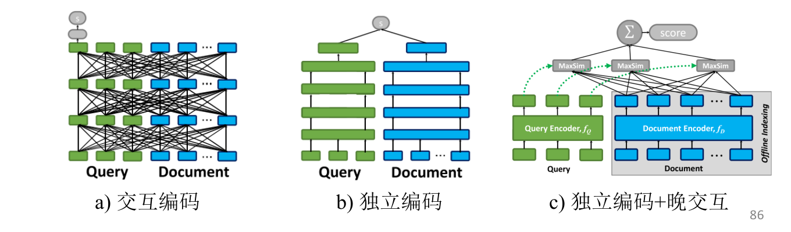
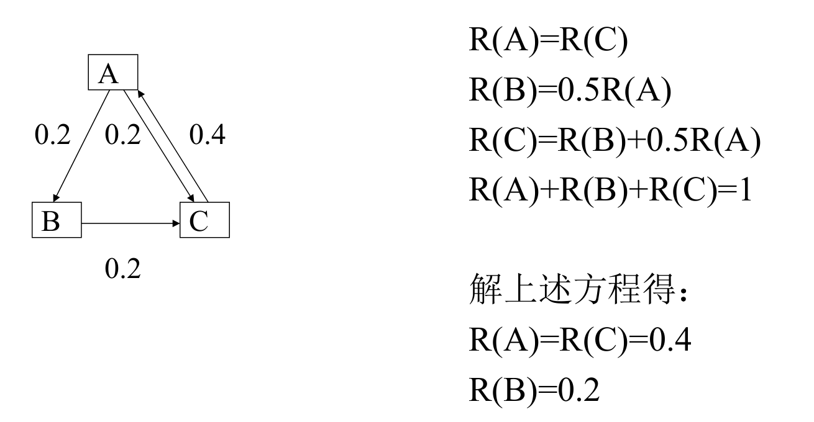

## 第1讲 布尔检索

布尔检索解决的是“哪些文档满足这些条件”。例如查找同时包含“检索”和“索引”、但不包含“广告”的文档，结果只有满足与不满足之分，模型本身不排列相关程度。

### 概念、索引与预处理

信息检索就是从大量资料中找到用户需要的内容。**非结构化资料**指正文、网页等不能直接用数据库固定字段完整表示的内容。信息需求是用户真正想解决的问题，查询只是其语言表达；查询词匹配并不必然意味着相关。同一篇资料对不同用户、不同任务的帮助可能不同，所以相关性要结合具体需求判断。

**词项**是索引中可以查询的词或其他检索单元，docID是文档的唯一编号。倒排索引有两部分：词典保存有哪些词、**每个词出现于多少篇文档（df）**、对应倒排表存在哪里；倒排表保存包含该词的文档编号，通常按编号从小到大排列。前向索引记录“文档→词项”，倒排索引记录“词项→文档”。布尔索引中同一词在同一文档内重复出现只保留一个docID；有评分需求时另存tf(**某个词在一篇文档中出现多少次**)，有短语需求时另存位置。


左边按词查找，右边列出包含该词的文档编号。例如Brutus对应的列表中有1和2，说明这两篇文档都出现过Brutus。查两个词是否同时出现，就对它们的编号列表求**交集**

文本进入索引前通常先经过以下处理：

- 分词（Tokenization）：把一段文字拆成词条。
- 规范化（Normalization）：统一大小写等写法，使不同形式能匹配到一起。
- 词干还原（Stemming）：把部分词形变化合并，如英语中不同的词尾形式。
- 停用词去除：删除“的”、the等出现很频繁、通常区分作用较小的词。

后三项可选，查询端与文档端必须采用一致规则。停用词去除节省存储和计算，但可能破坏短语语义，如“to be or not to be”。

### 布尔合并与优化

布尔合并解决的是：**用户提出几个搜索条件后，怎样从倒排表中找出同时满足条件的文档。** 优化则是在答案相同的前提下，选择通常更省计算的处理顺序。

假设系统中有5篇文档，建立倒排索引后，系统可以直接查到：

| 词   | 包含这个词的文档编号  |
| --- | ----------- |
| 苹果  | `[1, 2, 4]` |
| 华为  | `[3, 5]`    |
| 手机  | `[1, 3, 4]` |
| 维修  | `[4]`       |
搜索时，把这些编号列表拿来运算即可，不用临时打开所有文档重新找词。列表中的编号通常已经从小到大排好。
OR：并集去重
AND：交集
 1. AND NOT：交集取非
 2. 多个条件怎样一起计算更快，用户想查“``[1, 2, 4] or [3, 5] and [1, 3, 4] and not [4] ``，可写为：
倒排索引表从小到大：

```text
① 手机 AND NOT 维修      → [1, 3]
② 苹果 OR 华为          → [1, 2, 3, 4, 5]
③ 将两个结果求交         → [1, 3]
```

文档库很大、后面还有多个条件时，**较小的中间结果**通常能减少后续处理。

 5. 只有df时，怎样估计计算顺序
按照df大小，从小到大合并，有or就相加计算得到上界参与比较，具体见作业一第一题

 6. 先处理较短列表，不一定最快
例如A=`[1, 2]`，B=`[1, 2, 3]`，C=`[4, 5, 6, 7]`，要计算`A AND B AND C`：

- 按长度从小到大：先算A与B，得到`[1, 2]`；再与C求交，才得到空集。
- 先算A与C：第一次求交就得到空集，不必再处理B。

---

## 第2讲 索引构建

索引构建就是把一篇篇文档整理成可以按词查找的表。数据很大时，关键问题是内存放不下，因此要分批处理，再把各批结果合起来。

### 为什么不能直接把磁盘当内存

一个$(term,docID)$对表示“某个词出现在某篇文档中”。海量这样的记录无法全部装入内存；磁盘随机寻道比顺序传输昂贵。外部排序把随机小读写改成成块顺序读写，重点是降低I/O，而不是只减少CPU比较次数。

### BSBI与SPIMI

BSBI（Blocked Sort-Based Indexing）先攒记录，再通过排序把相同词的记录放到一起：

1. 解析文档，为词项分配整数编号termID，维护一个全局词典(term, termID)。
2. 在内存中收集一批$(termID,docID)$记录。
3. 先按termID、再按docID排序，将同一词的记录合并并去重。
4. 将这一批形成的倒排索引写到磁盘。
5. 所有批次处理完后，同时读取多个有序结果，归并成最终索引。

同一词项来自各块的表需合并。若记录总数为T，排序的典型计算复杂度$O(T\log T)$，外存实现关注块数、内存容量和读写遍数。termID映射词典本身也可能成为内存瓶颈。

SPIMI（Single-Pass In-Memory Indexing）直接把记录放进各词对应的表：

1. 为当前批次新建一个词典。
2. 读取一个词条；词典中没有它时，建立词典项和空倒排表。
3. 将当前文档的docID追加到该词的表中。
4. 内存满后，按词项顺序输出各倒排表，只需要排序词典。
5. 继续处理下一批，最后合并所有批次。

它不必先给所有词项建立全局termID，也不必排序每一个词项—文档对；倒排表容量不足时可成倍扩展。输入按docID顺序处理，表内docID自然有序，重复出现需合并或更新tf。


BSBI先收集记录再排序成倒排表；SPIMI使用每块独立词典，边扫描边构造倒排表，最后排序词典并合并。SPIMI减少全局词典和记录排序压力，适于大规模实现；二者都通过分块和最终归并突破内存限制。多路归并比重复两两归并减少中间数据落盘次数。

| 对比项    | BSBI                                     | SPIMI                       |
| ------ | ---------------------------------------- | --------------------------- |
| 读到一个词时 | 记下一条 `(termID, docID)`，先把记录攒起来           | 立即找到这个词的倒排表，把 `docID` 加进去   |
| 块写盘前   | 对整批记录按 `termID`、`docID` 排序，再把同一个词的记录归到一起 | 每个词的倒排表已经建好了，只需把这一块的词典词项排好序 |
| 词典     | 使用全局 `词 → termID` 映射                     | 每块可以独立建词典，合并时按词项对应          |

![[Pasted image 20261118215359.png|348]]

左BSBI右SPIMI

### 动态索引

主索引放磁盘，新增文档进入较小辅助索引；查询同时检索两者并合并。删除可用失效位图过滤，更新相当于删除旧版本并加入新版本。辅助索引过大后与主索引归并。归并太频繁会重复扫描大主索引，太少则查询辅助部分成本增加。

对数合并：内存缓冲满后产生小索引；同等级两个等规模索引合成上一级，类似二进制进位。T为累计记录数，活跃索引数量上界$O(\log T)$；每条记录参与$O(\log T)$次合并，总构建代价$O(T\log T)$。代价是一次查询要查多个索引。

---

## 第3讲 索引压缩

压缩索引是在保留查找能力的前提下，用更少的字节保存词典和文档编号。它既节省空间，也可能因为少读磁盘而加快检索。

### 动机和统计规律

压缩减少磁盘与内存占用，提高缓存命中率并减少I/O。解码需要CPU，但减少传输常使总检索时间下降；不必解压整个索引，只需访问相关倒排表或块。无损压缩可完全恢复原始数据；词干化、停用词去除改变可检索信息，属于有损处理。

Heaps定律：$M=kT^b$，T为词条总数，M为不同词项数，k、b由语料拟合，常见b约0.5。它预测**词典随语料增长而增长**。拼写错误未纠正会引入新词项，自动纠正会减少这种膨胀。Zipf定律：词项按频率降序排列，第i名的集合词频$cf_i\propto1/i$；**少数词很常见，多数词罕见**。

### 词典压缩

定长词项字段浪费空间且限制最长词；将词典拼成一个字符串，用指针确定词边界，可节省空白。**分块压缩**：每k个词只留一个块指针，块内存**词长和词串**；节省指针，但查词需要块内扫描。**前端编码**：同块排序后的词共享前缀只存一次，各词保存不同后缀；块大通常更省指针、更可能影响访问速度，公共前缀长度也影响收益。


automata、automate、automatic、automation都以automat开头。把automat只保存一次，再分别保存a、e、ic、ion，就减少了重复字符。图中的长度和分隔符用于恢复每个完整单词。

### 间距、VB与γ的精确约定

倒排表先把文档编号变成**间距**，再选 **VB 或 γ** 把这些间距写成二进制。

**间距就是相邻编号的差。** 例如倒排表 `[5, 12, 142]`，第一个编号保留 5，接着算 `12−5=7` 和 `142−12=130`，得到 `[5, 7, 130]`。还原时从 5 开始依次加上 7 和 130。一般写成 $g_1=d_1$、$g_i=d_i-d_{i-1}$，其中 $d_i$ 是第 $i$ 个文档编号，$g_i$ 是对应的间距。

**VB 按字节编码。** 每个字节留 7 位存数字，最高位用来表示这个整数是否结束。**约定最高位 `0` 表示继续读，`1` 表示这是最后一个字节。**

- **5** 用一个字节。把二进制补成 7 位 `0000101`，前面加结束标记 `1`，得到 `10000101`。
- **130** 用两个字节。因为 `130=1×128+2`，高组是 `0000001` 128x1，低组是 `0000010` 2。课件把高组写在前面，得到 `00000001 10000010`。最后一个字节加结束标记 `1`。

对正整数 $g$，VB 需要 $\lfloor\log_{128}g\rfloor+1$ 个字节。一个字节最大存 127，两个字节最大存 16383。

**γ 按位编码。** 去除二进制最左边的1，去除完后看还剩几个1，前缀就写几个1，再写一个0作为分隔符，再与剩下的位数进行拼接

一般来说，去掉开头的 `1` 后还剩 $\ell=\lfloor\log_2 g\rfloor$ 位。前缀占 $\ell+1$ 位，整段占 $2\ell+1$ 位。数字 1 去掉开头后没有剩余位，所以它的 γ 码只有一个 `0`。

编码示例：输入间距为5、7、18、47、53、130、240，VB采用高7位组在前。

|   g | VB                | γ               | γ位数 |
| --: | ----------------- | --------------- | --: |
|   5 | 10000101          | 11001           |   5 |
|   7 | 10000111          | 11011           |   5 |
|  18 | 10010010          | 111100010       |   9 |
|  47 | 10101111          | 11111001111     |  11 |
|  53 | 10110101          | 11111010101     |  11 |
| 130 | 00000001 10000010 | 111111100000010 |  15 |
| 240 | 00000001 11110000 | 111111101110000 |  15 |

VB总计9字节；γ总计71位，若单独按字节存储需**9字节**，其中最后1位为填充。

#### 组变长编码

每 4 个整数一组。先写 **1 个控制字节**，再依次写这 4 个整数的数据。控制字节的 8 位分成 4 份，每份 2 位，告诉解码器对应的整数占几个字节。

| 2 位长度标记 | 整数占用的字节数 |
| --- | ---: |
| `00` | 1 |
| `01` | 2 |
| `10` | 3 |
| `11` | 4 |

这里每个数据字节的 **8 位都用来存数字**，所以 130 和 240 都能各用 1 字节。前面的 VB 每字节只有 7 位存数字，存 130 就要 2 字节。

继续用这 7 个间距 `[5, 7, 18, 47, 53, 130, 240]`：

| 组 | 存入的数据 | 控制字节 | 这一组的大小 |
| --- | --- | --- | ---: |
| 第 1 组 | `[5, 7, 18, 47]` | `00 00 00 00` | 1 + 4 = 5 字节 |
| 第 2 组 | `[53, 130, 240, 0]`，最后的 0 用来补齐 | `00 00 00 00` | 1 + 4 = 5 字节 |

解码器看到 `00 00 00 00`，就把后面的数据按 1、1、1、1 字节切开。编码时另外记录有效整数数目为 7，解码后只取前 7 个，跳过最后补上的 0。**两组共 10 字节**，记录有效数量的空间另计。

#### Simple-9

每块固定 **32 位（4 字节）**。前 4 位是模式编号（selector），告诉解码器「这一块有几个数，每个数占几位」。后 28 位按所选模式存数据。Simple-9 共有 9 种模式，下面列出本例用到的几种。

| 模式 | 单个整数最大值 |
| --- | ---: |
| 5 个数，每个 5 位 | 31 |
| 4 个数，每个 7 位 | 127 |
| 3 个数，每个 9 位 | 511 |

1. **第一块放 `[5, 7, 18, 47]`。** 试「5 个数，每个 5 位」时，47 已超过 31。改用「4 个数，每个 7 位」，这 4 个数都不超过 127，刚好用完 $4×7=28$ 位。
2. **第二块放 `[53, 130, 240]`。** 130 和 240 都需要至少 8 位，选「3 个数，每个 9 位」就放得下。三个数用 $3×9=27$ 位，剩下 1 位留空。解码器按模式只读 3 个数。

**两块共 8 字节。** 对比这两个例子，组变长编码固定每组 4 个数，逐个记录占几字节。Simple-9 固定每块 32 位，同一块里的数都按同一种位宽存。

---

## 第4讲 通配查询与拼写矫正

搜 `mon*` 时，用户可能只知道单词以 `mon` 开头。用户想查询 `minutes`，但打错了变成`mniutes`。这两种查询都要先在词典里找出可能的完整词，再查这些词对应的倒排表。

### 怎么查带星号的词

`*` 代表任意长度的字符串，也可以是空串。查询 `mon*` 时，可以先在有序词典里定位到第一个以 `mon` 开头的词，再向后读到这个前缀结束。**哈希表**擅长按完整词直接查找，遇到前缀就要另外建索引或扫描词典。**B 树**按词的顺序组织数据，能定位一个范围。每个节点可以存多个键，树就比较矮，查找时读取的磁盘页也较少。

| 查询 | 找候选词的方法 |
| --- | --- |
| `mon*` | 在有序词典里查前缀 `mon` |
| `*mon` | 把词典中的词倒过来存，例如 `lemon → nomel`，再查前缀 `nom` |
| `m*nchen` | 找以 `m` 开头的词，再和以 `nchen` 结尾的词求交，最后核对原模式 |

**轮排索引**也能把中间有星号的查询变成前缀查找。先给单词加一个结束符 `$`。以 `hello$` 为例，依次把开头字符移到末尾，得到 `ello$h`、`llo$he` 等形式。每一种都指回 `hello`。这样就可以把 `m*nchen` 改写成 `nchen$m*`，用 `nchen$m` 查前缀。长度为 $L$ 的词会存 $L+1$ 个轮排项，查起来方便，词典也会变大。

**k-gram 索引**用连续的 $k$ 个字符找候选。比如用 2-gram 查 `m*nchen`，后半段必须出现 `nc`、`ch`、`he`、`en`。把这几段字符对应的**候选词列表**求交，再逐个检查首尾是否符合原模式。一个词可能恰好包含这些字符片段，却把它们放在不同位置，所以还要核对完整词。确定候选词后，把它们的**文档倒排表求并**。

两个词的字符片段有多少重合，可以用 Jaccard 相似度衡量。若两个词的片段集合分别为 $A$、$B$，就用共有片段数除以去重后的总片段数，即 $J(A,B)=|A\cap B|/|A\cup B|$。这个分数也能用来给拼写纠错筛候选。

### 怎么找拼写错误的词

- **词典里查不到。** 例如输入了 `mniutes`，系统可以找与它只差一两步的词，把 `minutes` 放入候选。
- **词典里查得到。** 想写 `wait five minutes`（等五分钟），却把相邻的 `t` 和 `e` 写反，变成了 `wait five minuets`。`minuets` 是「小步舞曲」的复数，词典里也有它。系统需要比较两种写法放回原句后的效果。`wait five` 后面接时间单位更自然，所以优先建议 `minutes`。这类情况叫**真实词错误**。

#### 编辑距离怎么用动态规划算

**编辑距离**是把一个词改成另一个词，最少需要的操作次数。Levenshtein 允许插入、删除、替换一个字符，每次算 1 步。例如 `cat → cut` 只要把 `a` 换成 `u`，距离就是 1。

**先把整词拆成前缀。** 表格左边是原词 `cat` 的前缀，上面是目标词 `cut` 的前缀。$D(i,j)$ 表示把原词的前 $i$ 个字符改成目标词的前 $j$ 个字符需要的最少步数。比如 `ca` 行和 `cu` 列交叉的格子问的是「`ca → cu` 要几步」。

| 从cat变成cut |  空串 | `c` |  `cu` | `cut` |
| --------- | --: | --: | ----: | ----: |
| 空串        |   0 |   1 |     2 |     3 |
| `c`       |   1 |   0 |     1 |     2 |
| `ca`      |   2 |   1 | **1** |     2 |
| `cat`     |   3 |   2 |     2 | **1** |

**初始化第一行和第一列。** 空串变成 `cu` 要插入两个字母，所以第一行对应的格子写 2。`ca` 变成空串要删除两个字母，所以第一列对应的格子也写 2。一般有 $D(0,j)=j$、$D(i,0)=i$。

**再从左往右、从上往下进行动态规划更新。** 每个格子都用已经算过的三个格子。以 `ca → cu` 为例：

| 看哪个格子 | 怎样用上它的答案 | 步数 |
| --- | --- | ---: |
| 上边 `c → cu` | 删掉 `ca` 末尾的 `a`，再把 `c` 改成 `cu` | $1+1=2$ |
| 左边 `ca → c` | 先把 `ca` 改成 `c`，再插入 `u` | $1+1=2$ |
| 左上角 `c → c` | 前面的 `c` 已经相同，把末尾的 `a` 换成 `u` | $0+1=1$ |

三种做法最少要 1 步，所以这个格子填 1。写成公式就是：

$$
D(i,j)=\min\{D(i-1,j)+1,\ D(i,j-1)+1,\ D(i-1,j-1)+[a_i\ne b_j]\}
$$

也就是当前状态由左边，上面，左上角转移过来

**噪声通道**把两个线索乘起来。用户打出了 $x$，候选原词是 $w$。$P(w)$ 看这个词本来有多常见，$P(x\mid w)$ 看它有多容易被打成 $x$。选 $P(x\mid w)P(w)$ 最大的词。

| 候选 | 原词概率 $P(w)$ | 打成当前输入的概率 $P(x\mid w)$ | 两者相乘 |
| --- | ---: | ---: | ---: |
| A | 0.01 | 0.02 | 0.0002 |
| B | 0.001 | 0.10 | 0.0001 |

B 更容易被打错成当前输入，A 的两个线索相乘得分更高，所以选 A。统计中一次也没出现过的拼写错误可以用加一平滑估计，即 $(c+1)/(C+V)$。这里 $c$ 是该结果的次数，$C$ 是同一条件下所有结果的总次数，$V$ 是可能结果的个数。

加入上下文后，可以用二元语言模型 $P(w_1)\prod_{i=2}^n P(w_i\mid w_{i-1})$ 给整句打分。换掉中间一个词，主要影响它与前、后两个词的搭配分数。把原词也留在候选中，系统就能比较「保持原样」和「改成另一个词」的分数。

---

## 第5讲 检索评价

假设库里有 10 篇相关文档。系统返回 5 篇，其中 4 篇相关。**查准率P**问返回的结果有多准，分母是返回的 5 篇，所以是 $4/5$。**召回率R**问相关文档找回了多少，分母是库里全部相关的 10 篇，所以是 $4/10$。

### 查准率、召回率和排名

| 记号 | 意思 | 例子里的数量 |
| --- | --- | ---: |
| TP | 返回了，并且相关 | 4 |
| FP | 返回了，人工判为不相关 | 1 |
| FN | 相关，但没有找回来 | 6 |
| TN | 不相关，也没有返回 | 取决于库的总大小 |

$$
P=\frac{TP}{TP+FP},\qquad R=\frac{TP}{TP+FN},\qquad F_1=\frac{2PR}{P+R}
$$

$F_1$ 把查准率和召回率放到一个分数里，两者都高时分数才高。通式是 $F_\beta=(1+\beta^2)PR/(\beta^2P+R)$，$\beta>1$ 时更重视召回。Accuracy 把 TP 和 TN 都算作正确。若库里绝大多数文档不相关，一个什么都不返回的系统也可能拿到很高的 Accuracy。

把视线缩到前 $k$ 名。**P@k** 用前 $k$ 名的相关数除以 $k$，**R@k** 用同一个相关数除以该查询的全部相关数。**R-Precision** 把 $k$ 设为全部相关文档数再算 P@k。**Hit@k** 按每个查询记分，前 $k$ 名至少命中一篇就记 1，否则记 0，最后对查询求平均。例如 10 篇相关文档只找回 1 篇时，这次查询可以 Hit=1，召回率仍只有 10%。

### AP 和 MAP 怎么算

一个查询总共有 5 篇相关文档，系统在第 2、4、6、10 位找回来 4 篇。**在每个命中位置算一次 P@k，最后除以全部 5 篇。**

|     命中位置 | 到这个位置共找到几篇相关文档 | 当时的 P@k |
| -------: | -------------: | ------: |
|        2 |              1 |   $1/2$ |
|        4 |              2 |   $2/4$ |
|        6 |              3 |   $3/6$ |
|       10 |              4 |  $4/10$ |
| 漏掉的第 5 篇 |           没有返回 |    贡献 0 |

$$
AP_1=\frac{1/2+2/4+3/6+4/10+0}{5}=0.38
$$

第 5 **位**虽然不相关，前 5 位仍然有 2 篇相关，所以 $P@5=2/5$。AP 的求和只取相关文档所在位置，所以这一位的 $2/5$ 不进入分子。漏掉的那一篇仍留在分母里，这就是 AP 会惩罚漏检的原因。每命中一篇相关文档，召回率增加 $1/|Rel_q|$，也可以把 AP 理解成每次召回增量乘当时精度后相加。

如果另一个查询总共 3 篇相关，命中位置为 1、3、9，则 $AP_2=(1+2/3+3/9)/3=2/3$。两个查询分量相同，因此 $MAP=(0.38+2/3)/2\approx0.5233$。

插值精度用 $P_{interp}(r)=\max_{r'\ge r}P(r')$，即在召回率达到 $r$ 及以后的位置取最高精度。以上 AP 直接用各命中位置的精度，是**未插值 AP**。GMAP 则取各查询 AP 的几何平均，对低分查询更敏感，遇到 AP 为 0 时按评测约定处理。

### nDCG 怎么看等级和位置

AP 把文档分成相关和不相关。nDCG 可以给文档分 0、1、2、3 等级，等级高的文档放在前面，贡献更大。

1. **算实际分 DCG。** 被除数取等级，除数，前两位都是1，后面都是 $\log_2 i$。
2. **算满分 IDCG。** 把完整标注里的文档按等级**从高到低排**，截到相同长度，再用同一个折扣公式算分。
3. **相除。** $nDCG@k=DCG@k/IDCG@k$。

例如实际前 6 位等级是 `[3,0,2,1,0,2]`，完整标注里还漏了一篇 3 级文档，理想前 6 位是 `[3,3,2,2,1,0]`。

| 截止位置 | 实际分 DCG | 理想分 IDCG | nDCG |
| ---: | ---: | ---: | ---: |
| 3 | $3+2/\log_2 3\approx4.261860$ | $3+3+2/\log_2 3\approx7.261860$ | 0.587 |
| 6 | $4.261860+1/2+2/\log_2 6\approx5.535565$ | $7.261860+2/2+1/\log_2 5\approx8.692536$ | 0.637 |


### 标注不全时怎么算

**Pooling（缓冲池）** 把多个系统的前几名合起来去重，再交给人工标注。这样能把人力用在较常见的候选上。池外可能还有相关文档，因此全库的真实相关数往往未知，召回率容易受影响。

**bPref**只看已判定的相关和不相关文档。对于每篇已返回的相关文档，数一数它前面压着几篇已判不相关的文档。压在它前面的越多，得分越低。

例如顺序是 `相关 A、未判断 X、不相关 B、相关 C`。跳过 X。A 前面有 0 篇不相关，C 前面有 1 篇。如果标注集合里就是 2 篇相关、1 篇不相关，更新公式以 $\min(2,1)=1$ 为扣分分母。A 得 1，C 得 $1-1/1=0$，所以 bPref 是 $(1+0)/2=0.5$。

一般写作 $\frac1R\sum_r[1-\min(n_r,R)/\min(R,N)]$。$R$、$N$ 是所有已判相关、不相关的数量，$n_r$ 是相关文档 $r$ 前面的已判不相关数。求和取已返回的已判相关文档，漏掉的已判相关文档贡献 0，仍计入 $R$。原始版本的扣分分母用 $R$。

做对比实验时，各系统共用语料、查询、标注和指标。TREC 查询可以由标题、描述和详细需求等字段组成。训练集用来学参数，验证集用来选设置，最后用测试集报告结果。比较新旧方案可以用多数据集、基线和显著性检验，线上 A/B 测试则随机分配用户。若想看两位标注者是否一致，Kappa 用 $\kappa=(P_o-P_e)/(1-P_e)$，$P_o$ 是实际一致率，$P_e$ 是按两人的标签使用比例估出的偶然一致率。

网页搜索常关心前几条够不够准。RAG 还要看前 $k$ 条有没有提供作答证据，因此常结合 P@k、Recall@k、Hit@k 和最终答案评分来看。

---

## 第6讲 TF-IDF与向量空间模型

搜「手机续航」，倒排索引能找出提到「手机」或「续航」的文档。现在有两篇都命中了，哪篇应该排在前面？第 5 讲的 nDCG 可以用人工标注判断排得好不好，这一讲要解决的是系统当时怎么排。

假设 A 是手机选购指南，「手机」出现 10 次，「续航」只出现 1 次。B 是电池测试，「手机」出现 1 次，「续航」出现 10 次。两篇文档各命中两个词。如果「手机」在全库很常见，「续航」只在少数文章里提到，B 的内容更接近这个查询。TF-IDF 把这个判断拆开算。**TF 看词在这一篇里有多常见，IDF 看词在全库里有多能区分文档。**

### TF、DF、CF 分别在数什么

| 项目 | 统计范围 | 例子 |
| --- | --- | --- |
| TF | 某个词在当前文档中的次数 | 「电池」在这一篇出现 3 次，TF=3 |
| DF | 全库有多少篇文档包含这个词 | 有 20 篇提到「电池」，DF=20 |
| CF | 这个词在全库出现的总次数 | 把每一篇中的次数加起来 |

统计这三项时，同一个词重复三次会让 TF 和 CF 各增加 3，DF 只多算这一篇。词袋把这类次数存下来，把词序省掉。若只把词当成集合，也可以算 Jaccard。上面的 A、B 都包含「手机」和「续航」，在这个两词例子里 Jaccard 给它们相同分数，TF-IDF 才会用到次数的差别。

一种常用权重如下：

$$
l(tf)=1+\log_{10}tf\quad(tf>0),\qquad idf_t=\log_{10}(N/df_t),\qquad w_{t,d}=l(tf_{t,d})idf_t
$$

$N$ 是文档总数。词出现 1 次时对数 TF 是 1，出现 10 次时是 2，出现 0 次时权重直接取 0。这个词出现在越少的文档里，IDF 越高。如果每篇都有它，$df_t=N$，IDF 为 0。

### 余弦怎么算

算完 TF-IDF，一篇文档会得到一组权重。比如第一个位置是「手机」的分数，第二个位置是「续航」的分数。查询也用同样的位置。现在要把两组数变成一个**匹配分**。

如果TF-IDF和查询权重是 $(2,1)$ 和 $(4,2)$，$(2*4 + 1 * 2) / \sqrt5\sqrt{20}$，余弦就是 1。

$$
\cos(q,d)=\frac{\sum_t w_{t,q}w_{t,d}}{\sqrt{\sum_t w_{t,q}^2}\sqrt{\sum_t w_{t,d}^2}}
$$

### SMART 记号和倒排表打分

上面的例子给查询和文档都乘了 IDF。实际建索引时，两边也可以用不同的权重方案。SMART 用三个字母记录每边怎样处理**词频、IDF 和归一化**。记号 `lnc.ltn` 左边描述文档，右边描述查询。

| 部分 | 第一位 | 第二位 | 第三位 |
| --- | --- | --- | --- |
| 文档 `lnc` | 对数 TF | 省略 IDF | 按模长归一化 |
| 查询 `ltn` | 对数 TF | 乘 IDF | 省略归一化 |

实际检索时，文档权重和模长可以先算好。查询来了就查各查询词的倒排表，把 $w_{t,q}w_{t,d}$ 加到对应文档的分数里，按需要除以模长后取前 $k$ 篇。对同一个查询，查询模长是所有文档共有的除数，计算排名时可以省略。单词查询的单个查询 IDF 也是公共因子。

余弦归一化会压低长向量的分数，有时短文档更容易排在前面。回转归一化调整长度与分数的关系，使不同长度文档的评分更接近实际相关分布。

---

## 第7讲 相关反馈与查询扩展

这一讲是**根据第一轮搜到的结果，重新分配查询词的权重，再搜一轮**。比如你搜「苹果 评测」，点了两篇有用的文章，系统发现这两篇都提到了「手机」，就可以把「手机」也加进查询。

### Rocchio 怎样改查询

查询和文档在第 6 讲已经写成了词权重向量。Rocchio 直接在这套坐标里改查询。比如把三个位置固定为「苹果、手机、评测」。原查询「苹果 评测」写成 (1,0,1)。中间的 **0** 表示「手机」目前不给匹配加分。假设第一轮查询之后，用户标了两篇相关文档和一篇不相关文档：

| 文档      |  苹果 |  手机 |  评测 |
| ------- | --: | --: | --: |
| 相关文档 A  |   2 |   2 |   0 |
| 相关文档 B  |   0 |   2 |   2 |
| 不相关文档 C |   0 |   4 |   0 |
这里 C 虽然多次提到「手机」，但它可能只是在卖配件，没提供你想看的评测。系统收到的反馈是：**「手机」有用，但光提到「手机」还不够。** 那么下轮怎么根据反馈修改词权重：
1. 保留一部分原查询向量。从 (1,0,1)开始，保留你本来要搜的「苹果」和「评测」。
2. 算相关文档的平均向量，加进去，让新查询更接近这组文档。A 和 B 按列求平均，得到(1,2,1)。**矩心**就是这个平均向量。正反馈系数取 (0.75)，所以加上(0.75,1.50,0.75)。
3. 扣掉不相关文档的线索。 C 的向量是 (0,4,0)。负反馈系数取 0.15，所以减去 (0,0.60,0)。
4. 三个部分相加得到新一轮的查询权重向量

$$
q_m=\alpha q_0+\frac{\beta}{|D_r|}\sum_{d\in D_r}d-\frac{\gamma}{|D_{nr}|}\sum_{d\in D_{nr}}d
$$

$q_0$ 是原查询，$D_r$ 和 $D_{nr}$ 分别是相关和不相关的反馈集合。$\alpha$ 决定保留多少原查询，$\beta$ 和 $\gamma$ 控制正、负反馈的力度。某组没有样本时就省去该项，算出负词权重后通常截到 0。
### 反馈从哪里来

刚才的例子已经知道哪些文档相关。实际搜索未必有明确标注，系统可以从用户行为或第一轮排序里找线索。

| 做法         | 系统用到的信号          | 实际影响                   |
| ---------- | ---------------- | ---------------------- |
| 显式反馈       | 用户直接点「相关」「不相关」   | 标签直接，需要用户操作            |
| 隐式反馈       | 点击、停留时间等行为       | 容易收集，排在前面的结果本来就更容易被点   |
| 伪相关反馈（PRF） | 暂把第一轮前 $k$ 篇当成相关 | 可以自动补词，第一轮主题偏了就可能继续偏下去 |

**局部扩展**从当前查询的反馈文档里找词，例如从手机评测里找到「续航」。**全局扩展**从同义词库、词语共现或查询日志里找词，例如把「轿车」和「汽车」联系起来。但补词也可能把查询带偏。比如第一轮恰好混进很多配件广告，系统就可能补上「保护壳」，下一轮反而搜出更多配件。保留原查询的权重、少补几个词，可以减轻这个问题。

Rocchio 有时也会被带偏：使用平均向量描述相关文档时，如果相关文档分成好几个主题，容易把它们混成一个平均向量，两组的专用词都可能被摊薄，下次搜索就不容易抓住其中某一个方向。**怎么判断改查询有没有用**，可以先移除用户已经看过、标注过的文档，再在剩余文档上比较检索结果。

还可以请语言模型生成用来补词的文本。**Query2doc** 生成一段假想的相关文档并加入查询，**GRF** 用生成文本模拟反馈，**AGR** 先分析问题，再生成候选扩展，最后整理扩展内容。生成的文本负责提供检索线索，回答所用证据从检索结果里找。

---

## 第8讲 概率检索模型

搜「手机续航」时，第 6 讲的 IDF 会给全库里比较少见的词更大权重。第 7 讲的反馈又提供了另一份信息，我们知道哪些结果对用户有用。这一讲是**怎样判断一篇文档有多可能和查询相关**。

### 概率排序和 Logistic 回归

概率排序原理（PRP）把更可能相关的文档排在前面。贝叶斯公式 $P(A\mid B)=P(B\mid A)P(A)/P(B)$ 在这里有个具体用法。我们想知道「看到一个词后，文档有多可能相关」，可以先统计「在已知相关的文档中，这个词出现得有多频繁」，再结合文档原本相关的比例。

**Logistic 回归**先算一个线性分数 $z=b+\sum_i w_i f_i(q,d)$。$f_i$ 是标题是否命中、词频、文档长度等特征，$w_i$ 是从标注数据中学出的权重。再用 $\sigma(z)=1/(1+e^{-z})$ 把分数转成 0 到 1 之间的相关概率。$z$ 越大，概率也越大，所以只排顺序时直接比较 $z$ 就够了。$z$ 也叫对数胜算。

### BIM 怎样给词加权

如果手上已经有一批人工判过的结果，可以分别数一数「续航」在相关组和不相关组各出现于多少篇。某个词在相关组里出现得更常，看到它时就有理由提高文档的分数。

BIM 只记录每个词「出现」或「没出现」，因此同一个词出现一次与出现十次的输入值相同。这个二值表示也叫多元伯努利模型。把文档按相关和不相关分成两组，在每组里分别估计各词出现的概率。计算时，把**同一组内**各词出现与否当作独立事件，这就是条件独立假设。

设词 $t_i$ 在相关组出现的概率是 $p_i$，在不相关组出现的概率是 $q_i$。胜算就是「出现概率 ÷ 未出现概率」。例如某词出现在相关组的 60% 文档里，胜算就是 $0.6/0.4=1.5$。不相关组也算一次，然后比较两组胜算。比值为 1 表示两组一样，取对数正好是 0。BIM 的词权重写成下面这样。

$$
W_i=\log\frac{p_i/(1-p_i)}{q_i/(1-q_i)}
$$

如果一个词在相关文档里明显更容易出现，它的权重就更大。给定同一个查询时，BIM 的排序分可以写成命中的查询词权重之和 $\sum_{t_i\in Q\cap D}W_i$。

### 已有标注时怎么数 RSJ 的四个格子

设全库 $N$ 篇，相关文档 $R$ 篇，包含这个词的文档 $n_i$ 篇，其中 $r_i$ 篇相关。

| | 含这个词 | 不含这个词 |
| --- | ---: | ---: |
| 相关 | $r_i$ | $R-r_i$ |
| 不相关 | $n_i-r_i$ | $N-R-n_i+r_i$ |

例如有 100 篇文档，其中 10 篇相关。20 篇含这个词，其中 6 篇相关。四个格子依次为 6、4、14、76。每个格子加 0.5 后，按「相关组胜算 ÷ 不相关组胜算」算出 $W_i=\log[(6.5/4.5)/(14.5/76.5)]$。权重为正，因为这个词在相关组里明显更常见。加 0.5 让某格为 0 时也能算。

缺少相关标注时，可用 $p_i=0.5$，再从全库估算 $q_i$，得到带平滑的 RSJ IDF：

$$
idf(t)=\log\frac{N-df_t+0.5}{df_t+0.5}
$$

当 $df_t>N/2$，这个版本给出负权重。停用词常出现在许多文档里，区分作用有限，预处理可以去掉这类词。

### BM25 ：把词频和文档长度算进去

BIM 解决了「**命中哪个词更有说服力**」。BM25 继续考虑两件事：
- **词频饱和。** 「续航」从 0 次变成 1 次，区别很明显。从 10 次变成 11 次，提供的新线索就少多了。
- **长度调整。** 同样提到「续航」3 次，在 100 词的短评测里可能是重点，在 300 词的综合指南里可能只占一小段。
因此，BM25 给每个命中的查询词算 **IDF × 经过长度调整的词频因子**，再把各词的贡献加起来。

$$
K_d=k_1(1-b+bL_d/\overline L),\qquad
score(q,d)=\sum_{t\in q\cap d}idf(t)\frac{(k_1+1)tf(t,d)}{tf(t,d)+K_d}
$$

$L_d$ 是当前文档词数，$\overline L$ 是全库平均词数。$k_1$管「同一个词多出现几次，还能加多少分」越大出现次数的差别更能拉开分数，$b$ 管「文档长短对这项分数影响多大」，0 时，两篇在「续航」上得分一样，因为文档长度不参与调整，1时长度调整完全按「这篇的长度 ÷ 平均长度」来算。

另一种写法还会乘查询词频因子 $qtf/(k_3+qtf)$，并将文档词频因子的分子写为 $k_1tf$。计算时按所给公式和对数底数代入。二重 Poisson 是词频部分的推导背景，用不同的分布描述主题性较强和较弱的文档中的词次数。BIM 则用二值变量描述词是否出现。

---

## 第9讲 统计语言模型与查询似然

BM25 把命中的查询词一项项加分。查询似然（QLM）换了一个问法。**如果按这篇文档的用词频率抽词，有多大机会抽出用户的查询？** 比如「手机续航」的测试报告经常同时用到「手机」和「续航」，按它的词频抽出这两个词的概率就比较高。下面把两个词记为 $a$ 和 $b$，用查询 $a\ b\ b$ 看重复的查询词怎么计入。

### 从词频算出概率

如果一篇文档共有 20 个词，其中 `a`、`b` 各出现两次，就用 $2/20=0.1$ 分别估计两词的概率。直接用样本里的词频比例估计概率，这叫最大似然估计（MLE）。

$$
P_{ML}(w\mid d)=\frac{c(w,d)}{|d|}
$$

$c(w,d)$ 是词 $w$ 在文档中的次数，$|d|$ 是文档的总词数，重复词也计入长度。用一元模型时，每次取词都沿用这张概率表。于是抽到 `a b b` 的概率是 $0.1\times0.1^2=0.001$。取对数避免结果太小了。

$$
P(q\mid d)=\prod_{w\in q}P(w\mid d)^{c(w,q)},\qquad
\log P(q\mid d)=\sum_{w\in q}c(w,q)\log P(w\mid d)
$$

**公式读法。** 查询里 $a$ 出现一次，$b$ 出现两次，所以只写两项，分别乘 $P(a\mid d)$ 和 $P(b\mid d)^2$。$c(w,q)$ 就是这个指数。取对数以后把连乘变成相加，排序结果相同。贝叶斯公式给出 $P(d\mid q)\propto P(q\mid d)P(d)$。若文档先验 $P(d)$ 都相同，就直接比较查询似然。把查询看成无序词数时会多一个只由查询决定的组合系数，同一查询下可省去。

### 一元、二元和多元伯努利怎么区分

语言模型可以让一个词的概率依赖已经看到的词。完整的链式展开是 $P(w_1)\prod_{i=2}^nP(w_i\mid w_1\ldots w_{i-1})$。**N-gram** 只看最近的 $N-1$ 个词。例如二元模型用前一个词来估计下一个词，可以区分 `apple phone` 和 `phone apple`。一元模型给两种顺序同样的分数。词典大小为 $M$ 时，各阶概率表合起来大致有 $M+M^2+\cdots+M^N$ 个位置。阶数越高，遇到训练语料里从没出现过的搭配越多。

BIM 对每个词分别判断「出现」与「未出现」，用的是多元伯努利。QLM 的一元多项式模型用每个词的**出现次数**来估计抽样概率，整张词表的抽样概率加起来为 1。

### 平滑怎样补上零概率

如果一篇评测一直写「电池能用多久」，刚好没有出现查询里的「续航」，直接用词频估计会得到 $P(\text{续航}\mid d)=0$，整条查询的概率也被乘成 0。**平滑给文档里没见到的词留一点概率**，让其他词的匹配仍能影响排序。JM 和 Dirichlet 都借用全库统计。先用 $p_C(w)=c(w,C)/|C|$ 算背景概率，即这个词在全库的出现次数除以全库总词数。

| 方法 | 怎么算 | 参数的作用 |
| --- | --- | --- |
| JM | $(1-\lambda)c(w,d)/\lvert d\rvert+\lambda p_C(w)$ | $\lambda$ 是全库背景的权重 |
| Dirichlet | $[c(w,d)+\mu p_C(w)]/(\lvert d\rvert+\mu)$ | $\mu$ 是补进来的背景计数总量，短文档受它影响更大 |
| 加一 | $[c(w,d)+1]/(\lvert d\rvert+\lvert V\rvert)$ | 给词典中每个词加一次，所以分母要加词典大小 $\lvert V\rvert$ |

用同一条查询 `a b b` 来算。$d_1$ 有 10 个词，`a` 出现 3 次，`b` 出现 0 次。$d_2$ 有 20 个词，两词各出现 2 次。假设全库背景中 $p_C(a)=0.1$、$p_C(b)=0.05$。

| 方法 | $d_1$ 的 $P(a),P(b)$ | $d_1$ 似然 | $d_2$ 的 $P(a),P(b)$ | $d_2$ 似然 |
| --- | --- | ---: | --- | ---: |
| 直接用文档词频 | 0.30、0 | 0 | 0.10、0.10 | 0.001 |
| JM，$\lambda=0.2$ | 0.26、0.01 | 0.000026 | 0.10、0.09 | 0.00081 |
| Dirichlet，$\mu=10$ | 0.20、0.025 | 0.000125 | 0.10、$1/12$ | 约 0.000694 |

以 $d_1$ 的 JM 为例，`b` 的概率是 $0.8\times0+0.2\times0.05=0.01$。由于查询里 `b` 有两次，整条查询的得分是 $0.26\times0.01^2$。两种平滑都让 $d_1$ 有了分数，这个例子里仍然是 $d_2$ 排前。

### 从抽词概率到比较两张概率表

查询似然从文档的词概率表里计算整条查询出现的可能性。如果也给查询做一张词概率表，就能直接比较两张表的差距。做法是比较查询分布 $p_Q$ 和文档分布 $p_D$ 的 **KL 散度**。常用方向是 $D_{KL}(p_Q\Vert p_D)=\sum_w p_Q(w)\log[p_Q(w)/p_D(w)]$，越小越相近。查询固定时，$\sum_w p_Q(w)\log p_Q(w)$ 是常数。若 $p_Q$ 由查询词频估计，此时排序与查询似然一致。

平滑解决了零概率，但仍然按同一个词来统计。「续航」和「电池使用时间」这类不同写法，可以再用词与词之间的对应概率来匹配。**翻译模型**把文档中的词 $t$ 对查询词 $w$ 的贡献写成 $P(w\mid t)P(t\mid d)$，再对 $t$ 求和。可以理解为先按文档词频抽到 $t$，再看它有多可能被用户写成 $w$。第 11 讲会用词向量来学习这种用词上的接近程度。

---

## 第10讲 文本分类与排序学习

一篇文章的标题可能写着「手机续航」，正文却只提了一句。另一篇标题叫「使用体验」，正文却有整段续航测试。BM25、标题匹配和查询似然都能给这样的候选提供线索。**排序学习用人工标注来学这些线索各占多少权重。**

先借分类里的 SVM 理解怎样用标注学权重。分类给单篇文档打标签，比如判定是不是垃圾邮件。排序针对同一个查询比较文档，目标是把更相关的放在前面。

### 文本分类怎样从特征得到标签

把词频、标题、URL、标点、链接等信息写成特征向量 $x$。线性分类器算 $f(x)=w^Tx+b$，两类可以按分数的正负区分。Rocchio、朴素贝叶斯、Logistic 回归、线性 SVM 都能得到线性决策边界。特征选择用于减少噪声和计算量。

SVM 希望分类分数留一点余地。例如两篇邮件的分数分别是 0.01 和 -0.01，虽然符号已经分对，但只要分数变一点就可能换类。SVM 会进一步看样本离分界线有多远。二分类标签 $y_i$ 取 $+1$ 或 $-1$。硬间隔要求每个样本都满足 $y_i(w^Tx_i+b)\ge1$，再最小化 $\frac12\|w\|^2$，让两侧间隔 $2/\|w\|$ 尽量宽。软间隔允许某些样本少达标一点，用 $\xi_i\ge0$ 记录少了多少，约束改成 $y_i(w^Tx_i+b)\ge1-\xi_i$。目标里加 $C\sum_i\xi_i$，$C$ 越大，越重视这些训练样本的失分。核函数 $K(x,z)=\phi(x)^T\phi(z)$ 可直接算映射后的内积，用于非线性边界。

### 先看标题和正文怎样分权重

回到标题和正文各占多少分的问题。把标题记为 $s_T$，正文记为 $s_B$，用 $g$ 和 $1-g$ 表示两边各占的比例。总分就是 $s=g s_T+(1-g)s_B$。例如标题命中记 1，正文没命中记 0，这篇文档就得 $g$ 分。正文命中、标题没命中，就得 $1-g$ 分。把这些分数和人工相关分 $r$ 做差，平方后加总，损失最小的 $g$ 就是学出来的权重。

例如有两篇相关文档只有标题命中，一篇不相关文档也只有标题命中，还有一篇相关文档只有正文命中。命中记 1，相关标签也用 0 或 1。四篇的平方损失之和是 $2(g-1)^2+g^2+[(1-g)-1]^2=4g^2-4g+2$。导数为 $8g-4$，在 $g=0.5$ 取 0，此时损失最小，为 1。若导数为 0 的点落在取值范围外，就比较两个端点。

| 排序学习方式 | 一条训练数据关心什么 |
| --- | --- |
| 逐点（pointwise） | 一篇文档的相关分接近多少 |
| 成对（pairwise） | 同一查询下，哪篇应该在前 |
| 列表（listwise） | 整张结果列表的顺序怎样 |

### Ranking SVM 怎样用文档对学习

逐点学到的分数可以用来排序。成对方法直接看两篇的前后顺序。例如人工标注认为一篇电池测试比手机选购指南更相关，训练时就看两篇的分差够不够。第 10 讲开头 SVM 用间隔区分两类，这里把间隔用到两篇文档的打分上。

取同一查询下应该排在前面的文档 $i$，减去应该排在后面的文档 $j$ 的特征，得到 $\Delta x=x_i-x_j$。如果两篇分别得 $s_i$ 和 $s_j$，它们的分差就是 $m=w^T\Delta x=s_i-s_j$。**分差大于 0 就排对了，达到 1 才没有合页损失。**

$$
L_{ij}=\max(0,1-m),\qquad J(w)=\tfrac12\|w\|^2+C\sum_{ij} L_{ij}
$$

例如分差 0.3，顺序正确，仍然欠 0.7 的间隔。分差 1.2，损失是 0。前面的 $\tfrac12\|w\|^2$ 用来控制权重大小。

若只有一个参数 $g$，令 $w=(g,1-g)$，则每对的分差是 $g\Delta x_1+(1-g)\Delta x_2$。分差跨过 1 时，这一对的合页损失会从 $1-m$ 变成 0，计算时要以这些点分段。算每段的最小点和端点，再选总分最低的 $g$。例如 A 的特征是 $(2,0)$、B 是 $(0,1)$ 且 A 应在前，分差为 $3g-1$，所以合页损失在 $g\ge2/3$ 时为 0。

### 算一遍六篇文档的权重

把两个特征看成标题和正文匹配分。$d_1,d_2$ 相关，其余四篇不相关。每一篇相关文档都和每一篇不相关文档配对，所以一共有 $2\times4=8$ 对。这里取 $C=1$。

| 文档 | 两项特征 | 标签 |
| --- | --- | --- |
| $d_1$ | (0.8, 0.4) | 相关 |
| $d_2$ | (0.5, 0.8) | 相关 |
| $d_3$ | (0.6, 0.3) | 不相关 |
| $d_4$ | (0.5, 0.4) | 不相关 |
| $d_5$ | (0.2, 0.1) | 不相关 |
| $d_6$ | (0.1, 0.3) | 不相关 |

例如配对 $(d_1,d_3)$，相减得到 $(0.2,0.1)$，分差 $0.2g+0.1(1-g)=0.1+0.1g$。

| 配对 | 特征差 | 分差 $m$ | 合页损失 $1-m$ |
| --- | --- | --- | --- |
| (1,3) | (0.2, 0.1) | $0.1+0.1g$ | $0.9-0.1g$ |
| (1,4) | (0.3, 0) | $0.3g$ | $1-0.3g$ |
| (1,5) | (0.6, 0.3) | $0.3+0.3g$ | $0.7-0.3g$ |
| (1,6) | (0.7, 0.1) | $0.1+0.6g$ | $0.9-0.6g$ |
| (2,3) | (−0.1, 0.5) | $0.5-0.6g$ | $0.5+0.6g$ |
| (2,4) | (0, 0.4) | $0.4-0.4g$ | $0.6+0.4g$ |
| (2,5) | (0.3, 0.7) | $0.7-0.4g$ | $0.3+0.4g$ |
| (2,6) | (0.4, 0.5) | $0.5-0.1g$ | $0.5+0.1g$ |

因为两个权重加起来是 1，分差是两个特征差的加权平均，最大也只有 0.7。因此这道题每一对都欠间隔，可以直接加最后一列，得到 $5.4+0.2g$，然后再加上一个$\underbrace{\tfrac12\|w\|^2}_{\text{正则项}} =\tfrac12\bigl[g^2+(1-g)^2\bigr].$

$$
J(g)=5.4+0.2g+\tfrac12[g^2+(1-g)^2]
=g^2-0.8g+5.9=(g-0.4)^2+5.74
$$

最小值出现在 $g=0.4$，权重为 $(0.4,0.6)$。把每篇文档的特征乘上权重得到分数，排序为 $d_2(0.68)>d_1(0.56)>d_4(0.44)>d_3(0.42)>d_6(0.22)>d_5(0.14)$。两篇相关文档都在前面，八个分差的范围是 0.12 到 0.54，所以合页损失仍然大于 0。

普通 Ranking SVM 给每一对同样的权重。若想更重视前几名的错误，可以按排名位置或相关等级加权。文档对很多的查询容易主导训练，也可以先在每个查询内归一。nDCG 随排序变化，同一顺序下小幅改分数时它保持不变，两个结果交换位置时才跳变，因此训练时常用易优化的损失。

---

## 第11讲 分布式表示

前面已经可以把多种分数合起来排文档。现在少的是一种能看见**用词不同、意思接近**的分数。假如搜索「汽车」，只写「轿车」的文章在关键词这项上可能拿不到分。第 6 讲的向量每个坐标对应一个词，两个词各占一格。词向量把词改写成一串从上下文学出来的数，让常出现在类似句子里的词有机会彼此接近。

例如词典只有「苹果、汽车、轿车」，one-hot 把它们写成 $(1,0,0)$、$(0,1,0)$、$(0,0,1)$，任意两个不同词的点积都是 0。接下来要解决的是，怎样用日常句子学出能区分「苹果」和「汽车」、又能联系「汽车」和「轿车」的向量。

### Word2vec 怎样学出词向量

语料里如果既有「我开汽车上班」，也有「我开轿车上班」，「开」和「上班」就给两个词提供了相似的训练线索。用「我 开 汽车 上班」举例，先只看中心词左右各一个词。

| 训练法 | 已知 | 预测 |
| --- | --- | --- |
| CBOW | 「开」「上班」等上下文词 | 中心词「汽车」 |
| Skip-gram | 中心词「汽车」 | 周围可能出现的词，如「开」「上班」 |

Skip-gram 给每个词存中心向量 $v$ 和上下文向量 $u$。要估计中心词 $c$ 周围出现词 $o$ 的概率，先算点积 $u_o^Tv_c$，再用 softmax 把词表中所有词的分数转换成概率：

$$
p(o\mid c)=\frac{\exp(u_o^Tv_c)}{\sum_{w\in V}\exp(u_w^Tv_c)}
$$

对这句话，Skip-gram 会看到「汽车 → 开」和「汽车 → 上班」两对。公式分子给当前真实邻居打分，分母把它和词表里的其他候选一起比较。真实邻居的概率越低，$-\log p(o\mid c)$ 越大。训练时滑动窗口，把看到的这些词对的损失汇总。语料长度为 $T$、窗口半径为 $m$ 时，可以写为 $J=-T^{-1}\sum_t\sum_{-m\le j\le m,j\ne0}\log p(w_{t+j}\mid w_t)$。对 $v_c$ 的单样本梯度是 $\sum_w p(w\mid c)u_w-u_o$。更新往相反方向走，即 $v_c\leftarrow v_c-\eta\nabla J$，其中 $\eta$ 为学习率。用小批样本做 SGD，完整 softmax 仍需遍历词表，负采样只抽少量词来做对照，例如让模型提高「汽车—上班」的分数，同时压低这一轮抽到的负例的分数，可以降低训练成本。

### 词向量怎样拿来检索

两个词向量可以用余弦比较，例如 $(1,0)$ 与 $(1,1)$ 的余弦为 $1/\sqrt2\approx0.7071$。词向量有时还能表现类比关系，例如 $v_{king}-v_{man}+v_{woman}\approx v_{queen}$。Word2vec 给同一个词一套固定向量，所以 `bank` 的金融和河岸两种用法会混在一起。

**DESM** 可以把文档中归一化后的词向量求平均，再算各查询词与这个文档中心的平均余弦。用中心词向量表示查询、上下文词向量表示文档，是一种常见做法。比如 Oxford 和 Cambridge 的语言环境相近，但搜特定学校时，学校名称的精确匹配同样重要。DESM 可以重排 BM25 找出的候选，也可以和 BM25 的分数加权。全局词向量从全库训练，局部词向量可从第一轮返回的文档训练，更贴近当前查询的词义。Duet 也结合精确匹配与语义匹配，做法见下一讲。

---

## 第12讲 神经信息检索

第 11 讲有了词与词的相似度，但排序还要决定**哪些匹配值得给整篇文档加分**。比如搜「手机续航」，下面两篇都提到了手机：
- A 写的是「这款手机连续播放视频 12 小时」。
- B 写的是「这款手机支持三种保护壳」。
A 提供了续航证据，B 只对上了「手机」。**神经检索要从训练数据里学到，哪些局部匹配能说明文档回答了问题。**第 10 讲由标注来学标题和正文的权重，这一讲也用训练数据，只是把要学习的东西扩展到查询和文档的表示，以及怎样把局部匹配合成总分。

### 网络是怎样算分的

第 10 讲的线性打分已经会做「每项乘权重再相加」。神经元在后面接一个激活函数，写成 $h=\sigma(w^Tx+b)$。这样叠几层后，模型可以根据多个线索是否同时出现来给分。例如同一小段里同时提到「电池」和「使用时长」，可以得到比两词分散在不同段落更强的匹配信号。Sigmoid 把输入压到 0 和 1 之间，tanh 的输出以 0 为中心，两者在曲线两端的梯度都小。ReLU 把负值变成 0，正值照原样输出。

分类时，softmax 对每个分数 $z_i$ 取指数，再除以指数总和，即 $p_i=e^{z_i}/\sum_je^{z_j}$。若两个类别的原始分数是 2 和 0，得到的概率约为 0.88 和 0.12。交叉熵 $-\sum_i y_i\log p_i$ 会惩罚把正确类别的概率给得太低。反向传播把损失的梯度传回各层，优化器据此改权重。L1 鼓励部分权重变成 0，L2 压制过大的权重，dropout 在训练时随机关闭部分单元。早停和数据增强也能减少过拟合。

| 网络 | 怎样读输入 | 一个直观例子 |
| --- | --- | --- |
| CNN | 同一个小窗口在各位置滑动，检测局部模式，再用池化汇总 | 查询里的短语和文档中某一小段能否对上 |
| RNN | 依次读入，当前计算带上前一步的状态 | 按顺序读词，每一步更新到目前为止的表示 |
| LSTM | 用输入、遗忘和输出门控制哪些信息写入、保留和读出 | 让较早出现的线索能保留到后面的词 |

无填充时，CNN 在一维上输入长度 $n$、窗口长度 $k$、步长 $s$，输出长度为 $\lfloor(n-k)/s\rfloor+1$。例如 32×32×3 的输入用一个 5×5×3 的核、步长 1，输出 28×28×1。RNN 的基本更新是 $h_t=\tanh(b+Wh_{t-1}+Ux_t)$。序列很长时梯度可能变得太小或太大，LSTM 用受门控制的细胞状态缓解这种问题。

### 查询和文档在哪一步相遇

也就是先把查询和文档各自算好，再比较，还是先比较两边的词，再根据匹配细节给整篇文档打分？
如果先分别处理查询和文档，文档就能提前算好。把它们的词放到一起比较，能留下更多匹配细节，却要等查询来了才算。这和前几讲的**召回与重排**接得上。召回要从全库快速挑出一批候选，重排只需比较这批候选，可以花更多计算来判断内容是否相关。
假设用户搜「手机续航」，有一篇文档写着「这款手机可以连续播放视频 12 小时」。

| 方法               | 查询到来前             | 查询到来后                             | 使用场景                  |
| ---------------- | ----------------- | --------------------------------- | --------------------- |
| 表示型，如 DSSM       | 把整篇文档编码成一个向量，提前存好 | 把「手机续航」也编码成一个向量，比较两个向量的相似度        | 文档向量可以提前算好，适合快速召回     |
| 交互型，如 DRMM、K-NRM | 可以先存文档里的词向量       | 比较「手机」「续航」和文档里的各个词，再根据这些局部匹配给整篇打分 | 能看见具体哪几个词对上了，常用于给候选重排 |
表示型可以接着第十一讲的 DESM 理解。DESM 用词向量求平均来表示文档，DSSM 则**用训练数据学出怎么把整段文字变成向量**。交互型把这一步拆开，先让你看见各个词是怎么对上的。

| 方法           | 从匹配信号中怎样得到一个分数                                |
| ------------ | --------------------------------------------- |
| MatchPyramid | 把词对相似度表当成图，用 CNN 找相邻的匹配模式                     |
| DRMM         | 对每个查询词统计相似度落在各区间的次数，取对数后交给小网络评分，再按词的重要性加总     |
| K-NRM        | 用高斯核做软计数。相似度越靠近某个核的中心，该词对给这个核的贡献越大            |
| PACRR        | 用不同大小的卷积看单词和短语匹配，再保留各处最强的若干信号                 |
| Duet         | 一路判断字面匹配，一路学习语义匹配，合起来给分                       |
| SNRM         | 学高维稀疏表示，多数维为 0，可以给非零维建倒排表                     |
| NPRF         | 拿第一轮的前几篇当反馈，把反馈文档与候选再匹配。初始 BM25 分数可以用于调整反馈的权重 |

例如 DRMM 的三个相似度是 1、0.7、0.1，可以给「完全匹配」「较高相似」「较低相似」各记一次。直方图保留各区间的次数，词的位置和次序会丢失。硬分箱也让梯度很难传回相似度。K-NRM 把计数改成连续的 $K_k(i)=\sum_j\exp[-(s_{ij}-\mu_k)^2/(2\sigma_k^2)]$。$s_{ij}$ 是查询词 $i$ 与文档词 $j$ 的相似度，第 $k$ 个核由中心 $\mu_k$ 和宽度 $\sigma_k$ 控制。对查询词汇总 $\sum_i\log K_k(i)$，训练时学习每种匹配强度该占多少权重。

所以，检索通常是**先召回再重排**：

|     | 侧重解决的问题                   | 用什么模型                                                             |
| --- | ------------------------- | ----------------------------------------------------------------- |
| 召回  | 从 10 万篇里快速挑出 100 篇可能相关的文档 | 文档用**表示型模型**。文档向量提前算好，查询来了就找和查询向量最接近的文档。也可以用 **BM25** 召回          |
| 重排  | 在这 100 篇里，把最能回答问题的放到前面    | 面用**交互型模型**，仔细看查询词和文档词怎么匹配。例如把包含「连续播放视频 12 小时」的实测排在只提到「手机」的配件介绍前面 |


---

## 第13讲 预训练语言模型、稠密检索与生成式检索

Word2vec 给同一个词固定的向量。「苹果售后」和「苹果含糖量」里的「苹果」，得到的是同一套词向量。第 12 讲讨论了查询和文档在哪一步比较，这一讲先解决比较之前的另一个问题。**同一个词放到不同句子里，能不能用周围的词给它算出不同的表示？** 预训练语言模型把上下文算进词的表示，然后就能用这些表示召回、重排或生成检索结果。

### Transformer 怎样看上下文

想让模型看懂「苹果售后」里的「苹果」，就得让这个位置读到「售后」。自注意力的做法是让每个位置都算三样东西。$Q$ 表示它要找什么，$K$ 表示它能不能和对方匹配，$V$ 表示匹配后实际传过去的信息。

以「苹果」为例，先用它的 $Q$ 和各位置的 $K$ 算匹配分。再用第 12 讲的 softmax 把分数变成各位置的权重。最后按权重加总各位置的 $V$，就得到了吸收周围信息后的表示。

$$
Attention(Q,K,V)=softmax(QK^T/\sqrt{d_k})V
$$

$d_k$ 是键的维度，softmax 按行算，所以每个位置分给其它位置的权重和为 1。多头注意力在不同投影空间分别做这件事，再把结果拼起来。位置编码告诉模型词的顺序，残差连接把上一层的表示加回来。序列有 $n$ 个位置时，注意力分数表有 $n^2$ 个格子，每层还要做线性投影和前馈运算。

ELMo 用双向 LSTM 从上下文算词向量。BERT 用双向 Transformer 编码，训练时选出 15% 的 token，其中 80% 换成 `[MASK]`，10% 换随机词，10% 保持原样，再预测这些位置的原词。它还用 NSP 预测后一段是不是前一段的下文。

| 模型 | 预训练时做什么 |
| --- | --- |
| RoBERTa | 动态选择遮盖位置，加强训练，去掉 NSP |
| XLNet | 用不同的预测顺序训练排列语言模型，采用双流注意力 |
| ELECTRA | 由生成器替换部分词，再让判别器找出被换的位置 |
| T5 | 把任务统一成输入文本、输出文本 |
| BART | 读入被扰乱的文本，重建原文 |
| GPT | 根据已出现的词预测下一个词 |

### 交叉编码、双编码和晚交互

第 12 讲的表示型和交互型都能换上这种编码器。假设要找某款手机的电池测试，先决定文档是否能提前算好，再决定每篇存一个向量还是一组词向量。差别就在这里。

| 方式 | 查询来了以后要做什么 | 适合用在哪 |
| --- | --- | --- |
| 交叉编码（cross-encoder） | 把查询与每篇候选拼成一条输入，例如 `[CLS] q [SEP] d [SEP]`，一起过模型打分 | 两边从开头就能互相参考，适合精排少量候选 |
| 双编码（bi-encoder） | 单独给查询算向量，再用点积或余弦找接近的文档向量 | 文档向量和近似最近邻（ANN）索引提前建好，适合在全库召回 |
| 晚交互（late interaction） | 查询和文档分别得到多个 token 向量，最后逐词匹配 | 保留词级证据，文档向量可以提前算好，索引比单向量更大 |



左图的查询与文档接在一起。中图各有一个向量。右图各保留一组词向量，最后再比较。

交叉编码的成本随候选数增加，因为每一对都要重新计算注意力和前馈网络。常见做法是先用 BM25 或双编码召回，再精排前几篇。遇到长文档，可以切段打分后汇总，直接截断时只会看到截断前的证据。蒸馏可以把大模型的打分能力教给更小的模型。**monoT5** 让模型输出 `true`、`false` 并用相应概率打分，**RankT5** 将排序目标加入训练。

双编码常用对比学习。把相关文档 $d^+$ 和一批候选 $\mathcal B$ 放在一起，让相关文档得分尽量高：

$$
-\log\frac{\exp(s(q,d^+)/\tau)}{\sum_{d\in\mathcal B}\exp(s(q,d)/\tau)}
$$

$s$ 是相似度。温度 $\tau$ 越低，高分和低分的差异越突出。**困难负例**是看起来与查询接近、却被当成不相关的候选，例如查某款手机，负例是同系列的另一款。未充分标注时，这类候选中也可能混有相关文档。

| 双编码方法 | 主要做法 |
| --- | --- |
| RepBERT | 平均多个词表示，得到一个向量 |
| ANCE | 定期用模型从全库找出新的困难负例 |
| RocketQA | 改进负例采集和去噪 |
| Contriever | 用无监督对比学习训练检索器 |

**ColBERT 的 MaxSim** 对每个查询 token，从文档的全部 token 中选一项最高相似度，再把选出的值加起来。公式是 $S(q,d)=\sum_i\max_j\langle\hat q_i,\hat d_j\rangle$，尖括号表示向量点积。若两行分别为 `[0.2,0.8,0.3]` 和 `[0.6,0.1,0.4]`，就各取一项，算出 $0.8+0.6=1.4$。多个查询词可以选中同一个文档词。TCT-ColBERT 则把这类多向量模型蒸馏成单向量模型。

### 生成式检索和语言模型的几种用法

语言模型还能用来改查询，甚至直接给出文档编号：
**DSI** 让同一个 seq2seq 模型学两件事。看到文档时输出它的编号，看到查询时输出相关文档的编号。编号可以是独立符号、字符串或按语义组织的结构。新增文档时要处理模型里的文档与编号对应关系。DSI-QG 用生成的查询补训练数据，SEAL 用文档里的子串作标识，NCI 也使用神经语料索引。假设一篇电池评测编号为 `42`，训练时让模型学会看到这篇文档，或看到对应的检索问题时，输出 `42`。搜索时可以拿生成的编号去取原文。

| 要做的事     | 方法怎样用语言模型                                                                                                                           |
| -------- | ----------------------------------------------------------------------------------------------------------------------------------- |
| 生成检索训练数据 | InPars 为文档生成查询，可用于训练 monoT5。Promptagator 用少量示例引导模型生成训练对                                                                             |
| 扩展查询     | 延续第七讲的**查询扩展**。比如用户问「这款手机一天要充几次」，模型可以生成一段像评测的假想文字，带出「续航时间」「视频播放测试」等说法。HyDE 生成一篇假想文档，把它编码成向量再查真实文档库。Query2doc 把假想文本放进文字查询，GRF 生成反馈文本 |
| 给候选重新排序  | RankGPT、LRL 比较一组候选的次序。PRP 每次比较两篇，PRP-Graph 用瑞士制安排部分比较，再用带权 PageRank 汇总，最后可和关键词分数加权                                                  |

### RAG 怎样从文档里找答案

如果用户问「这款手机一直看视频能用多久」，返回评测列表只能让用户自己去读。RAG 把检索到的评测交给生成模型，让它从正文里找测试时长和条件，再写成答案。

前面的方法正好对应这条流程。先用第 2、3 讲的思路为评测片段建索引，查时用 BM25 或双编码快速召回，再用交叉编码等方法挑出最相关的片段。最终把问题和选中的片段一起交给生成模型。


检索器负责把能回答问题的片段放前面，生成器负责从这些片段中读出答案。评价时可以分别看这个问题的证据有没有找回，以及最后答得对不对。

文档片段通常还存原文 ID 和位置，方便回查。切太短会把一句话的条件和结论分到两处，切太长会带进与问题无关的内容并占用输入空间。相邻片段留一点重叠可以减少句子被截断，也会让一部分文字重复。更新文档时，索引也要同步更新。

检索可以从 BM25 的词项匹配开始，也可以用向量查语义相近的段落。MonoT5、UPR、RankGPT、RankLLaMA 等可用于重排候选。查询扩展则会在检索前加入答案文档可能使用的词。例如搜「手机一天要充几次」，扩展后可以查到写「续航时间」的段落。

### AGR 怎么扩展查询

1. **Analyze。** 先认出问题类型和关键专名，例如它在问时间、地点还是人物。
2. **Generate。** 参考第一轮的候选，生成多条可能更贴近答案文档的扩展。
3. **Refine。** 筛掉偏题或可疑的内容，整理成最终查询。

课程实验使用 BM25 与 Mistral-7B，并与 RM3、EAR/GAR、Query2Doc、Query2Keywords 等比较。**Hit@k** 看前 $k$ 条是否至少命中一条证据，**EM** 看最终答案是否与标准答案精确匹配。消融实验看 Hit@5 和 EM@10。该实验里 AGR 在域外零样本设置有收益，运行时间约为 Q2D+PRF 的 2–3 倍。

### 生成文本写回文档库会怎样

反馈实验从人写的文档库开始。每轮先检索，再生成答案，把处理后的生成文本写回库并更新索引，下一轮就可能搜到之前生成的文本。实验里，生成文本短期内可能改善效果。多轮之后，它们更容易占据前列，人写的内容变少，结果也更相似。如果错误答案被反复写回，纠正它的证据就更难排到前面。

**Self-BLEU** 用来测结果之间有多像，分数越高，多样性越低。EM 看答案字符串，EMllm 让模型判断文本与给定答案是否一致。还可以同时记录命中率、来源比例和正确证据在什么位置，以便查出变化发生在检索还是生成阶段。

一种过滤方法按来源保留检测器判为人写的文本，保住较多人工内容，也可能删掉有用的候选。另一种按相似度过滤前 5 个结果，实验示例用 3-gram Self-BLEU 和 0.4 阈值，逐步去掉使结果最重复的文档。后者更着重让结果内容不同，保留人工文本的效果较弱。

---

## 第14讲 搜索推理

上一讲的 RAG 可以先搜一批评测，再从里面找续航时间。有些问题得先查到一个事实，才知道下次应该查什么。比如只知道手机的营销名称，电池测试却按型号编号收录，就得先查对应编号，再用编号找测试。**搜索推理把读结果和发起下一次搜索交替进行。**

「《百年孤独》作者出生国的首都是哪里」也是同样的结构。先找到作者加西亚·马尔克斯，再查到他出生在哥伦比亚，最后查哥伦比亚的首都波哥大。每一步的结果都是下一步查询的输入。

### 推理怎样和搜索配合

| 方法 | 模型怎么获得下一步的信息 |
| --- | --- |
| CoT（思维链） | 把问题分成几个推理步骤，使用当前上下文和模型已有知识 |
| 常见的单轮 RAG | 先检索一次，再读取找到的资料生成答案 |
| IRCoT | 把推理和检索交替进行，用刚推到的信息改写查询 |
| ReAct | 按「思考 → 行动 → 观察」循环，行动可以是搜索或调用其他工具 |
| Search-o1 | 在测试时把较深入的推理和搜索结合起来 |

模型已有知识可能过时。搜索能补充外部资料，也给结论留下证据。在上面的例子里，第一步的人名决定第二步查谁，查错作者就会连带影响后面的结果。

### Search-R1 怎样学会什么时候查

IRCoT 和 ReAct 说明了搜索可以插进推理中间。Search-R1 接着学的是**这一步值不值得搜，搜什么，什么时候停下来**。例如资料已经给了续航时长，就可以结束。如果资料只给了型号，就还要用型号再查一轮。

一次完整尝试可以写成 `think → search → 阅读结果 → think → answer`。模型觉得信息够了，就可以直接作答。信息不足时，模型生成一条查询，搜索引擎返回结果，模型读完再选择下一步。

同一道题训练时可以尝试多次。轨迹 $y$ 包含模型生成的推理、查询、答案，也记录搜索引擎返回了什么。$\pi_\theta$ 表示模型在当前上下文中选下一步的概率。用最终答案的精确匹配（EM）给轨迹奖励，答对的尝试获得较高的奖励：

$$
\max_\theta\ E_{y\sim\pi_\theta(\cdot\mid x;R)}[r(x,y)]
-\beta D_{KL}(\pi_\theta\Vert\pi_{ref})
$$

$x$ 是问题，$R$ 是检索环境，$r(x,y)$ 是结果奖励。第二项把策略与参考模型的差异计入代价，$\beta$ 越大，训练时越重视保留原策略。奖励来自最后的答案，因此过程里某一步查得好不好，通常要通过同类尝试的结果来学习。

最终答案的奖励有了，还需要用它调整模型下一次的选择。PPO 和 GRPO 都处理这一步。

**PPO** 用 $r_t=\pi_\theta(y_t\mid s_t)/\pi_{old}(y_t\mid s_t)$ 看新模型对某步选择的概率变了多少。这里的 $r_t$ 是概率比。$A_t$ 是优势，表示这步比常见水平好多少。优势为正，训练会提高这步的概率。优势为负，训练会压低它。裁剪项 $\min(r_t A_t,\operatorname{clip}(r_t,1-\epsilon,1+\epsilon)A_t)$ 中的 $\epsilon$ 控制单次更新受到鼓励的范围。

**GRPO** 用同一道题的多次尝试作参照。先算组内奖励平均值 $\bar r$ 和标准差 $\sigma_r$，再算 $A_i=(r_i-\bar r)/(\sigma_r+\varepsilon)$。比如三次分别得 `[0,1,1]`，平均是 $2/3$，总体标准差为 $\sqrt{2}/3$。省略分母里很小的稳定项时，三个优势分别是 $-\sqrt{2}$、$1/\sqrt{2}$、$1/\sqrt{2}$。三次得分完全一样时，这组尝试无法提供哪次更好的信息。组内比较也省去了单独训练价值模型（critic）。

### 搜索结果在训练中怎么算

搜索引擎把文档返回给模型，模型需要读这些文档来决定下一步。训练时把返回文档的 token 从**策略损失**里屏蔽掉，因为这些字是搜索引擎给的。模型自己写出的推理、查询和答案参与训练。文档照常放在上下文里，模型下一步仍能参考它。

### AutoRefine 和 R-Search 怎样处理证据

**AutoRefine** 在读到搜索结果后，先让模型从文档中提炼当前问题需要的内容，再继续推理。训练会看最终答案，也用与检索相关的奖励来评价这一环节。比如页面提到作者的一生，当前步骤只需要出生地点，提炼时就保留地点及其相关句子。

**R-Search** 让模型显式写出 Evidence，再据此推理或作答。搜索引擎原样返回的文本仍是外部输入，由模型选写的证据则参与策略训练。它用多种奖励协调搜索、证据提取和回答。

评测时，EM 和 F1 看最终回得对不对。中间证据、搜索次数和耗时能进一步说明系统哪里出了问题，例如第一步查到了错误的人，或模型反复查同一个问题。

---

## 第15讲 Web搜索

前面搜评测、建索引时，我们已经有一批可用的文档。做 Web 搜索时，网页库本身也要不断维护。拿手机评测来说，同一篇可能被几个网站转载，页面也可能更新。搜索引擎要先决定**抓哪些页面、哪些内容属于重复**，才能把较干净的网页交给前面的检索流程。查询也有常见和罕见之分，例如「手机评测」经常有人搜，带具体型号和测试条件的查法各自可能只出现几次，大量这类低频查询构成了长尾。用户看到的自然结果按相关性等信号排，广告另有出价和计费规则。

### 搜索广告怎样排位和收费

例如搜「手机电池更换」，搜索页可能展示维修服务广告。两家都愿意投放时，系统需要决定谁先展示，以及点了一次该付多少。

广告主的出价（bid）是愿意为**一次点击**支付的最高费用。CTR 是广告展示后预计有多少比例会被点击。一个简化机制用 $bid\times CTR$ 排位，收费时看刚好能维持当前排名的价格。

| 广告 | 出价 | 预计 CTR | 排位分 |
| --- | ---: | ---: | ---: |
| A | 4 元 | 10% | 0.40 |
| B | 3 元 | 8% | 0.24 |

A 排第一。A 要维持位置，只需让自己的排位分过 B 的 0.24。按 A 的 CTR 反推，临界价格是 $0.24/0.10=2.40$ 元。若规则要求再加一分钱，A 的每次点击价格就是 2.41 元。一般写作 $price_i=bid_{i+1}CTR_{i+1}/CTR_i$，最小加价按规则另算。自然搜索另有自己的相关性排序，广告出价只用于广告机制。

### 怎样找接近重复的网页

完全相同的正文可以用内容指纹来查。两篇文章只改了一句时，可以比较它们共有的连续词片段。每个长度为 $k$ 的片段叫一个 **shingle**。例如 `a rose is a rose` 滑过长度为 3 的窗口，得到 `a rose is`、`rose is a`、`is a rose`。

第 6 讲用 Jaccard 比较两组词有多少重合。现在把集合里的元素从单个词换成连续词片段，再算同样的重合比例。用两篇的共有片段数除以合并去重后的片段数。若 $A=\{1,2,3\}$、$B=\{2,3,4\}$，共有 2 个，合起来 4 个，所以 $J=0.5$。Jaccard 距离则是 $1-J$。这种方法主要找文字相近的重复页面。

若每篇评测都和库里其他网页逐篇比较，文档越多，就越需要一种便宜的初筛。**MinHash** 给每个网页只存一串较短的签名，用它来估计 Jaccard。每次用同一套随机顺序给所有片段编号，再给每篇网页记下它的最小编号。两篇网页的最小编号相同，说明两篇合起来最靠前的片段恰好属于它们的交集。因此：

$$
P[h_\pi(A)=h_\pi(B)]=\frac{|A\cap B|}{|A\cup B|}
$$

换多套随机顺序，就能用「签名对应位置相同的比例」估计 Jaccard。比如 4 个位置里有 3 个相同，估计为 $3/4=0.75$。签名让每次比较更便宜，网页很多时还可以先筛候选，避免让所有网页两两比较。

### 爬虫怎样决定下一页

1. 把种子网址放进待抓取队列。
2. 取一个网址，检查抓取规则和同一站点的访问间隔。
3. 下载页面，解析和去重，保存可索引内容。
4. 从页面提取新链接，规范化网址，未访问过的加入队列。
5. 按网页价值和更新频率安排抓取及重访。

已访问集合用来防止同一个网址一再入队。队列优先级决定先抓谁。遵守 `robots.txt` 和同站点限速可以减轻服务器负担。分布式抓取时可按主机分配任务，方便统一控制访问速度。超时、坏链接和无限生成的动态网址则会影响抓取进度。

---

## 第16讲 链接分析

第 15 讲的爬虫会从每个网页提取链接，把新网址放进待抓取队列。同一批链接也能拿来排序。比如几篇评测都链接到同一份原始电池测试报告，这些入链能给报告增加一条重要性线索。**PageRank 看网页在整个链接网中的重要性，HITS 则在当前查询附近区分「有用的内容页」和「好的导航页」。**

链接上可见的文字叫锚文本。例如链接写的是「研究生招生简章」，可以把它用来描述目标页。画出链接方向后，把每页的入链或出链存成邻接表。相似的邻接表还可以像第 3 讲那样做差分或间距压缩。

### PageRank 怎样把权重分出去

假设读者正在几个网页之间浏览。大部分时候，他会从当前页的链接里任选一个继续走，有时也会跳到别的页。PageRank 问的是，长期看他有多大比例的时间停在每个页面。经常被走到的页面就得到更高的分数。

计算时，每页把上一轮的分数按出链平分。两条出链各拿一半。**新一轮的分数由两部分组成，一份来自随机跳转，另一份来自指向它的页面。**

$$
PR_{t+1}(u)=\frac{1-d}{N}+d\sum_{v\to u}\frac{PR_t(v)}{out(v)}
$$

$N$ 是网页总数，$out(v)$ 是 $v$ 的出链数。$d$ 是沿链接走的概率，$1-d$ 是随机跳转的概率。均匀跳转时，每页都分到 $(1-d)/N$。如果某页没有出链，就把它本来要沿链接分配的那部分权重也按跳转分布分出去。这样权重可以离开没有出口的页面，通常会收敛到稳定分布。



图里的链接是 A 指向 B、C，B 指向 C，C 指向 A。只沿链接走时，稳定后 A 与 C 都是 0.4，B 是 0.2。因为 A 给 B、C 各分一半，B 把自己的全部给 C，C 再把全部给 A。

现在在同一张图上加随机跳转。取 $d=0.85$，三页的初值都是 $1/3$，每页每轮先分到 $(1-0.85)/3=0.05$。**整轮都用上一轮的分数来算。**

| 页面 | 从谁收到链接权重 | 第 1 轮 | 第 2 轮 |
| --- | --- | ---: | ---: |
| A | C 的全部 | $0.05+0.85/3\approx0.333333$ | 0.453750 |
| B | A 的一半 | $0.05+0.85/6\approx0.191667$ | 0.191667 |
| C | A 的一半加 B 的全部 | $0.05+0.85(1/6+1/3)=0.475$ | 0.354583 |

例如第 2 轮的 A 用第 1 轮 C 的 0.475，算 $0.05+0.85\times0.475=0.45375$。一直迭代到两轮差距足够小，或直接解稳定方程，得到 $(A,B,C)\approx(0.387790,0.214811,0.397400)$，C 排第一。

矩阵写法中，若 $P_{vu}$ 表示从页面 $v$ 走到页面 $u$ 的概率，每行和为 1。分数写成列向量时，更新为 $r^{(t+1)}=(1-d)\mathbf1/N+dP^Tr^{(t)}$。若概率矩阵按列存出链，则直接用该矩阵乘列向量。另有一种把每页的跳转项写成 $1-d$，所有分数相当于统一放大 $N$ 倍，排序相同。

### HITS 怎样算内容页和导航页

搜「研究生招生简章」时，「各院系简章入口」适合帮人找链接，「某院系招生简章」才直接提供报名条件。PageRank 会给两页各算一个重要性分数。HITS 把这两种作用分别计算，先从当前查询找一批网页，再看它们怎么互相推荐。

HITS 给每页两个分数。**Authority** 看有多少好的导航页推荐它。**Hub** 看它指向了多少好的内容页。比如「招生信息入口」链接到多份有用公告，有机会成为好的 Hub。多处入口都推荐的公告，有机会成为好的 Authority。

针对**一次搜索**，先取文字检索返回的一批网页，叫根集合（root set）。再沿它们的入链和出链补充网页，形成基础集合（base set），最后在这张子图里算两个分数。设 $A_{ij}=1$ 表示 $i$ 指向 $j$：

- 更新 Authority 时，沿入链把推荐者的 Hub 分数相加，即 $a\leftarrow A^Th$。
- 更新 Hub 时，沿出链把所指页面的 Authority 分数相加，即 $h\leftarrow Aa$。
- 两组分数各自做归一化，反复更新到稳定。合在一起看，$a$ 对应 $A^TA$ 的主特征向量，$h$ 对应 $AA^T$ 的主特征向量。

例如网页 1 指向 3 和 4，网页 2 只指向 3。初始 Hub 都是 1。第 1 轮先数推荐，3 得 2，4 得 1，归一化后 $a=(0,0,2/\sqrt5,1/\sqrt5)$。再给导航页加分，1 同时指向 3 和 4，得到 $3/\sqrt5$，2 只指向 3，得到 $2/\sqrt5$。归一化后 $h=(3/\sqrt{13},2/\sqrt{13},0,0)$。下一轮 $a=(0,0,5/\sqrt{34},3/\sqrt{34})$。稳定时 3 的 Authority 约为 0.851，4 约为 0.526。1 和 2 的 Hub 分数也分别约为 0.851 和 0.526。

### PageRank 和 HITS 的区别

| 比较项    | PageRank          | HITS                       |
| ------ | ----------------- | -------------------------- |
| 有几个分数  | 每页一个重要性分数         | 每页有 Authority 和 Hub 两个分数   |
| 链接怎么传分 | 按出链数分摊，再加随机跳转     | 根据入链或出链把相邻分数相加             |
| 在哪张图算  | 通常在全网图提前算好，可跨查询复用 | 经典搜索用法从当前查询扩展出一张子图         |
| 搜索时怎么用 | 把预计算的分数与文本匹配信号结合  | 结果**随查询子图变化**，构图与迭代也会增加计算量 |

两种方法的分数都取决于链接。改动链接可以影响分数，HITS 的子图扩展还可能沿链接走到原问题以外的主题。
