>
> **考试要求**：中文、开卷简答题，可携带不限种类与数量的纸质资料；禁止使用手机、电脑、平板、智能手表、电子阅读器等电子设备。考试时间为2026年11月17日15:25—17:00；教二楼104、204，具体座位见课程安排。请提前打印所需资料。

## 一、生成模型的共同框架

*复习课：第5–37页。*

### 1. 总目标与三项用途

**先分清“概率”和“密度”：**离散情形可直接说某结果的概率；图片像素等连续变量通常讨论密度，也就是某个小范围内概率有多集中。密度高表示附近更受模型支持；连续变量落在某个范围内的概率，需要在该范围上积分。

生成模型根据有限训练样本，学习一个尽可能接近真实数据分布的概率模型。真实分布本身未知，训练数据只是它的有限观测。

| 用途 | 关注的能力 | 典型模型 |
|---|---|---|
| 样本生成 | 从模型抽样，产生合理的新数据 | AR、VAE、NF、GAN、扩散、Score等 |
| 密度／似然估计 | 计算模型赋予某个样本的密度或概率 | AR、NF，以及可沿轨迹计算密度的CNF |
| 表示学习 | 用潜变量表达数据背后的结构 | 以VAE等潜变量模型为典型 |

“表示学习”就是把复杂数据转成便于使用的编码，例如用一小组数概括一张人脸的姿态与外观。各类模型的用途可以交叉。例如，GAN也有输入潜变量；从数据反推潜变量则需要另设编码或推断机制。

### 2. 三个设计层次

| 层次 | 决定什么 |
|---|---|
| 模型族 | 用什么结构和分布表达数据规律 |
| 学习目标 | 用什么标准衡量模型与真实数据的差异 |
| 优化方法 | 如何利用样本调整参数 |

**模型结构、训练目标与采样方法是三个可分别设计的层次；相似的网络可以组成不同的概率模型。**

### 3. 高维分布的表达与参数效率

直接给高维数据的每一种可能组合存一个概率，状态和参数数量会随维度指数增长，形成维度灾难。**白话理解：**“整张图所有可能长相”的组合太多，逐一建表代价极高。

| 方法 | 如何处理复杂性 | 要点 |
|---|---|---|
| 完整概率表 | 为每种状态单独指定概率 | 灵活，但参数和数据需求巨大 |
| 链式法则 | 将联合分布精确分解为条件分布的乘积 | 精确分解，保留完整概率表的参数量 |
| 贝叶斯网络 | 利用条件独立，缩小每个变量的条件集合 | 简化依赖结构，可能损失表达能力 |
| 神经网络参数化 | 用有限参数的函数表达条件分布 | 保留条件变量，以网络容量、结构和优化决定近似能力 |

神经网络用共享的函数规律概括不同输入的条件概率，节省逐项建表的参数。有限网络的表达精度受容量、结构和优化效果限制。

### 4. KL、最大似然与样本平均

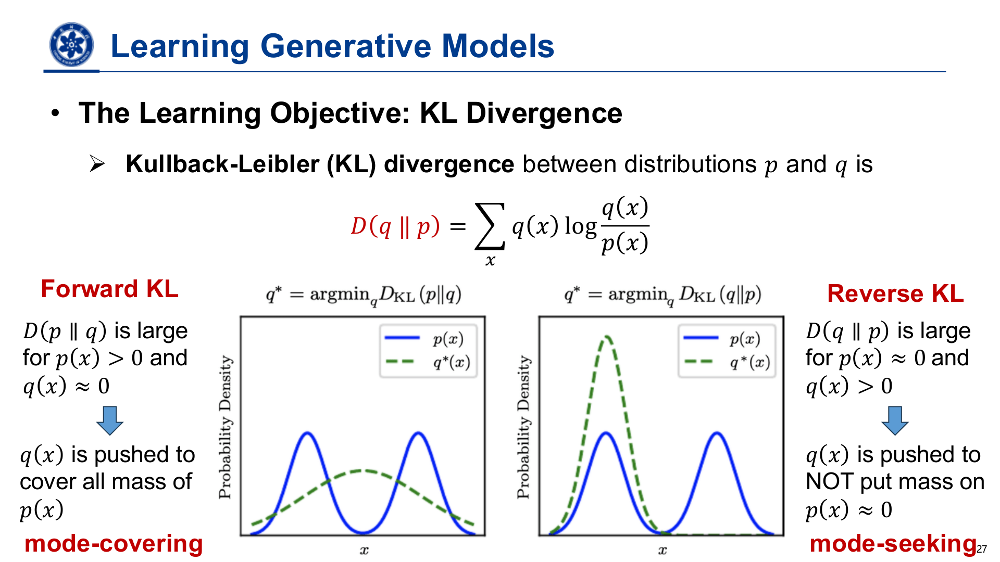

*课件原图 · 第27页：前向KL与反向KL的不同偏好。*

**看图方法：**蓝线是要拟合的分布，绿虚线是受限制的拟合结果。左图宁愿铺得宽一些，也不轻易漏掉一个峰；右图更愿意贴住一个峰，避开中间真实密度低的地方。

**KL散度**衡量两种概率分配相差多少。“失配”就是同样的数据，真实分布和模型给出的支持程度不同。KL非负，通常具有方向性：交换比较顺序会得到不同结果。

| 方向 | 特别不愿出现的情况 | 受限模型下的常见倾向 |
|---|---|---|
| 前向KL：真实分布 → 模型 | 真实数据会出现，模型却几乎不给概率 | 覆盖模式，mode-covering |
| 反向KL：模型 → 真实分布 | 模型经常生成，真实分布却几乎不支持 | 寻找模式，mode-seeking |

“模式”指分布中的高密度区域；一个人工类别也可能包含多个模式。覆盖与寻峰是模型受限时的典型倾向；如果模型能够准确表达整个多峰分布，两种KL都可以在分布一致时达到最优。

**最大似然的逻辑链：**

> 匹配真实分布 → 最小化前向KL → 最大化真实数据上的期望对数似然 → 用训练样本的平均对数似然近似。

真实分布自身的熵对模型参数是常数，优化前向KL时可以省去；由于这个常数未知，似然值主要用于比较模型对数据的支持程度。

**蒙特卡洛估计**就是“抽一些样本，用样本平均代替总体平均”，例如用抽样调查估计所有人的平均身高。最大似然则选择一套参数，让已经看到的数据得到更高支持。**独立同分布**指各样本来自同一分布，且相互独立；在这个假设下，最大化整批数据的联合似然等价于最大化各样本的对数似然之和。

---

## 二、自回归模型：按顺序学习条件分布

*复习课：第39–46页。*

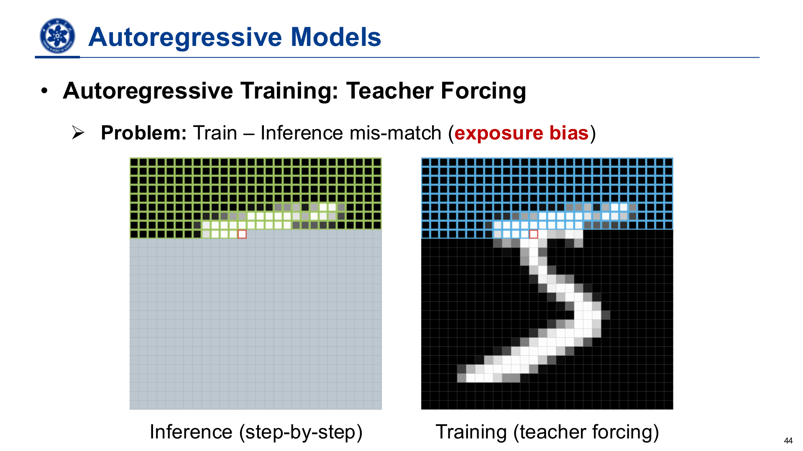

*课件原图 · 第44页：生成时逐步补全，训练时使用真实前缀。*

**看图方法：**左侧随着生成逐步填入像素；右侧训练直接读取真实图片中的前面部分。

### 1. 概率结构与归纳偏置

$$
p(x_1,\ldots,x_n)=\prod_{i=1}^{n}p(x_i\mid x_{<i})
$$

**公式读法（第41页）：**整份数据的概率，等于“第一部分的概率 × 已知第一部分时第二部分的概率 × ……”。$x_{<i}$是第$i$项之前的内容，$\prod$表示连乘。

自回归模型按某种顺序，把联合分布拆成“给定已有部分，当前部分如何分布”。生成时使用自己的先前输出作为后续输入。

定义模型时需要明确：**每个生成单元代表什么，以及这些单元按什么顺序排列。**单元可以是词、像素、潜在token或数据块；不同顺序会引入不同归纳偏置，使条件分布的学习难度不同。**归纳偏置**就是模型预先带有的学习倾向：例如按句子顺序预测，相当于相信“前文有助于预测后文”。

### 2. 训练与生成的区别

**前缀**指已经给出的前面内容。例如生成“今天下雨”，预测“下雨”时，“今天”就是前缀。

| 阶段 | 前缀来自哪里 | 计算特点 |
|---|---|---|
| 训练：Teacher Forcing | 真实训练数据 | 前缀已知，便于并行计算各位置目标，避免沿完整采样链反传 |
| 生成 | 模型自己已生成的结果 | 后面的输入依赖前面结果，通常逐步进行 |

**暴露偏差：**训练看真实前缀，推理看生成前缀；两种输入分布不一致，生成错误可能逐步累积。

**架构无关性：**自回归是一种概率分解，可用RNN、CNN、注意力网络等实现。掩码相当于遮住答案，使当前位置只读取允许使用的前文。训练并行性取决于架构；RNN在Teacher Forcing下仍按时间递归。

### 3. 主要能力

已知完整样本时，可以计算各位置真实取值的条件概率并组合为联合似然；采样则按同一分解顺序逐步抽取。其典型优势是可处理的似然，典型瓶颈是生成串行性。

---

## 三、潜变量与VAE：边缘化困难引出变分学习

*复习课：第48–60页。*

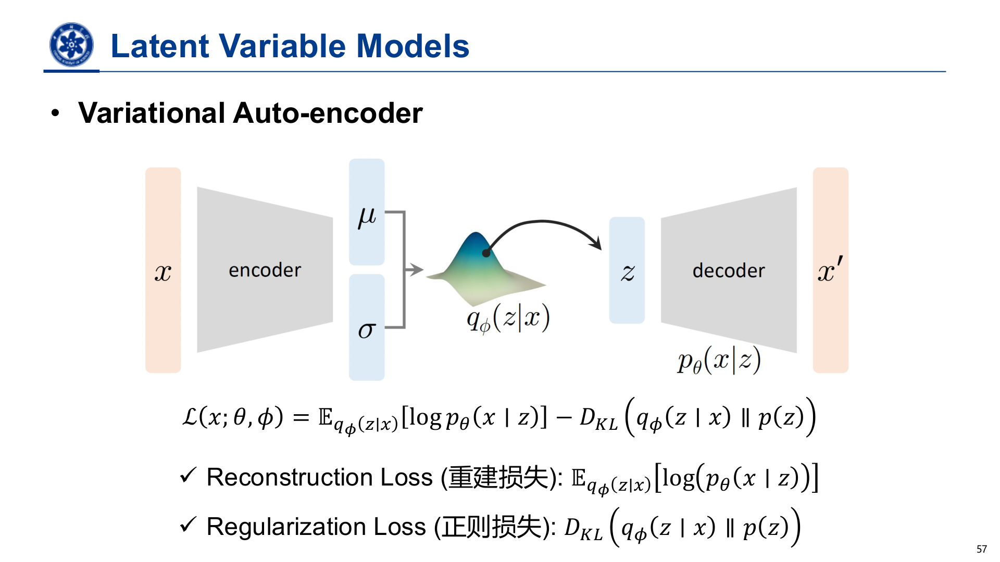

*课件原图 · 第57页：VAE编码、采样、解码与ELBO两项。*

**看图方法：**左侧输入图片，编码器给出一团可能编码的分布；从中取一个编码$z$，再由解码器重构。$\mu$是分布中心，$\sigma$控制采样分散程度。

### 1. 潜变量的作用与代价

**先验与后验：**先验是看到当前图片前，对编码的默认分布；后验是看到这张图片后，对“哪些编码可能解释它”的判断。近似后验就是编码器给出的、算起来较容易的一种替代判断。

潜变量用于表达观测背后的结构。生成方向是“先从先验采样潜变量，再在给定潜变量时生成数据”；推断方向是“根据观测，判断可能的潜在原因”。

它能把复杂边缘分布组织成较简单的先验与条件分布，也可提供紧凑表示。代价是：**观测似然必须汇总所有可能潜变量的解释，求和或积分通常难以处理。**

**边缘化的白话含义：**把所有可能编码的贡献合起来，得到“这张图片出现的可能性”。

$$
p_\theta(x)=\int p_\theta(x\mid z)\,p(z)\,\mathrm dz
$$

**公式读法（第50–51页）：**每种编码生成这张图的支持程度，乘上该编码本身的可能性，再汇总。离散编码用求和，连续编码用积分。联合分布看“图片和编码一起出现”；边缘分布只看图片。

### 2. 从朴素采样到ELBO

| 思路 | 机制 | 主要限制／意义 |
|---|---|---|
| 朴素蒙特卡洛 | 从先验抽潜变量，平均其对当前观测的解释概率 | 多数潜变量可能无法解释该观测，估计效率低 |
| 重要性采样 | 改从提议分布抽样，并用权重修正 | 优先抽取有用编码，同时覆盖所有有贡献的区域 |
| ELBO | 利用Jensen不等式，把难优化的对数期望换为可处理下界 | 优化边缘对数似然的下界 |

**提议分布**就是“改用哪种抽样方式”的分布。重要性权重则校正抽样偏向，避免只顾常抽到的编码。Jensen不等式给出一个可优化的下界：“先平均再取对数”给出原目标，“先取对数再平均”给出下界。这里理解下界的用途即可。

### 3. 变分推断与变分学习

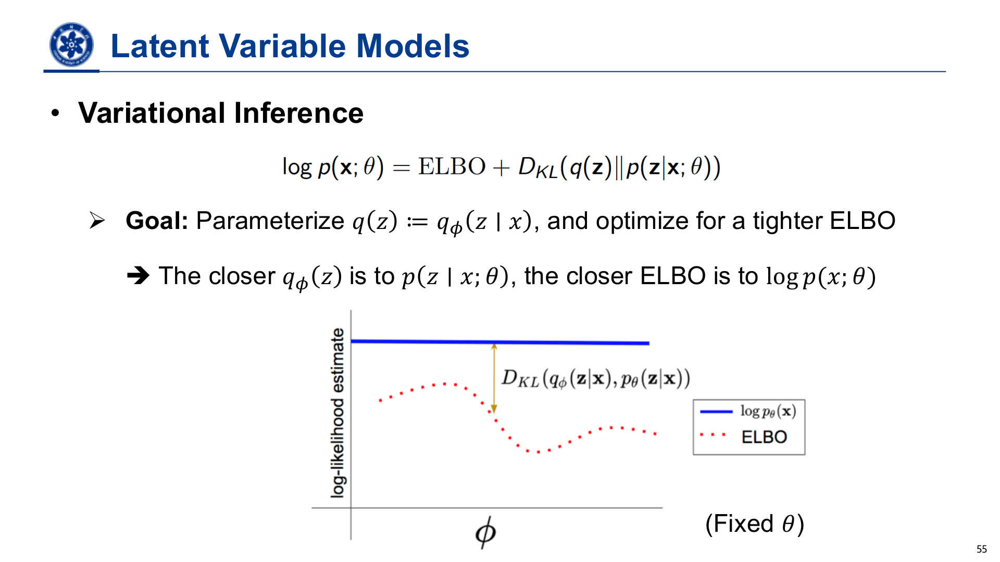

*课件原图 · 第55页：对数似然与ELBO之间的间隙。*

**看图方法：**蓝线是真实对数似然，红虚线是下界。固定生成模型时，优化近似后验，就是让红线更靠近蓝线。“变分”在这里可以理解为：不用硬算难求的后验，而是调整一个容易计算的分布去逼近它。

**核心关系：边缘对数似然 = ELBO + 近似后验相对真实后验的KL间隙。**

- **变分推断：**固定生成模型，优化近似后验，使其接近真实后验，让下界更紧。
- **变分学习：**同时优化生成模型和近似后验，通过提高下界学习数据分布。
- **取等条件：**近似后验等于真实后验时，间隙为零。

**“下界更紧”**就是它与真实值的差距更小。ELBO是对数似然的保证值；联合训练时，生成模型和下界间隙都会变化。

### 4. VAE的两个目标

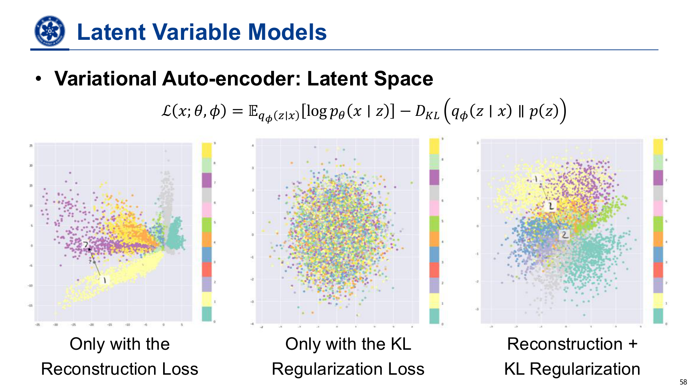

*课件原图 · 第58页：只重建、只约束KL、同时使用两项时的潜空间。*

**看图方法：**左图编码分成零散小团，中间留下未学好的区域；中图只强调靠近先验，类别结构变得混杂；右图同时照顾重建与先验约束。图中的潜空间就是“所有可能编码组成的空间”，每个点对应一种编码。

| 部分 | 鼓励什么 | 单独使用的不足 |
|---|---|---|
| 重建项 | 潜变量保留输入信息，解码器能解释输入 | 编码可能形成孤立团块，随机先验采样未必落在学好的区域 |
| KL正则项 | 每个近似后验靠近共同先验 | 潜变量可能不再携带足够的输入信息 |

两项共同约束，使潜空间既能重构，又适合从先验采样。这里的KL比较“近似后验与先验”，**不同于ELBO间隙中“近似后验与真实后验”的KL。**

编码器输出近似后验的参数，解码器输出条件生成分布的参数。训练时从近似后验采样以重构；生成时从先验采样后解码，不需要先输入真实图片。

### 5. 重参数化的意义

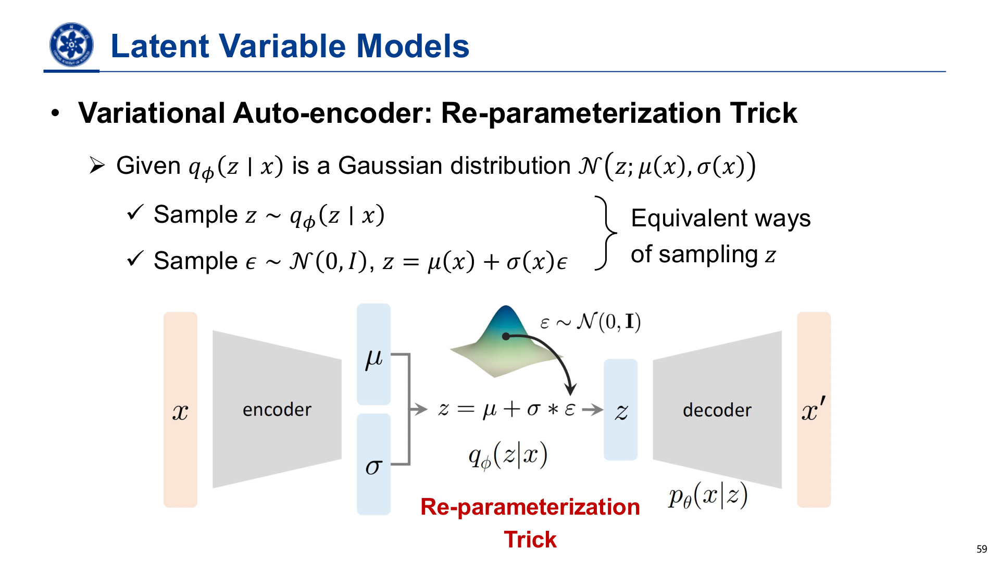

*课件原图 · 第59页：把随机性放到独立噪声中。*

$$
\epsilon\sim\mathcal N(0,I),\qquad z=\mu(x)+\sigma(x)\odot\epsilon
$$

**公式读法：**先取一份标准噪声，再按编码器给出的分散程度缩放，最后移动到编码中心。$\odot$表示对应位置相乘。可以想成“在地图中心附近随机落点”，中心和散布范围都由编码器决定。

把依赖网络参数的高斯采样，改写成“独立标准噪声经过均值、标准差的可微变换”。

这种写法保留原来的采样分布与随机性，并把参数到潜变量的路径改为可微运算，使重建信号能传回编码器，也就是能计算“编码器参数改一点，会让重建误差怎样变化”。

---

## 四、归一化流：用可逆性换取可计算似然

*复习课：第62–65页。*

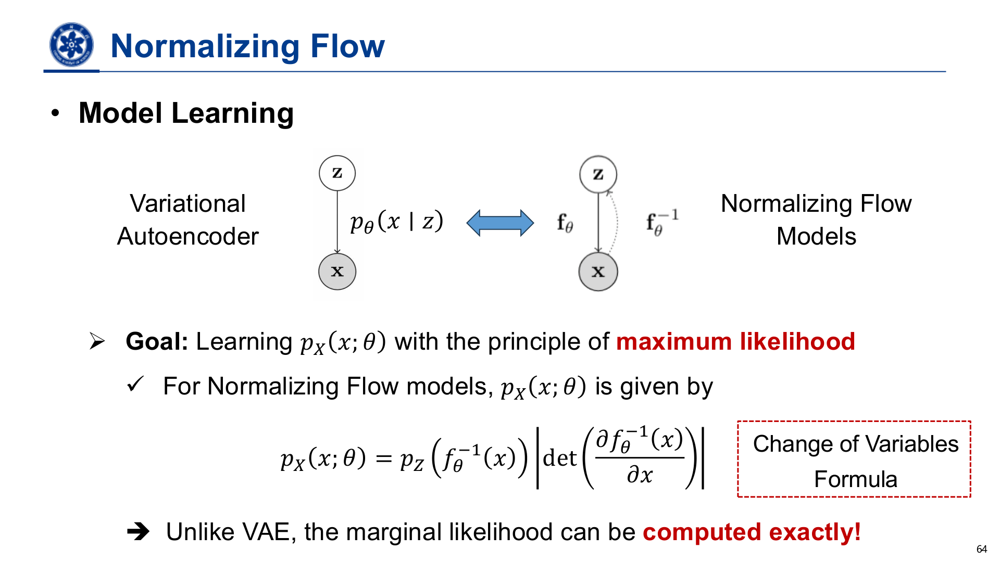

*课件原图 · 第64页：通过逆映射和体积修正计算数据密度。*

**看图方法：**上方把VAE的随机条件关系，与流模型的双向可逆映射作对比。下方红框的换元公式说：先找回对应基础点，再修正空间被拉伸或压缩的程度。

### 1. 设计动机

AR具有可处理似然，但没有直接的潜变量推断机制；一般潜变量模型便于学习表示，却面临难算的边缘似然。归一化流用一个确定、可逆的变换连接基础变量与数据，结合这两类能力。

### 2. 与VAE的区别

| 维度 | VAE | 普通归一化流 |
|---|---|---|
| 数据与潜变量的联系 | 概率条件生成，观测可有多个潜在解释 | 确定的一一可逆映射 |
| 潜变量推断 | 用近似后验 | 用逆变换精确找回对应基础点 |
| 维数 | 可以不同 | 本讲标准形式连续且同维 |
| 训练 | 优化ELBO | 通过换元直接计算似然并做MLE |

### 3. 换元公式的含义

数据密度由两部分决定：**对应基础点的密度，以及变换造成的局部体积修正。**

变换保持概率质量，并按体积变化调整密度。空间拉伸时，同样概率摊到更大体积，密度降低；空间压缩则密度提高。Jacobian行列式的绝对值衡量这种缩放。

### 4. 结构设计的关键

**Jacobian（雅可比矩阵）**记录输入各部分轻微变化时，输出各部分会如何变化；它的行列式在这里概括局部体积放大或缩小多少。可以把空间想成印着网格的橡皮膜：拉开网格，同样概率分布到更大面积，密度就下降。

一般高维行列式计算昂贵；三角Jacobian的行列式只需组合对角元素，能大幅简化计算。因此流模型的网络结构需要同时满足表达能力、可逆性与行列式可计算性。

---

## 五、GAN：直接从真假样本比较学习

*复习课：第67–73页。*

### 1. 似然评价概率分配，生成质量评价样本

| 复习课反例 | 说明 |
|---|---|
| 少量真实数据分布与大量噪声混合 | 采样大多是噪声，但高维数据上的平均对数似然仍可能显得接近理想值 |
| 只记忆并输出训练图片 | 样本可以逼真，但未见数据的似然与泛化能力差 |

两个例子说明似然与生成质量需要分别评价。第一个例子中，有限的对数似然差相对高维总量可能很小，因此似然看起来接近，采样结果却大多是噪声。

### 2. 两个网络与交替优化

**生成器G：**把简单先验噪声映射成样本。**判别器D：**接收真实或生成样本，估计其来自真实数据的概率。

> 固定G，提高D的真假判别能力 → 固定D，让G更能欺骗D → 交替更新。

标准GAN通过真实与生成样本训练。更新G时，固定D的参数，由经过D的梯度提供更新方向。

### 3. 最优判别器与JS联系

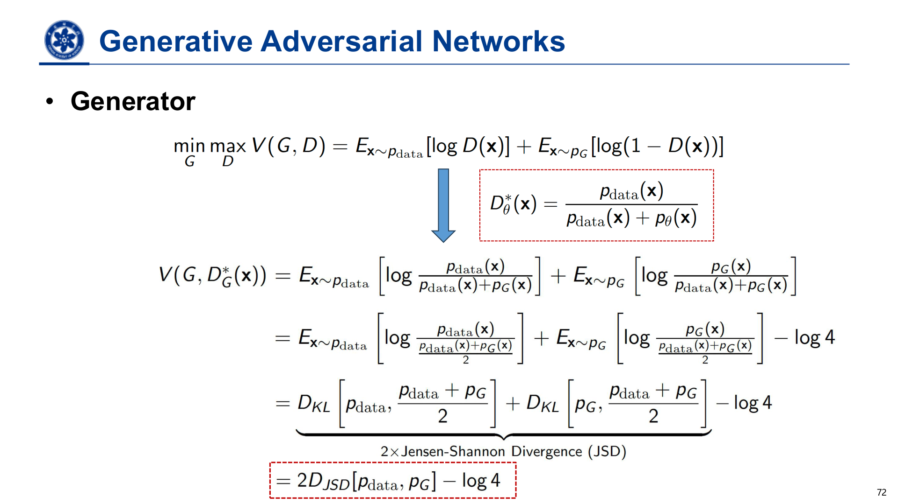

*课件原图 · 第72页：最优判别器与生成器目标中的JS散度。*

**看图方法：**中间红框是最优判别器，最下方红框给出原始对抗目标与JS散度的关系。

$$
D^*(x)=\frac{p_{\mathrm{data}}(x)}{p_{\mathrm{data}}(x)+p_G(x)}
$$

**公式读法：**在同一种外观附近，真实样本占的比重越大，就越应该判真。比如两种来源在这里贡献相同，理想判别器只能给出二分之一；$D^*$中的星号表示“固定当前生成器时的最优判别器”。

将最优判别器代回原始极小极大目标，生成器相当于最小化经过缩放和平移的JS散度，也就是对这个差异乘常数、再加一个不影响最优位置的常数。JS借助两分布的平均分布，综合衡量双方的差异；这一关系基于“固定生成器时，判别器达到最优”的理想条件；实际训练通过交替更新逼近。

### 4. G与VAE、NF的区别

| 模型 | 从潜变量生成 | 是否要求可逆 | 是否直接规定后验推断 |
|---|---|---|---|
| VAE | 条件概率生成 | 否 | 用编码器近似 |
| NF | 确定变换 | 是 | 逆变换 |
| 标准GAN | 确定生成映射 | 否 | 通常没有编码器 |

GAN的输入噪声负责提供生成变化，VAE的编码器负责从数据推断潜变量。判别器准确率约50%既可能来自分布接近，也可能来自判别器能力不足，需要结合生成结果判断。

---

## 六、扩散模型：预设加噪，学习反向恢复

*复习课：第75–85页。*

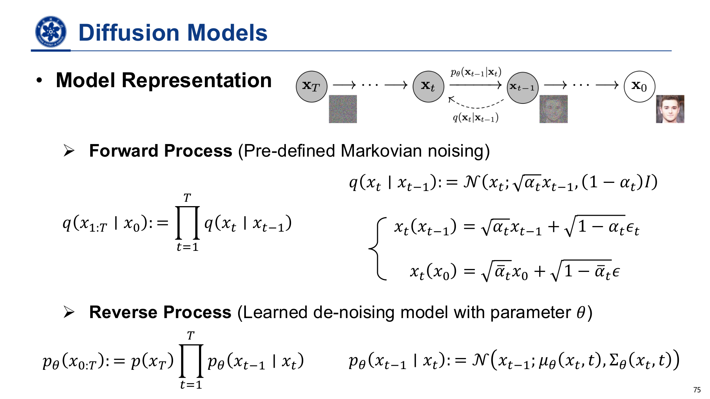

*课件原图 · 第75页：固定的前向加噪链与学习的反向去噪链。*

**看图方法：**$x_0$是干净图片，$x_T$是噪声端；前向从数据走向噪声，生成反着走。$q$在本节表示预设加噪分布，$p_\theta$表示要学的反向分布。

### 1. 两条过程与一个训练便利

**马尔可夫**在这里指：下一步的条件分布只依据当前状态。“高斯噪声”就是按钟形分布随机生成的扰动。

- **前向：**固定的马尔可夫高斯加噪过程，逐步破坏数据结构，最终接近高斯噪声。
- **反向：**学习从当前带噪状态到较干净状态的条件分布；生成时从噪声端逐步采样回数据。
- **训练便利：**前向边缘可解析构造，已知干净数据时，可以直接得到任意时间的带噪样本，不必先模拟所有前向步骤。

生成阶段仍按反向过程逐步去噪。

### 2. 与VAE的联系和区别

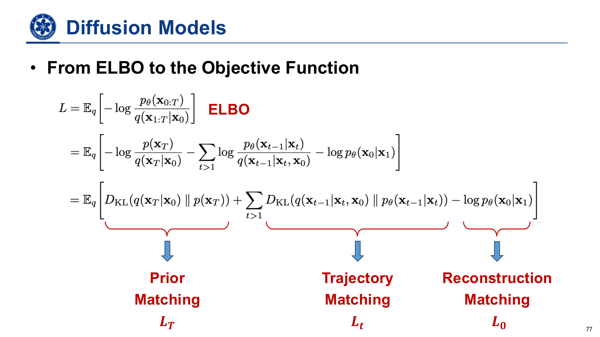

*课件原图 · 第77页：扩散目标分成先验、轨迹、重建三类匹配。*

**看图方法：**主要认底部三个括号，分别对照下表。这里的“匹配”就是让两个分布尽量接近。

两者都可通过潜变量模型的ELBO学习。扩散的潜变量是一串带噪中间状态，基本DDPM的前向推断链固定设计；普通VAE则通常学习一个编码器近似后验。

| 负ELBO中的部分 | 约束的含义 |
|---|---|
| 先验匹配 | 最终前向带噪分布接近生成起点的高斯先验 |
| 轨迹／扩散匹配 | 学到的反向转移接近给定原图时可计算的前向后验 |
| 重建匹配 | 从最接近数据的带噪状态恢复原始观测 |

**先验项：**让累计信号足够小、末端噪声足够强，便可使两者接近；有限步下通常实现近似匹配。固定前向过程和先验时，它不依赖去噪网络参数。

**重建项：**负责最后的边界恢复，是完整概率目标的一部分；中间时间的转移由扩散匹配项负责。

### 3. 用原图构造训练监督，用当前状态完成生成

仅给当前带噪状态时，真实反向条件难算；再给定原始数据后，相应前向后验可解析计算。因此训练可以借助原图构造监督，但待学网络仍只需输入当前状态与时间。

生成时，网络根据当前带噪状态、时间与已学到的统计规律预测反向转移。

### 4. 均值、噪声与干净信号参数化

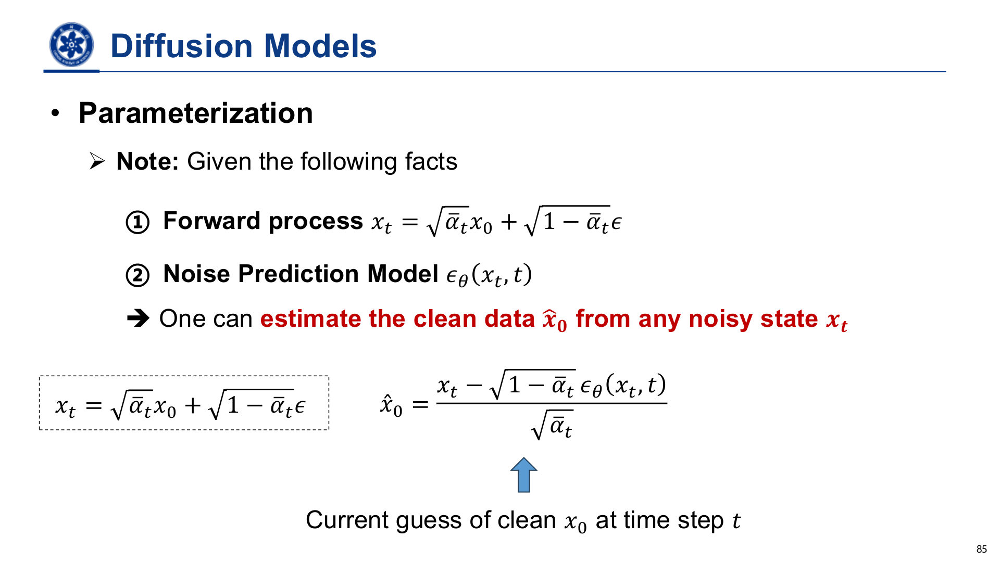

*课件原图 · 第85页：从带噪状态估计干净图片。*

$$
\hat x_0=\frac{x_t-\sqrt{1-\bar\alpha_t}\,\epsilon_\theta(x_t,t)}{\sqrt{\bar\alpha_t}}
$$

**公式读法：**当前带噪图减去“模型估计的噪声部分”，再把衰减过的信号放大回来。$\bar\alpha_t$描述原始信号到此时还保留多少，$\epsilon_\theta$是模型预测的噪声，帽子$\hat{\ }$表示“估计值”。这是当前的干净图估计，其误差取决于噪声预测质量。

给定噪声调度，反向均值与噪声预测之间可以转换；预测噪声后，还能从当前带噪状态估计干净数据。

**三个对象要分清：**当前带噪状态、对最终干净样本的当前估计、实际反向采样得到的下一状态。分别对应当前输入、最终结果的预测，以及下一步的采样结果。

---

## 七、Score模型：学习密度变化的方向

*复习课：第87–99页。*

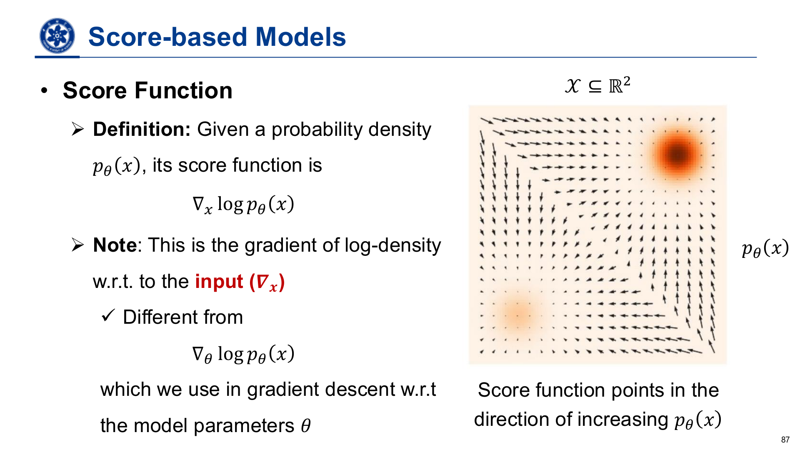

*课件原图 · 第87页：Score是对输入求导得到的方向。*

**看图方法：**右侧颜色表示密度，箭头表示附近往哪里移动能提高密度。$\nabla_x$是移动数据点，$\nabla_\theta$是修改网络参数，两者分别用于生成过程和参数训练。

### 1. Score与能量模型

**向量场**可以想成一张风向图：每个位置都配一根箭头，记录方向和大小。Score场记录的是“数据点向哪边改，能更像高密度区域中的样本”。

Score是**对数密度对输入位置的梯度**，指向局部密度增加的方向。它是与输入同维的方向向量，描述输入怎样变化会提高密度。

**能量**可以看成模型给样本打的“不合理程度分数”，越低越受支持。**归一化**是把所有可能结果的概率调整到合计为1；**配分函数**就是完成这个调整所需的总量。这个总量可能依赖网络参数，却不随当前输入$x$变化，所以对输入求导时消失，score无需显式计算它。

### 2. 从Fisher散度到DSM

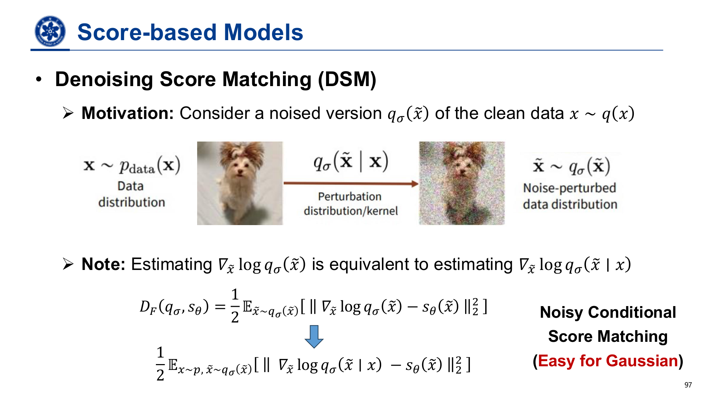

*课件原图 · 第97页：干净数据加噪后，用已知条件分布构造训练目标。*

**看图方法：**猫的原图经过已知噪声变成带噪图；虽然不知道整个带噪图片分布的方向场，但知道“这张原图被怎样扰动”，所以能做出训练标签。

**Fisher散度**在这里就是比较“目标箭头与网络预测箭头”的平均平方差；**回归**指让网络预测一组数，并尽量贴近目标数值。

| 方法 | 核心思路 | 计算难点／改进 |
|---|---|---|
| 直接Score Matching | 匹配模型score和真实数据score | 真实数据密度及score未知 |
| 等价目标 | 改写为只需样本与模型导数的目标 | 雅可比迹等计算不易扩展到高维 |
| DSM去噪Score Matching | 给数据加已知噪声，用条件分布的score构造监督 | 绕开未知边缘score和原始高维导数目标 |

**DSM等价性的含义：**用单个样本的条件score构造监督，网络通过平均回归学到带噪分布的边缘score。等价性体现在整体训练目标上。

### 3. Langevin与多尺度噪声

Langevin每步结合score方向与随机噪声。前者引导样本进入高密度区域，后者保持探索，帮助实现分布采样；仅做梯度上升更像寻峰。

**低维流形**的直觉是：图片虽然有很多像素，但合理图片只占全部像素组合中的一小部分，就像三维空间里的点实际上集中在一张薄纸上。远离这张“纸”的区域，原始分布的对数密度梯度可能没有良好定义；样本少的区域，方向也难估准。加噪相当于把薄纸变厚，让附近更多位置能获得学习信号。

| 噪声强度 | 优点 | 代价 |
|---|---|---|
| 大噪声 | 平滑分布，改善稀疏区域估计和全局探索 | 扰动后分布偏离真实数据 |
| 小噪声 | 更接近真实数据，利于细节恢复 | 稀疏区域估计和跨模式探索更困难 |

**退火**在这里就是逐渐降低噪声强度：Langevin从大噪声逐步降到小噪声，每层结果作为下一层初始状态。一个以噪声水平为条件的网络可共享多个尺度的学习。

### 4. NCSN与DDPM的统一联系

两者的带噪样本都可以理解成“缩放信号与高斯噪声的混合”。NCSN通常保留原信号尺度、逐步增大噪声；DDPM同时衰减信号并加入噪声。

NCSN侧重预测score，DDPM常预测噪声。给定加噪关系后，两种预测目标具有缩放联系；各自的时间权重、噪声调度与采样过程分别设计。

---

## 八、连续时间与流模型：从随机去噪到确定性搬运

*复习课：第101–118页。*

### 1. 连续时间统一视角

**连续时间**可以把它想成：原来隔一段时间拍一张照片，现在把间隔取得极小，用一条随时间变化的运动规律描述整个过程。SDE是带随机扰动的微分方程，ODE是没有额外随机扰动的微分方程。这里重点看它们如何描述生成过程。

当离散噪声水平变得足够密，可以用SDE表示前向过程：漂移描述确定性变化，扩散项描述随机扰动。

| 模型对应 | 漂移的直觉 | 扩散的直觉 |
|---|---|---|
| NCSN对应的方差爆炸过程 | 基本形式中不系统性缩小原信号 | 持续增加噪声方差 |
| DDPM对应的方差保持过程 | 将信号向原点收缩 | 注入匹配强度的噪声 |

逆时间SDE利用score构造正确的反向动力学；采样时从末端先验出发，反向数值求解。反向更新由已学习的score和相应动力学共同决定。

### 2. SDE与概率流ODE

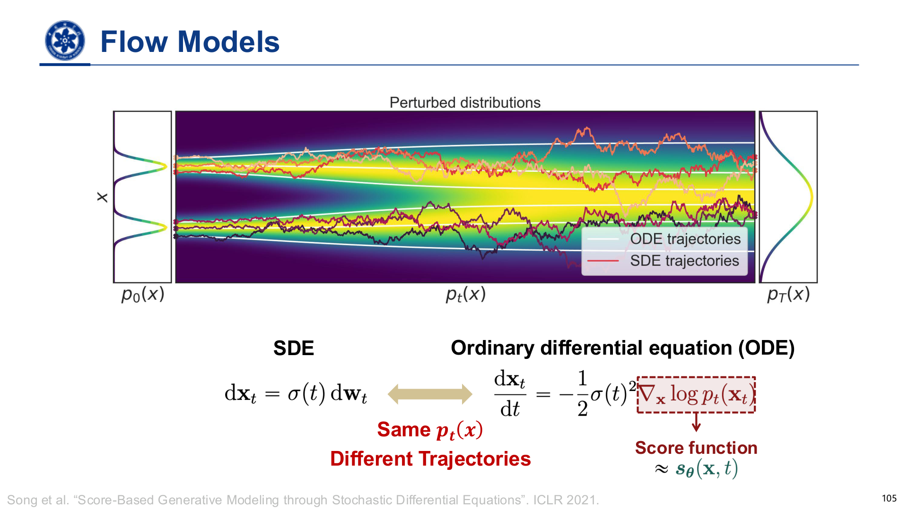

*课件原图 · 第105页：同样的时间分布可以由不同运动轨迹实现。*

**看图方法：**彩色曲折线表示随机轨迹，平滑线表示确定性轨迹。两种过程到同一时刻时，样本整体的分布可以相同，但某个点走过的路径不同。

| 比较维度 | SDE | 对应的概率流ODE |
|---|---|---|
| 固定起点后的轨迹 | 随机 | 确定、平滑 |
| 时间边缘分布 | 在理想条件下，与对应ODE一致 | 在理想条件下，与对应SDE一致 |
| 单条轨迹 | 随机路径 | 对应另一组确定性路径 |

**“时间边缘分布”**就是只截取某一个时刻，看所有样本落在哪里，不追问它们此前各自怎么走。好比两批人某一时刻的人群分布相同，却可能走过不同路线。**同一时间的分布可以由不同路径实现。**概率流ODE通过调整漂移，在去掉随机项后保持对应的时间边缘分布。初始点随机抽取，所以确定性ODE仍能生成多样样本。

### 3. CNF与归一化流的联系

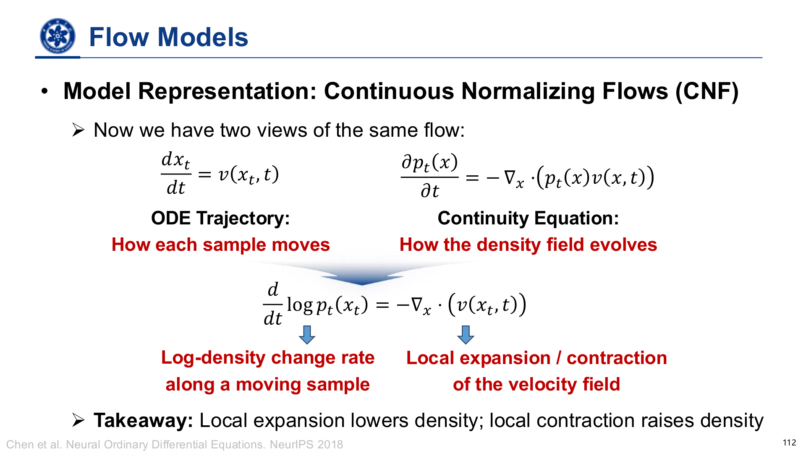

*课件原图 · 第112页：样本运动、密度流动与局部体积变化。*

**看图方法：**左上描述一个点怎样移动，右上描述某个位置周围的人群密度怎样变化，下方描述跟着某个点走时，密度如何随局部膨胀或收缩改变。

CNF用随位置、时间变化的速度场，把初始分布连续搬运到目标分布。在适当正则条件下，ODE解唯一，轨迹在同一时间不会相交，形成可逆映射；同一个ODE可正向或反向求解。

| 描述层次 | 负责说明什么 |
|---|---|
| ODE轨迹 | 每个样本点怎样移动 |
| 连续性方程 | 固定位置的概率密度怎样因净流入、流出而变化 |
| 瞬时换元 | 沿移动样本，局部体积变化怎样改变其对数密度 |

**连续性方程**的白话含义是“人数不会凭空增减”：一个区域的密度变化来自流入和流出。**散度**描述附近的流动倾向于向外散开还是向内聚拢；跟着移动的样本看，向外膨胀让密度下降，向内收缩让密度上升。这里用人群帮助理解，实际守恒的是概率质量。

### 4. CNF的三种训练表述

| 表述 | 做法 | 关键取舍 |
|---|---|---|
| 最大似然 | 沿轨迹累计密度变化，计算似然并优化 | 密度关系理论上可计算，但ODE与相关导数计算昂贵 |
| Flow Matching | 直接回归目标概率路径的边缘速度场 | 采样只需要速度场，但边缘目标速度通常未知 |
| Conditional Flow Matching | 回归可构造的条件速度，间接学到所需边缘速度 | 绕开不可直接获得的边缘监督 |

### 5. CFM的“条件”与“边缘”

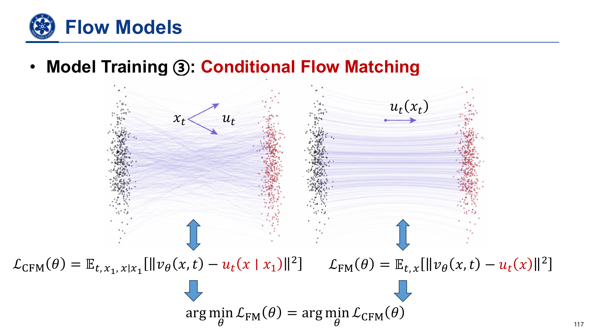

*课件原图 · 第117页：多个条件方向汇总为一个边缘速度方向。*

**看图方法：**左侧不同端点配对会给当前位置提出不同移动方向；右侧变成网络学习的一个整体方向。同一网络只根据当前状态和时间，给出接下来怎样移动。

**条件速度**是“如果目标固定为这一个样本，该往哪里走”；**边缘速度**是“不预先固定目标，综合各种可能目标后，该往哪里走”。这里的“条件”是目标数据点，“边缘”是消去具体目标后的整体描述。

同一时刻、同一位置可能对应多个目标点的不同条件速度。边缘速度是给定该位置与时间后，对这些条件速度的后验加权平均。**白话理解：**当前位置更可能来自哪些目标，就更听那些方向的意见。

在对应条件下，CFM与FM损失只差不依赖模型参数的常数，具有相同优化梯度和最优解。**“差一个常数”**就像给所有成绩统一加5分，谁最好以及怎样提高排名都不变；两个目标数值相差一个常数，最优参数一致。因此可以用容易采样和计算的条件目标训练网络，而无需显式求出边缘速度。

结合上图可进一步理解：直线条件路径经共享速度场综合后，实际轨迹仍可能弯曲，因此生成通常需要多步积分。

---

## 九、跨模型对照：统一复习表示、训练与生成

| 模型 | 核心表达 | 训练目标 | 生成流程 | 似然与推断 |
|---|---|---|---|---|
| AR | 有序条件分解 | 最大似然 | 前缀条件下逐项采样 | 局部条件可计算时，联合似然可得 |
| VAE | 随机潜变量生成 | ELBO | 先验采样后解码 | 边缘似然难算，编码器近似后验 |
| NF | 确定可逆变换 | 换元后的最大似然 | 基础样本经变换 | 逆映射找回基础点并计算密度 |
| GAN | 不要求可逆的生成映射 | 对抗目标 | 噪声经生成器 | 标准形式通常无直接可求密度与编码器 |
| DDPM | 多步带噪隐变量链 | 变分目标／去噪回归 | 从噪声反向迭代 | 用可计算的条件后验构造监督 |
| Score | 多噪声尺度的score场 | Fisher散度相关目标／DSM | Langevin或逆SDE等 | 给出密度变化方向 |
| CNF／FM | 连续可逆运输 | 似然或速度回归 | ODE积分 | 可沿轨迹累计密度变化 |

### 必须区分的三组关系

**随机性与潜变量：**VAE有随机条件生成和近似后验；NF给定基础变量后确定且可逆；GAN给定噪声后通常确定，但不必可逆。潜变量的可解释性与后验推断难度取决于具体模型设计。

**各类模型的学习目标：**KL与似然关注概率分配；GAN用样本真假比较，Score用向量场匹配，Flow Matching用速度匹配。

**三个“生成步骤”：**AR逐个补全数据单元；扩散逐步降低噪声；CNF逐步积分速度场。都是多步，但每一步的对象和含义不同。

