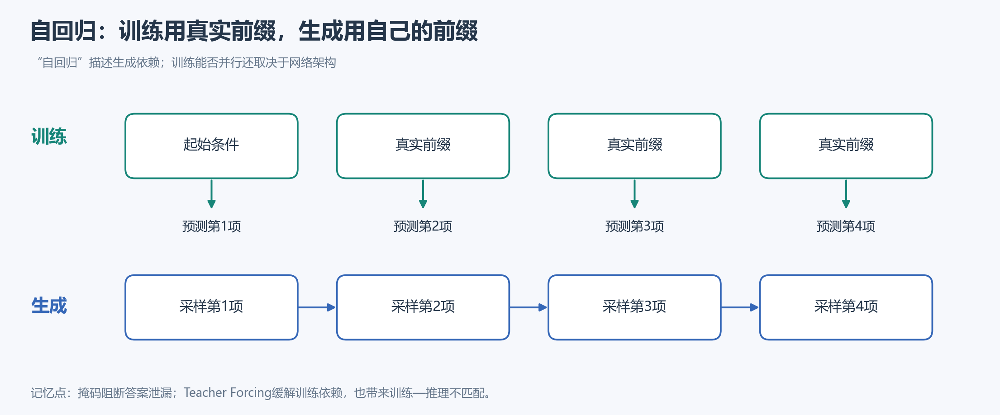
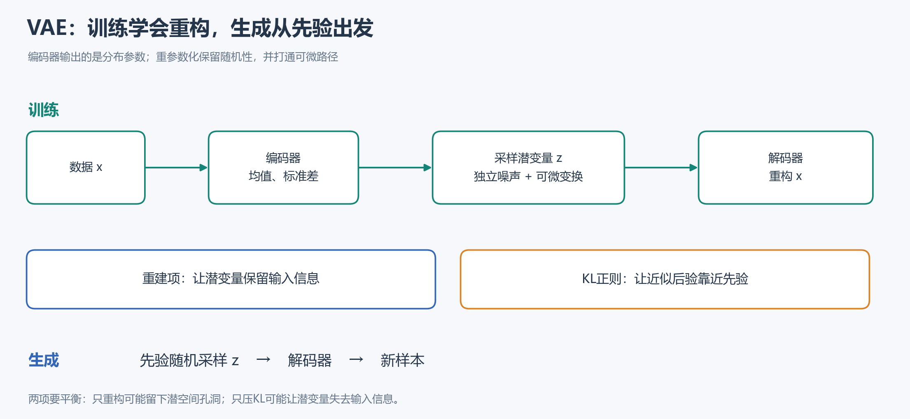
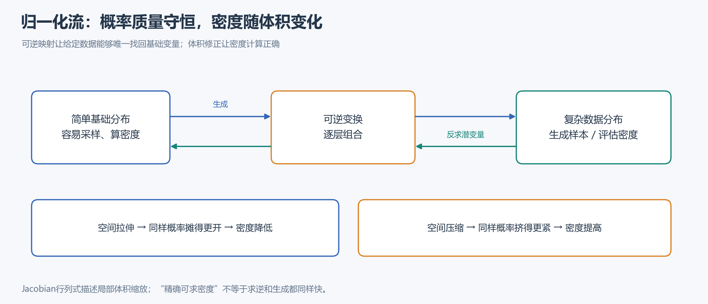
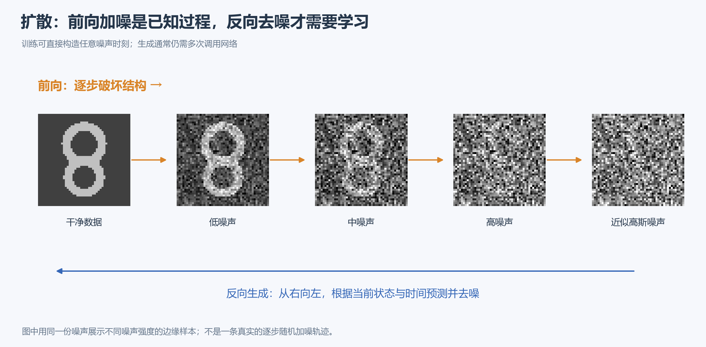
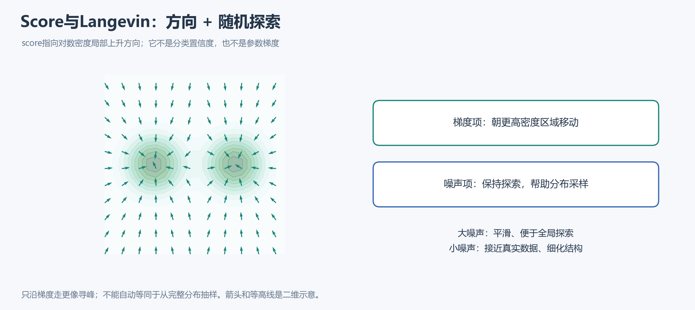
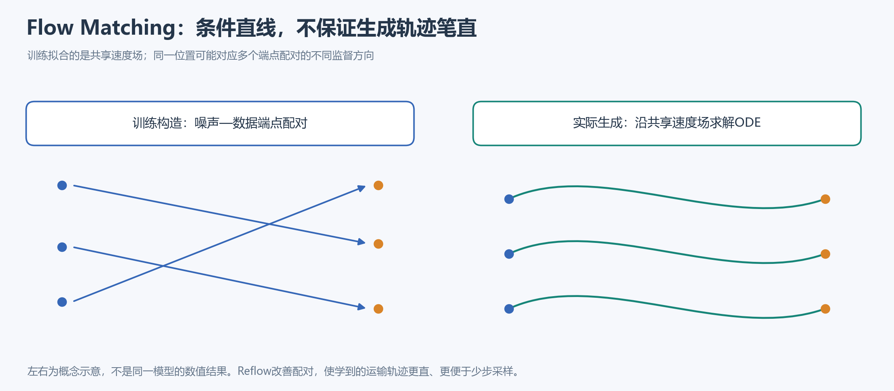

# 生成式人工智能｜Lecture 16 复习课总结

> 按老师复习课的顺序整理，采用知识要点与比较表，不使用问答体。保留概念和公式的意义，省略推导与计算。
>
> **考试要求（复习课第2页）：中文、开卷简答题，可携带不限种类与数量的纸质资料；禁止使用手机、电脑、平板、智能手表、电子阅读器等电子设备。**考试时间为2026年11月17日15:25—17:00；教二楼104、204，具体座位见课程安排。请提前打印所需资料。

**阅读顺序：**共同框架 → AR → 潜变量与VAE → 归一化流 → GAN → 扩散 → Score → 连续流。所有页码均指[老师复习课文件](<file:///C:/Users/Administrator/Desktop/Learning%20Materials/%E7%A0%94%E4%B8%80/%E7%94%9F%E6%88%90%E5%BC%8F%E4%BA%BA%E5%B7%A5%E6%99%BA%E8%83%BD/%E8%AF%BE%E4%BB%B6/Lecture16_Review.pdf>)的PDF页码。配图沿用此前重绘的概念示意。

---

## 一、生成模型的共同框架

*复习课：第5–37页。*

### 1. 总目标与三项用途

生成模型根据有限训练样本，学习一个尽可能接近真实数据分布的概率模型。真实分布本身未知，训练数据只是它的有限观测。

| 用途 | 关注的能力 | 典型模型 |
|---|---|---|
| 样本生成 | 从模型抽样，产生合理的新数据 | AR、VAE、NF、GAN、扩散、Score等 |
| 密度／似然估计 | 计算模型赋予某个样本的密度或概率 | AR、NF，以及可沿轨迹计算密度的CNF |
| 表示学习 | 用潜变量表达数据背后的结构 | 以VAE等潜变量模型为典型 |

这里列出的是代表性用途，不是排他的能力分类。例如，GAN也有输入潜变量，但标准GAN没有直接规定“给定数据如何推断潜变量”的编码器。

### 2. 三个设计层次

| 层次 | 决定什么 |
|---|---|
| 模型族 | 用什么结构和分布表达数据规律 |
| 学习目标 | 用什么标准衡量模型与真实数据的差异 |
| 优化方法 | 如何利用样本调整参数 |

这三个层次要分别理解：**使用相似的网络，不代表定义了相同概率模型；使用相同模型结构，也可以选择不同训练目标和采样方法。**

### 3. 高维分布的表达与参数效率

直接给高维数据的每一种可能组合存一个概率，状态和参数数量会随维度指数增长，形成维度灾难。

| 方法 | 如何处理复杂性 | 要点 |
|---|---|---|
| 完整概率表 | 为每种状态单独指定概率 | 灵活，但参数和数据需求巨大 |
| 链式法则 | 将联合分布精确分解为条件分布的乘积 | 本身不节省完整概率表的参数，也不引入近似 |
| 贝叶斯网络 | 利用条件独立，缩小每个变量的条件集合 | 简化依赖结构，可能损失表达能力 |
| 神经网络参数化 | 用有限参数的函数表达条件分布 | 不必额外删去条件变量，但受容量、结构和优化限制 |

神经网络节省参数的关键，是用共享的函数规律概括不同输入的条件概率，而不是为每一种输入组合单独建表。它并不意味着任意复杂分布都能被有限网络无误差地表达。

### 4. KL、最大似然与样本平均

**KL散度**度量分布失配，非负但一般不对称，因此不是通常意义上的距离。

| 方向 | 特别不愿出现的情况 | 受限模型下的常见倾向 |
|---|---|---|
| 前向KL：真实分布 → 模型 | 真实数据会出现，模型却几乎不给概率 | 覆盖模式，mode-covering |
| 反向KL：模型 → 真实分布 | 模型经常生成，真实分布却几乎不支持 | 寻找模式，mode-seeking |

“模式”指分布中的高密度区域，不必严格等于一个人工类别。覆盖与寻峰是模型受限时的典型倾向；如果模型能够准确表达整个多峰分布，两种KL都可以在分布一致时达到最优。

**最大似然的逻辑链：**

> 匹配真实分布 → 最小化前向KL → 最大化真实数据上的期望对数似然 → 用训练样本的平均对数似然近似。

其中，真实分布自身的熵不依赖模型参数，所以优化前向KL时可以去掉这一常数。但它未知，也意味着仅靠似然值不能直接知道距离理想模型还有多远。

**蒙特卡洛估计**用样本平均近似期望；最大似然是在选定模型族中，让已观测数据最可能出现。独立同分布假设下，最大化数据的联合似然等价于最大化各样本的对数似然之和。

---

## 二、自回归模型：按顺序学习条件分布

*复习课：第39–46页。*

### 1. 概率结构与归纳偏置

自回归模型按某种顺序，把联合分布拆成“给定已有部分，当前部分如何分布”。生成时使用自己的先前输出作为后续输入。

定义模型时需要明确：**每个生成单元代表什么，以及这些单元按什么顺序排列。**单元可以是词、像素、潜在token或数据块；不同顺序会引入不同归纳偏置，使条件分布的学习难度不同。

### 2. 训练与生成的区别

| 阶段 | 前缀来自哪里 | 计算特点 |
|---|---|---|
| 训练：Teacher Forcing | 真实训练数据 | 前缀已知，便于并行计算各位置目标，避免沿完整采样链反传 |
| 生成 | 模型自己已生成的结果 | 后面的输入依赖前面结果，通常逐步进行 |

**暴露偏差：**训练看真实前缀，推理看生成前缀；两种输入分布不一致，生成错误可能逐步累积。

**架构无关性：**自回归是一种概率分解，不专属于RNN。CNN、注意力网络等也可通过掩码实现。掩码阻断当前位置对自身答案和未来信息的依赖；并行程度仍受具体架构约束，Teacher Forcing不消除RNN自身的时间递归。

### 3. 主要能力

已知完整样本时，可以计算各位置真实取值的条件概率并组合为联合似然；采样则按同一分解顺序逐步抽取。其典型优势是可处理的似然，典型瓶颈是生成串行性。

---

## 三、潜变量与VAE：边缘化困难引出变分学习

*复习课：第48–60页。*

### 1. 潜变量的作用与代价

潜变量用于表达观测背后的结构。生成方向是“先从先验采样潜变量，再在给定潜变量时生成数据”；推断方向是“根据观测，判断可能的潜在原因”。

它能把复杂边缘分布组织成较简单的先验与条件分布，也可提供紧凑表示。代价是：**观测似然必须汇总所有可能潜变量的解释，求和或积分通常难以处理。**

注意区分：数据与潜变量的联合分布，由先验和条件生成分布组成；数据的边缘分布还需要消去潜变量，二者不是同一个对象。

### 2. 从朴素采样到ELBO

| 思路 | 机制 | 主要限制／意义 |
|---|---|---|
| 朴素蒙特卡洛 | 从先验抽潜变量，平均其对当前观测的解释概率 | 多数潜变量可能无法解释该观测，估计效率低 |
| 重要性采样 | 改从提议分布抽样，并用权重修正 | 提议分布应更多覆盖有效解释区域；还需覆盖有贡献的支撑 |
| ELBO | 利用Jensen不等式，把难优化的对数期望换为可处理下界 | 下界是代理目标，不等于精确边缘对数似然 |

“对数里的期望”不能随意交换成“对数的期望”；这一差别正是引入下界的关键。

### 3. 变分推断与变分学习

**核心关系：边缘对数似然 = ELBO + 近似后验相对真实后验的KL间隙。**

- **变分推断：**固定生成模型，优化近似后验，使其接近真实后验，让下界更紧。
- **变分学习：**同时优化生成模型和近似后验，通过提高下界学习数据分布。
- **取等条件：**近似后验等于真实后验时，间隙为零。

下界越高提供越强的似然保证，但一次联合更新不能直接理解成“真实似然必然提高了同样多”。

### 4. VAE的两个目标

| 部分 | 鼓励什么 | 单独使用的不足 |
|---|---|---|
| 重建项 | 潜变量保留输入信息，解码器能解释输入 | 编码可能形成孤立团块，随机先验采样未必落在学好的区域 |
| KL正则项 | 每个近似后验靠近共同先验 | 潜变量可能不再携带足够的输入信息 |

两项共同约束，使潜空间既能重构，又适合从先验采样。这里的KL比较“近似后验与先验”，**不同于ELBO间隙中“近似后验与真实后验”的KL。**

编码器输出近似后验的参数，解码器输出条件生成分布的参数。训练时从近似后验采样以重构；生成时从先验采样后解码，不需要先输入真实图片。

### 5. 重参数化的意义

把依赖网络参数的高斯采样，改写成“独立标准噪声经过均值、标准差的可微变换”。

这样与原采样在分布上等价，也没有消除随机性；改变的是参数到潜变量的计算路径，使重建信号能经潜变量传回编码器。它不等于直接用均值替代随机样本。

---

## 四、归一化流：用可逆性换取可计算似然

*复习课：第62–65页。*

### 1. 设计动机

AR具有可处理似然，但没有直接的潜变量推断机制；一般潜变量模型便于学习表示，却面临难算的边缘似然。归一化流用一个确定、可逆的变换连接基础变量与数据，结合这两类能力。

### 2. 与VAE的区别

| 维度 | VAE | 普通归一化流 |
|---|---|---|
| 数据与潜变量的联系 | 概率条件生成，观测可有多个潜在解释 | 确定的一一可逆映射 |
| 潜变量推断 | 用近似后验 | 用逆变换精确找回对应基础点 |
| 维数 | 可以不同 | 本讲标准形式连续且同维 |
| 训练 | 优化ELBO | 通过换元直接计算似然并做MLE |

### 3. 换元公式的含义

数据密度由两部分决定：**对应基础点的密度，以及变换造成的局部体积修正。**

概率质量守恒不意味着密度不变。空间拉伸时，同样概率摊到更大体积，密度降低；空间压缩则密度提高。Jacobian行列式的绝对值衡量这种缩放。

### 4. 结构设计的关键

一般高维行列式计算昂贵；三角Jacobian的行列式只需组合对角元素，能大幅简化计算。因此流模型必须兼顾表达能力、可逆性与行列式可计算性，不能任意套用普通网络结构。

---

## 五、GAN：直接从真假样本比较学习

*复习课：第67–73页。*

### 1. 似然与生成质量不是同一目标

| 复习课反例 | 说明 |
|---|---|
| 少量真实数据分布与大量噪声混合 | 采样大多是噪声，但高维数据上的平均对数似然仍可能显得接近理想值 |
| 只记忆并输出训练图片 | 样本可以逼真，但未见数据的似然与泛化能力差 |

高似然不自动保证好样本，好样本也不自动保证高测试似然。第一个例子强调有限的对数似然差相对高维总量可能很小，并不是噪声质量差的模型真的等于真实分布。

### 2. 两个网络与交替优化

**生成器G：**把简单先验噪声映射成样本。**判别器D：**接收真实或生成样本，估计其来自真实数据的概率。

> 固定G，提高D的真假判别能力 → 固定D，让G更能欺骗D → 交替更新。

标准GAN只要求能采样，不要求显式计算生成密度。更新G时，梯度经过D提供方向，但D的参数不随这一步更新。

### 3. 最优判别器与JS联系

理想判别器根据某个位置的真实密度和生成密度之比判断真假。两分布一致时，最优判别器无法区分来源，输出二分之一。

将最优判别器代回原始极小极大目标，生成器相当于最小化经过缩放和平移的JS散度。JS借助两分布的平均分布，综合衡量双方的差异；实际神经网络训练并不总满足“判别器每步都最优”等理想条件。

### 4. G与VAE、NF的区别

| 模型 | 从潜变量生成 | 是否要求可逆 | 是否直接规定后验推断 |
|---|---|---|---|
| VAE | 条件概率生成 | 否 | 用编码器近似 |
| NF | 确定变换 | 是 | 逆变换 |
| 标准GAN | 确定生成映射 | 否 | 通常没有编码器 |

有输入噪声不等于具有VAE式表示学习机制；判别器准确率约50%也不单独证明生成成功，可能只是判别器没有学好。

---

## 六、扩散模型：预设加噪，学习反向恢复

*复习课：第75–85页。*

### 1. 两条过程与一个训练便利

- **前向：**固定的马尔可夫高斯加噪过程，逐步破坏数据结构，最终接近高斯噪声。
- **反向：**学习从当前带噪状态到较干净状态的条件分布；生成时从噪声端逐步采样回数据。
- **训练便利：**前向边缘可解析构造，已知干净数据时，可以直接得到任意时间的带噪样本，不必先模拟所有前向步骤。

这个训练便利不意味着生成也能一步完成。

### 2. 与VAE的联系和区别

两者都可通过潜变量模型的ELBO学习。扩散的潜变量是一串带噪中间状态，基本DDPM的前向推断链固定设计；普通VAE则通常学习一个编码器近似后验。

| 负ELBO中的部分 | 约束的含义 |
|---|---|
| 先验匹配 | 最终前向带噪分布接近生成起点的高斯先验 |
| 轨迹／扩散匹配 | 学到的反向转移接近给定原图时可计算的前向后验 |
| 重建匹配 | 从最接近数据的带噪状态恢复原始观测 |

**先验项：**让累计信号足够小、末端噪声足够强，便可使两者接近；有限步下通常是近似，不应无条件写成严格为零。固定前向过程和先验时，它不依赖去噪网络参数。

**重建项：**是最后的边界恢复，区别于中间时间的转移匹配；不能因为简化目标强调噪声预测，就认为完整概率目标没有这项。

### 3. 训练监督能用原图，生成输入不能依赖原图

仅给当前带噪状态时，真实反向条件难算；再给定原始数据后，相应前向后验可解析计算。因此训练可以借助原图构造监督，但待学网络仍只需输入当前状态与时间。

生成时没有原图，网络利用已学到的统计规律预测反向转移；不是把某张已知原图当作隐藏输入。

### 4. 均值、噪声与干净信号参数化

给定噪声调度，反向均值与噪声预测之间可以转换；预测噪声后，还能从当前带噪状态估计干净数据。

**三个对象要分清：**当前带噪状态、对最终干净样本的当前估计、实际反向采样得到的下一状态。它们不是同一个量。

---

## 七、Score模型：学习密度变化的方向

*复习课：第87–99页。*

### 1. Score与能量模型

Score是**对数密度对输入位置的梯度**，指向局部密度增加的方向。它是与输入同维的向量，不是单个真假分数，也不是对网络参数求梯度。

能量模型用能量定义未归一化密度，低能量对应高密度。配分函数对输入是常数，因此对输入求导后消失：score可由负能量的输入梯度表示，无需显式计算配分函数。

### 2. 从Fisher散度到DSM

| 方法 | 核心思路 | 计算难点／改进 |
|---|---|---|
| 直接Score Matching | 匹配模型score和真实数据score | 真实数据密度及score未知 |
| 等价目标 | 改写为只需样本与模型导数的目标 | 雅可比迹等计算不易扩展到高维 |
| DSM去噪Score Matching | 给数据加已知噪声，用条件分布的score构造监督 | 绕开未知边缘score和原始高维导数目标 |

**DSM等价性的含义：**条件score监督与目标带噪边缘score在相应平均回归目标下等价，不是说每一个训练样本的条件score都等于边缘score。

### 3. Langevin与多尺度噪声

Langevin每步结合score方向与随机噪声。前者引导样本进入高密度区域，后者保持探索，帮助实现分布采样；仅做梯度上升更像寻峰。

真实数据常集中在低维流形附近：流形外的对数密度梯度可能没有良好定义，稀疏区域的score也难从有限样本估准。

| 噪声强度 | 优点 | 代价 |
|---|---|---|
| 大噪声 | 平滑分布，改善稀疏区域估计和全局探索 | 扰动后分布偏离真实数据 |
| 小噪声 | 更接近真实数据，利于细节恢复 | 稀疏区域估计和跨模式探索更困难 |

退火Langevin从大噪声逐步降到小噪声，每层结果作为下一层初始状态。一个以噪声水平为条件的网络可共享多个尺度的学习。

### 4. NCSN与DDPM的统一联系

两者的带噪样本都可以理解成“缩放信号与高斯噪声的混合”。NCSN通常保留原信号尺度、逐步增大噪声；DDPM同时衰减信号并加入噪声。

NCSN侧重预测score，DDPM常预测噪声；对给定加噪关系，两种预测目标具有缩放联系，但时间权重、噪声调度和采样过程不能因此直接混同。

---

## 八、连续时间与流模型：从随机去噪到确定性搬运

*复习课：第101–118页。*

### 1. 连续时间统一视角

当离散噪声水平变得足够密，可以用SDE表示前向过程：漂移描述确定性变化，扩散项描述随机扰动。

| 模型对应 | 漂移的直觉 | 扩散的直觉 |
|---|---|---|
| NCSN对应的方差爆炸过程 | 基本形式中不系统性缩小原信号 | 持续增加噪声方差 |
| DDPM对应的方差保持过程 | 将信号向原点收缩 | 注入匹配强度的噪声 |

逆时间SDE利用score构造正确的反向动力学；采样时从末端先验出发，反向数值求解。它不是简单把前向加噪动作逐个机械抵消。

### 2. SDE与概率流ODE

| 比较维度 | SDE | 对应的概率流ODE |
|---|---|---|
| 固定起点后的轨迹 | 随机 | 确定、平滑 |
| 时间边缘分布 | 在理想条件下，与对应ODE一致 | 在理想条件下，与对应SDE一致 |
| 单条轨迹 | 不要求与ODE逐条相同 | 不要求与SDE逐条相同 |

**相同分布不等于相同路径。**概率流ODE需要调整漂移，并非直接删掉SDE的随机项。初始点随机抽取，所以确定性ODE仍能生成多样样本。

### 3. CNF与归一化流的联系

CNF用随位置、时间变化的速度场，把初始分布连续搬运到目标分布。在适当正则条件下，ODE解唯一，轨迹在同一时间不会相交，形成可逆映射；同一个ODE可正向或反向求解。

| 描述层次 | 负责说明什么 |
|---|---|
| ODE轨迹 | 每个样本点怎样移动 |
| 连续性方程 | 固定位置的概率密度怎样因净流入、流出而变化 |
| 瞬时换元 | 沿移动样本，局部体积变化怎样改变其对数密度 |

**共同直觉：**局部膨胀降低密度，局部收缩提高密度，概率质量守恒。

### 4. CNF的三种训练表述

| 表述 | 做法 | 关键取舍 |
|---|---|---|
| 最大似然 | 沿轨迹累计密度变化，计算似然并优化 | 密度关系理论上可计算，但ODE与相关导数计算昂贵 |
| Flow Matching | 直接回归目标概率路径的边缘速度场 | 采样只需要速度场，但边缘目标速度通常未知 |
| Conditional Flow Matching | 回归可构造的条件速度，间接学到所需边缘速度 | 绕开不可直接获得的边缘监督 |

### 5. CFM的“条件”与“边缘”

“条件”指给定一个目标数据点，而不默认指文本提示或类别标签；“边缘”指对整个数据分布混合后的路径和速度。

同一时刻、同一位置可能对应多个目标点的不同条件速度。边缘速度是给定该位置与时间后，对这些条件速度的后验加权平均，不是对所有目标无差别平均。

在对应条件下，CFM与FM损失只差不依赖模型参数的常数，具有相同优化梯度和最优解。因此可以用容易采样和计算的条件目标训练网络，而无需显式求出边缘速度。

图中“直线配对与弯曲生成轨迹”用于辅助理解：训练条件路径即使选为直线，共享速度场的实际轨迹仍可能弯曲，不保证一次更新就完成生成。

---

## 九、跨模型对照：统一复习表示、训练与生成

| 模型 | 核心表达 | 训练目标 | 生成流程 | 似然与推断 |
|---|---|---|---|---|
| AR | 有序条件分解 | 最大似然 | 前缀条件下逐项采样 | 局部条件可计算时，联合似然可得 |
| VAE | 随机潜变量生成 | ELBO | 先验采样后解码 | 边缘似然难算，编码器近似后验 |
| NF | 确定可逆变换 | 换元后的最大似然 | 基础样本经变换 | 逆映射找回基础点并计算密度 |
| GAN | 不要求可逆的生成映射 | 对抗目标 | 噪声经生成器 | 标准形式通常无直接可求密度与编码器 |
| DDPM | 多步带噪隐变量链 | 变分目标／去噪回归 | 从噪声反向迭代 | 用可计算的条件后验构造监督 |
| Score | 多噪声尺度的score场 | Fisher散度相关目标／DSM | Langevin或逆SDE等 | score本身不是归一化密度值 |
| CNF／FM | 连续可逆运输 | 似然或速度回归 | ODE积分 | 可沿轨迹累计密度变化 |

### 必须区分的三组关系

**随机性与潜变量：**VAE有随机条件生成和近似后验；NF给定基础变量后确定且可逆；GAN给定噪声后通常确定，但不必可逆。存在潜变量不自动保证可解释性或易于后验推断。

**两类分布学习：**KL与似然关注概率分配；GAN用样本真假比较，Score用向量场匹配，Flow Matching用速度匹配。不能把所有生成模型都概括成同一种最大似然训练。

**三个“生成步骤”：**AR逐个补全数据单元；扩散逐步降低噪声；CNF逐步积分速度场。都是多步，但每一步的对象和含义不同。

---

## 十、复习课覆盖范围与旧资料衔接

本文件正文展开到CFM与概念矩阵。**扩散进阶与评价出现在路线图，但没有单独的复习正文；WGAN、MAF／IAF等原课内容也未在本次文件中详细展开。**这描述的是文件的展开程度，不是老师宣布的排除考试范围。

- 本笔记用于沿复习课抓主线和概念联系。
- [图文精简版](<生成式人工智能-图文精简版.md>)可补查WGAN、流结构、扩散加速、潜空间扩散与评价指标。
- [文字详版](<生成式人工智能-开卷简答题复习资料.md>)可展开具体方法与原讲次页码。

**最后梳理：**每个模型都按“如何表达分布、训练监督从哪里来、怎样生成、似然与推断是否容易、主要代价是什么”这五条线复习。它们也是老师复习课贯穿各类模型的比较维度。
