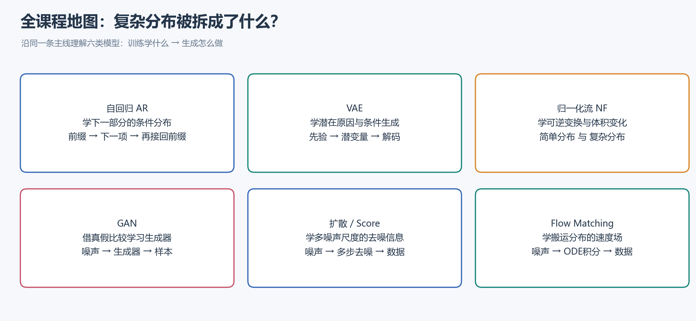
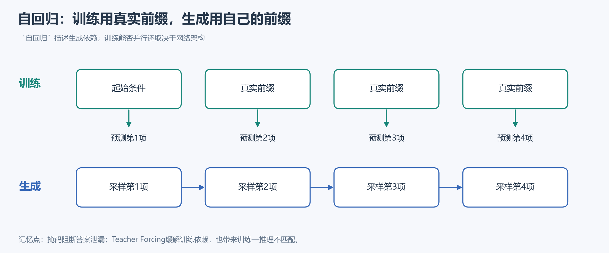
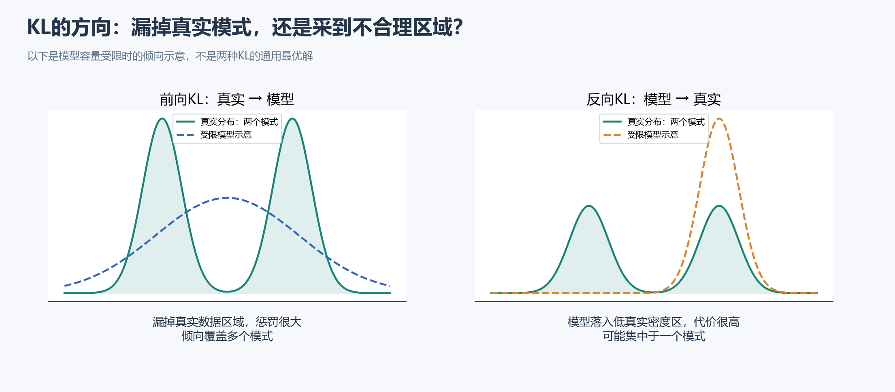
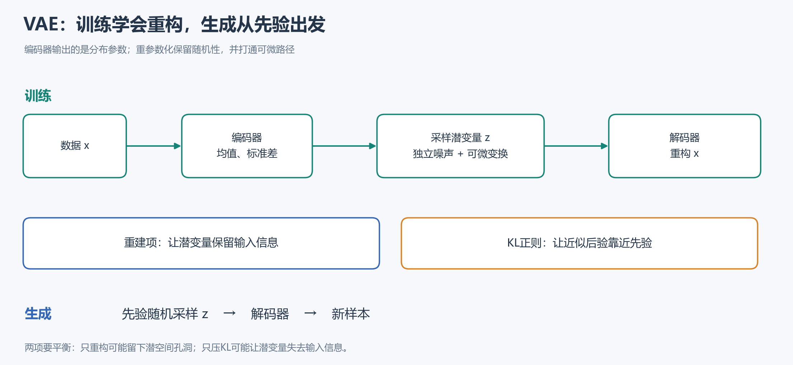
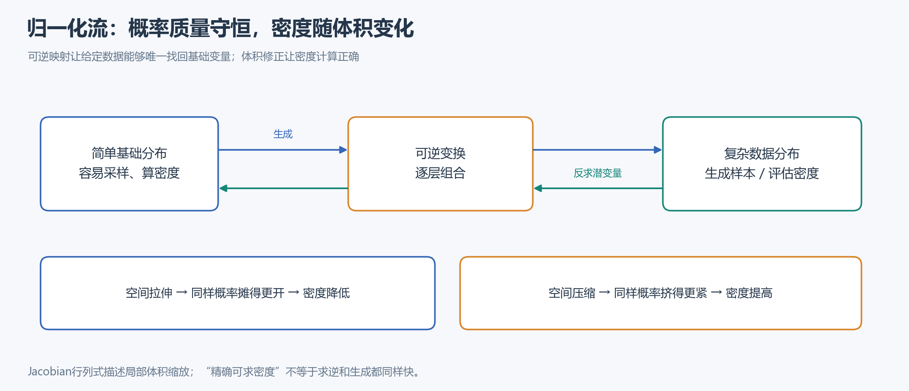
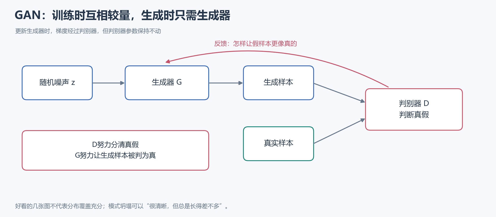
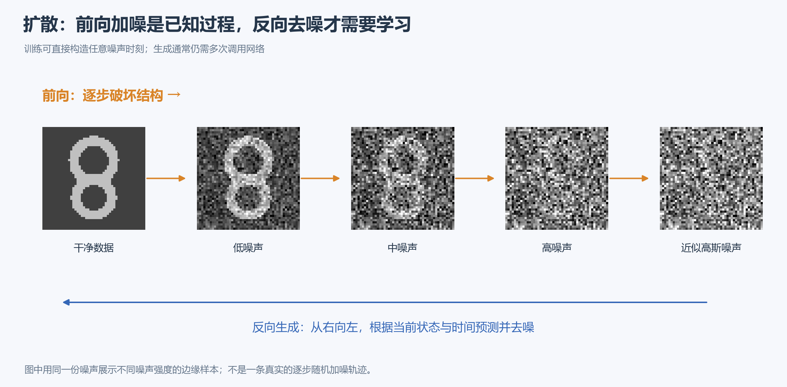
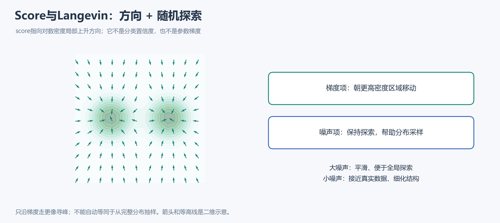
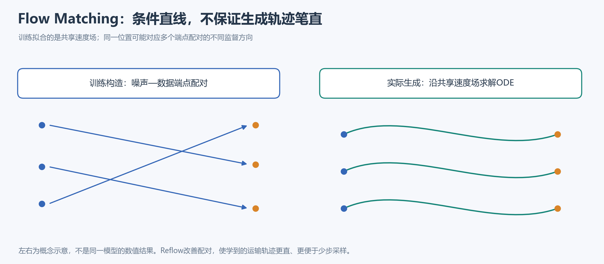

# 生成式人工智能 · 图文复习资料

> 面向开卷简答题：先看图抓住机制，再看“答题要点”和比较表。共10张示意图，覆盖Lecture 1–15，不展开公式推导与计算。
>
> 想查更完整的解释、扩展问题与课件文件索引，可打开[文字详版](<生成式人工智能-开卷简答题复习资料.md>)。页码均为对应PDF的实际页码；L3使用96页版。图是根据课程内容重绘的概念示意，不是实验结果。

## 导航

| 基础 | 主要模型 | 后续专题 |
|---|---|---|
| [课程地图](#map) | [潜变量与VAE](#vae) | [Score与多尺度采样](#score) |
| [概率建模](#prob) | [归一化流](#nf) | [连续流与Flow Matching](#fm) |
| [自回归模型](#ar) | [GAN与WGAN](#gan) | [扩散加速与设计](#design) |
| [最大似然与KL](#mle) | [DDPM扩散](#ddpm) | [评价指标](#eval) |
|  | [模型横向比较](#compare) | [简答自测](#quiz) |

## 1. 全课程地图：先分清“拆解方式”

**总目标：**从有限样本学习数据分布，并据此生成新的合理样本。

**三类挑战：**数据维度高 → 需要有效表示；分布复杂 → 需要可处理的分解；真实分布未知 → 需要合适的训练目标和评价方式。

**三个用途：**采样生成、似然估计、表示学习。一个模型擅长其中某一项，不代表另外两项也最好。

**简答写法：**定义 → 核心机制 → 为什么有效 → 优势与局限。比较题沿同样的维度比较，避免只写“效果好、效果差”。

课件：L1，第12–21、31–39页。

---

## 2. 概率建模：结构决定“依赖谁”

### 必须分清的概念

| 概念 | 一句话理解 | 例子 |
|---|---|---|
| 联合分布 | 多个变量共同取值的规律 | 一幅图像全部像素的共同分布 |
| 条件分布 | 已知一部分后，其余部分怎么分布 | 给定前文的下一词分布 |
| 边缘分布 | 消去不关心的变量后的分布 | 对潜变量积分，得到数据分布 |
| 先验 | 当前观测出现前的分布假设 | 生成前潜变量的标准高斯分布 |
| 后验 | 结合观测后的未知变量分布 | 给定图像，推断潜在原因 |
| 独立 | 知道一个变量不改变另一个的分布 | 两次独立投币 |
| 条件独立 | 给定条件后，额外变量不再提供信息 | 朴素贝叶斯中，给定类别后的词语独立假设 |

### 三个常见简答

**生成与判别有什么区别？**判别式分类直接学习“给定数据，标签是什么”；生成式分类学习类别先验及各类的数据分布，再用贝叶斯规则推断类别。生成模型也能做分类，仅有标签预测器通常不足以生成输入数据。

**链式法则能解决维度灾难吗？**它提供精确的条件分解，本身不减少完整概率表的参数量。真正的简化来自条件独立、受限参数化及参数共享；代价可能是表达能力受限。

**贝叶斯网络与神经网络是什么关系？**前者用有向无环图表达概率依赖和条件独立，后者可用来参数化其中的条件分布。图结构决定依赖谁，神经网络决定具体如何表达。概率依赖箭头不自动等于因果关系。

**顺手记住：**高维联合状态指数增长叫维度灾难；完全独立虽然省参数，却会丢失图像轮廓等变量间结构。条件生成通常是一对多，同一提示允许多个合理结果。

课件：L1，第23–28页；L2，第7–24、26–40页。

---

## 3. 自回归：用已经知道的，预测下一部分

### 答题要点

- **是什么：**把联合分布按顺序拆成条件分布。生成时逐项采样，把已有结果作为后续输入。
- **为什么灵活：**文本、图像、潜在token都可排序或分块；每步可以输出一个块，不限于一个标量。链式分解本身精确，有限网络的近似仍可能有误差。
- **如何评估：**完整样本已知时，计算各真实值的条件概率，再组合为联合似然。
- **主要取舍：**通常可精确评估似然、训练方便；标准生成存在串行瓶颈。

### Teacher Forcing的两个关键问题

| 问题 | 答题核心 |
|---|---|
| 为什么训练能并行、生成却通常串行？ | 训练的真实前缀全部已知；生成时后面的条件依赖尚未生成的前缀。并行程度还受架构约束，RNN仍有时间递归。 |
| 什么是暴露偏差？ | 训练看真实前缀，推理看自己的生成前缀；输入分布不同，错误可能累积。 |

### 方法演进速查

| 方法 | 主要变化 |
|---|---|
| FVSBN | 用逻辑回归表达二值变量的条件分布 |
| NADE | 用非线性网络提高表达能力，并共享部分参数 |
| MADE | 在单个网络中屏蔽连接，保证当前位置只依赖前序变量 |
| RNN / PixelRNN | 用递归隐藏状态概括历史；长依赖与并行性受限 |
| WaveNet / PixelCNN | 用因果或掩码卷积处理音频、图像；感受野影响上下文 |
| Transformer / GPT | 用因果注意力访问历史；生成仍通常逐token |

**易错点：**普通AE只学习重构，没有自动定义可随机采样的分布；MADE因合法条件分解成为生成模型。掩码应阻断整条信息路径的答案泄漏，不只是遮掉直接输入。

**归纳偏置：**任何合法顺序都能分解，但顺序、局部连接和参数共享会影响有限模型的学习难度。

课件：L3，第13–28、35–58、60–93页。

---

## 4. 最大似然与KL：方向决定惩罚什么

### 四句话抓住主线

1. **最大似然MLE：**选择使观测数据最可能出现的模型参数；最大化对数似然等价于最小化负对数似然NLL。
2. **KL散度：**衡量分布失配，非负但通常不对称，不是一般意义的距离。
3. **MLE与KL的联系：**最大化真实数据的期望对数似然，等价于最小化“真实分布到模型分布”的前向KL。
4. **有限数据怎么办：**用样本平均近似真实期望，再用随机小批量估计经验目标的梯度。

| 方向 | 特别敏感的错误 | 常见倾向 |
|---|---|---|
| 前向KL：真实 → 模型 | 真实常出现，模型却给极低概率 | 覆盖模式，mode-covering |
| 反向KL：模型 → 真实 | 模型常采到，真实分布却不支持 | 容量受限时可能寻峰，mode-seeking |

**图怎么看：**绿色是两个真实模式，虚线是受限模型的示意。覆盖与寻峰是特定条件下的倾向，不是必然结果。

### 统计学习速查

| 概念 | 核心意思 |
|---|---|
| 概率 vs 似然 | 概率固定参数看数据；似然固定已观测数据比较参数。似然不是参数后验。 |
| 蒙特卡洛估计 | 用抽样平均估计期望；适当条件下无偏，样本越多通常方差越小 |
| 经验风险 vs 总体风险 | 训练数据上的平均损失 vs 真实分布上的平均损失 |
| 欠拟合 / 高偏差 | 模型表达能力不足，单纯增加数据未必解决 |
| 过拟合 / 高方差 | 对有限数据扰动敏感；更多数据或适当约束容量可缓解 |

课件：L4，第9–24、31–43页。L4第14页熵差顺序有笔误，正确含义为“交叉熵减去真实分布自身的熵”。

---

## 5. 潜变量与VAE：先找原因，再生成观测

### 5.1 为什么引入潜变量？

**直觉：**图像像素很复杂，姿态、风格等潜在因素可能更紧凑。先描述潜变量的先验，再描述给定潜变量时的数据，可以组合出复杂边缘分布。

**GMM例子：**先抽高斯成分编号，再从对应高斯采样。单个条件高斯很简单，混合后的整体分布仍可多峰；给定观测后，各成分的后验概率可用于软聚类。

**计算困难：**一个观测可能对应很多潜变量解释，算似然要对它们求和或积分。容易采样，不等于容易算似然。

### 5.2 ELBO与变分推断：只记这条关系

**边缘对数似然 = ELBO + 近似后验与真实后验之间的KL间隙。**

| 术语 | 答题要点 |
|---|---|
| 重要性采样 | 从更容易解释当前观测的提议分布抽样，再用权重修正；不是换了分布后直接平均 |
| 变分推断 | 在可处理的分布族中优化近似后验，把难求后验改成优化问题 |
| ELBO | 证据对数的下界；近似后验越准确，下界越紧，等于真实后验时取等 |
| 摊销推断 | 一个共享编码器，针对不同输入输出各自的后验参数，避免逐样本单独优化 |
| EM联系 | E步令辅助分布等于当前模型的后验，使下界贴紧；课件仅点到这一联系 |

**别混淆两个KL：**下界间隙比较“近似后验与真实后验”；VAE正则项比较“近似后验与先验”。

### 5.3 VAE如何训练、如何生成？

**训练：**输入数据 → 编码器输出均值与标准差 → 采样潜变量 → 解码并重构 → 同时优化重建项和KL项。

**生成：**从先验采样潜变量 → 解码器 → 新样本。生成时不要求先输入一张真实图片。

**重参数化：**先抽与参数无关的标准噪声，再用均值、标准差构造潜变量。分布不变，随机性保留，但参数到潜变量的路径变成可微运算。

**ELBO两项：**重建项让编码保留输入信息；KL正则让近似后验靠近先验。固定方差高斯观测模型下，重建对数似然可转为平方误差；并非所有VAE都只能用L2。

### 5.4 三种扩展和一个常见问题

| 主题 | 记住什么 |
|---|---|
| AE与VAE | AE重构好不保证随机潜点可生成；VAE用分布编码和先验正则组织潜空间，但不保证所有点都完美 |
| β-VAE | 调节KL权重，平衡信息保留与约束；能施加解耦压力，不保证天然语义解耦 |
| 后验坍塌 | 潜变量不再携带有效输入信息，解码器绕过它；KL很小不一定是好事 |
| VQ-VAE | 连续编码选最近码本向量，用离散索引作潜代码；重建项、码本项、承诺项分别约束重构和编码对齐 |
| VQ-VAE2 | 多层级离散码组织全局与局部信息，并学习离散先验 |

**VQ训练补充：**离散选索引不便直接求导；直通梯度和stop-gradient分别处理重建信号传递及不同损失的更新路径。

课件：L5，第12–43、50–62页；L6，第4–33、35–75页。

---

## 6. 归一化流：可逆，还要管体积

### 答题要点

**机制：**用一系列可逆变换，把简单基础分布变成复杂数据分布。给定数据可唯一反求基础变量，因此无需像一般潜变量模型那样汇总所有潜在解释。

**为什么要Jacobian？**概率质量随变换守恒，空间体积却会变。拉伸降低密度，压缩提高密度；Jacobian行列式的绝对值给出局部体积缩放。

**主要约束：**普通连续流要求同维、可逆，并能高效计算行列式。它不是普通降维压缩器；两个方向是否快取决于结构。

### 耦合层为什么容易求逆？

| 方法 | 怎么变换 | 为什么容易 |
|---|---|---|
| NICE加性耦合 | 一组不变，另一组加上由前一组算出的平移 | 不变组已知，求逆只需减去同一平移；耦合本身保体积 |
| NICE缩放层 | 增加非数据依赖的缩放 | 补充调整整体尺度的能力 |
| Real-NVP | 保留一组，另一组做条件缩放和平移 | 缩放非零即可反解；三角Jacobian让行列式易算 |

**关键原因：**只需反解耦合结构，无需反解内部计算平移、缩放的神经网络。多层交替变换不同分组，增强表达能力。

### MAF与IAF：方向相反的效率取舍

| 方向 | MAF | IAF |
|---|---|---|
| 条件参数依赖谁 | 前面的观测值 | 前面的基础噪声 |
| 基础噪声 → 数据 | 逐步生成，较慢 | 噪声已知，可并行，较快 |
| 任意数据 → 基础噪声 | 数据已知，可并行，较快 | 逐步恢复，较慢 |
| 典型优势 | 似然评估与MLE | 快速生成 |

**IAF例外：**对自己刚生成的样本，可以缓存基础噪声并快速算密度，不必重新求逆。

**Parallel WaveNet：**用密度评估快的自回归教师，指导采样快的IAF学生；学生相对教师的KL利用学生自己的样本进行估计，组合两种方向的优势。

课件：L7，第11–37页；L8，第10–25、27–51页。

---

## 7. GAN：判别器提供“像不像”的反馈

### 基础四问

| 问题 | 参考答案要点 |
|---|---|
| 为什么是隐式生成模型？ | 可以采样，但标准形式通常没有可直接计算的数据密度；不直接用似然训练。 |
| 怎样训练？ | 固定G更新D，使真假分开；固定D更新G，使假样本更像真；交替进行。 |
| 理想均衡是什么？ | 生成分布等于真实分布，最优D输出二分之一；实际D准确率50%也可能只是没学好。 |
| 为什么不稳定？ | 两个网络互相改变对方的目标；强弱失衡、梯度饱和等可能导致震荡或坍塌。 |

**原始GAN与JS：**最优判别器下，生成目标与JS散度相关。JS对称且有界；它的平方根才是满足通常距离性质的JS距离。理论结论依赖理想条件，不保证实际训练收敛。

**Flip Trick：**使用非饱和生成器目标，直接提高假样本被判真的概率，缓解初期梯度过弱；不是把判别器标签永久对调。

**模式坍塌：**不同噪声总生成少数相似结果；可以很清晰，但不够多样。

### WGAN改变了什么？

**原问题：**分布支撑不重叠时，JS可能饱和，无法反映“到底相隔多远”。

**新思路：**Wasserstein距离是把一堆概率质量搬成另一堆的最小成本，即使不重叠也能表达远近。

**Critic：**输出实数评分，不是0到1的真假概率；通过真实与生成样本的平均评分差估计距离。必须约束其变化速度，课件介绍权重裁剪和梯度惩罚。换目标不能保证永不坍塌。

### GAN变种：按“解决什么”记

| 方法 | 核心用途 / 改变 |
|---|---|
| SRGAN、图像修补 | 重建保证内容，对抗项改善感知真实性；逼真纹理不等于准确恢复原始细节 |
| VQ-GAN | 给离散视觉编码的重建加入对抗约束，改善感知质量 |
| Pix2Pix | 配对图像转换；判别器同时看条件输入与输出 |
| CycleGAN | 非配对双域转换；对抗约束 + 循环一致性，不保证唯一正确的语义映射 |
| StarGAN | 多域共享模型，用目标域条件控制转换 |
| ADDA | 对抗对齐源域与目标域特征，服务迁移，不必生成新图 |
| PG-GAN | 从低到高逐步增加分辨率和网络规模 |
| StyleGAN / StyleGAN2 | 改进风格控制与不同尺度生成，进一步减少伪影 |

课件：L9，第8–44、48页；L10，第9–30、32–65页。

---

## 8. DDPM：把生成拆成许多小步去噪

### 三条流程

| 阶段 | 做什么 | 是否学习 |
|---|---|---|
| 前向过程 | 按预设马尔可夫链逐步加高斯噪声，最终接近高斯先验 | 基本DDPM中固定设计 |
| 训练 | 抽干净样本、时间和噪声，直接构造带噪样本，让网络预测加入的噪声 | 学习去噪网络 |
| 生成 | 从高斯噪声出发，根据当前状态与时间，反复采样更干净的状态 | 使用已训练网络 |

**为什么预测噪声有用？**加噪关系已知，噪声估计可以换算为干净样本估计及反向高斯均值。不同参数化相联系，但训练权重可能不同。

**为什么训练需要原图，生成不需要？**给定原图，相关前向后验可解析计算，便于构造监督；生成依靠网络已学到的分布规律，输入仍是当前带噪状态与时间。

### 训练目标的直觉

- **先验匹配：**最终带噪分布接近高斯起点；过程和先验固定时，通常不依赖去噪网络参数。
- **中间匹配：**学习的反向转移接近可计算的前向条件后验。
- **重建匹配：**最接近干净数据的状态能够恢复原始样本。

这些来自层次潜变量模型的变分目标。DDPM常用简化噪声均方误差；它把部分时间权重设为1，不应说与完整ELBO的全部细节相同。

**优势与代价：**目标相对稳定、生成质量高，通常比GAN少发生模式坍塌；反复调用网络导致采样慢。闭式构造任意前向时刻，不代表反向也能一步生成。

课件：L11，第13–24、26–43、46–71、74–87页。

---

## 9. Score模型：学会在概率地形中往哪里走

### 四个概念串起来

1. **能量模型EBM：**灵活表达未归一化密度；难点是配分函数要在高维空间汇总，通常难算。
2. **Score：**对数密度对输入的梯度；对输入求导时，配分函数这个常数消失。
3. **DSM：**加上已知高斯噪声，以可计算的条件score监督；总体学到带噪边缘分布的score。
4. **Langevin：**沿score移动并加入随机噪声；梯度负责趋向高密度，噪声负责探索和分布采样。

**为什么不能只学一个噪声尺度？**大噪声让分布平滑、容易探索，却偏离真实数据；小噪声更接近数据，稀疏区域的score却更难估计。

**NCSN与退火采样：**一个以噪声尺度为条件的网络学多个score；采样从大噪声到小噪声，每个尺度内运行若干步Langevin，逐渐细化。

| DDPM | NCSN |
|---|---|
| 从马尔可夫加噪链与变分目标出发 | 从score估计及流形、稀疏区域困难出发 |
| 常预测噪声，学习反向转移 | 学多尺度score，退火Langevin采样 |
| 两者都以噪声水平为条件，多步恢复数据；在连续时间框架中有统一联系 |  |

**易错点：**score不是分类分数；只做梯度上升更像寻峰，不等于完整分布采样；单个训练对的条件score不等于总体边缘score。

课件：L12，第5–28、30–53、55–63页。

---

## 10. 连续时间与Flow Matching：学一个共享速度场

### 先分清SDE、ODE、CNF

| 概念 | 核心意思 |
|---|---|
| SDE | 包含确定性漂移与随机扰动的连续时间过程；可统一多种离散加噪方法 |
| 逆时间SDE | 利用当前带噪分布的score，反向生成，仍有随机项 |
| 概率流ODE | 确定性动力学；理想条件下与对应SDE具有相同时间边缘分布，但逐条轨迹不同 |
| CNF连续归一化流 | 用ODE搬运分布，在适当条件下建立连续可逆映射 |

**两个重要边界：**概率流ODE不是把SDE随机项直接删掉，漂移也要调整；固定初始点的确定性不损害多样性，因为初始噪声本来随机。

**连续性与密度：**速度场说明点怎么移动，连续性方程说明密度怎样守恒变化。沿轨迹累计局部膨胀、收缩，可计算密度变化；理论可计算不等于实际没有数值误差或成本。

### Flow Matching怎样避免昂贵的似然训练？

**目标：**直接回归用于生成的速度场，减少训练时沿整条ODE计算似然的开销。但真实边缘速度未知，需要可构造的条件监督。

**CFM训练：**抽噪声端点与数据端点 → 抽时间 → 构造中间状态 → 用可计算的条件速度回归网络。

**为什么成立：**条件速度在给定当前位置和时间后的合适平均，对应边缘速度；相应CFM与FM目标只差与参数无关的常数，因此优化方向一致。不是每条条件速度都等于边缘速度。

**图中最重要的一点：**单对端点可线性连接，但网络只看当前位置与时间，会综合多个配对方向；最终生成轨迹可能弯曲，未必一步到终点。Reflow通过改进端点配对，让运输更直、更便于少步求解。

**时间约定：**本讲常用“时间0是噪声、时间1是数据”，与扩散的常见约定相反；比较时先看方向。

课件：L13，第12–34、36–61、62–85、87–91页。

---

## 11. 扩散设计空间：加速、训练和架构分别看

### 采样加速：改算法，还是加训练？

| 路线 | 核心改变 | 记忆点 |
|---|---|---|
| DDIM | 根据当前干净样本估计和噪声估计，构造可跳步的新轨迹 | 可复用噪声预测网络；既有确定性版本，也可引入随机性 |
| 求解器，如DPM-Solver | 利用ODE结构，用较少函数评估提高求解效率 | 主要改求解，不是训练学生 |
| 渐进蒸馏 | 学生逐轮模仿教师更多步的效果 | 推理快，付出额外训练 |
| 一致性模型 | 同一ODE轨迹的不同状态，预测相同终点 | 不是所有不同初始噪声都输出同一张图 |

**比较加速不能只数步：**NFE是网络函数评估次数，一步可能调用多次网络；还应结合实际延迟和质量。

### 训练设计：为什么SNR重要？

- **SNR是信号相对噪声的强弱。**高SNR时预测干净图较容易；低SNR时预测注入噪声较容易，不代表能准确恢复某张原图。
- **预测目标能换算，损失未必相同。**噪声、干净信号、v等参数化会隐含不同时间权重。
- **噪声日程控制学习经历。**它决定信号何时被破坏，也塑造SNR轨迹。课件的余弦日程比线性日程保留有用信号更久。
- **v的定义依赖路径。**扩散的v参数化不能直接等同于线性Flow Matching的“数据减噪声”。

### 潜空间与主干：两个独立选择

| 设计 | 做什么 | 代价 / 易混淆点 |
|---|---|---|
| LDM潜空间扩散 | 先用AE压缩，再在潜变量上加噪、去噪，最后解码 | 减少重复计算，但细节受AE信息保留能力限制 |
| U-Net | 多尺度下采样、上采样与跳跃连接，用于去噪预测 | 内部编码—解码结构不是LDM外部的图像压缩AE |
| DiT | 用Transformer处理带噪潜在token，注入时间与条件 | 是主干选择，可与潜空间扩散组合 |

课件：L14，第12–29、31–44、46–56页。

---

## 12. 评价：先问你想验证什么

### 生成质量指标速查

| 指标 | 比较什么 | 趋势 | 主要局限 |
|---|---|---|---|
| 测试似然 / NLL | 真实新数据获得的概率 | 似然高 / NLL低 | 不等于采样视觉质量；ELBO只是下界 |
| IS | 单图分类自信 + 整体类别覆盖 | 高较好 | 不直接参考真实数据；可能忽略类内坍塌和记忆 |
| FID | 真实与生成特征的高斯均值、协方差 | 低较好 | 特征与高斯近似仅保留部分信息；受样本和流程影响 |
| KID | 特征空间中基于核的MMD差异 | 总体差异低较好 | 不需高斯拟合，仍依赖特征、核和样本 |
| 人工 / HYPE | 人是否容易识别真假 | 越难分辨越逼真 | 成本、偏差、复现性；不自动识别记忆 |
| CLIPScore等任务指标 | 条件与结果是否对齐 | 结合定义判断 | 对齐不保证数量、空间关系和细节都正确 |

**两个反例必须会说：**模型大量生成噪声仍可能有看似不错的高维测试似然；只记住训练图可以生成逼真图片，却缺少泛化。因此高似然与好样本不能互相保证。

**似然难算时：**VAE用ELBO或采样估计；只有样本的模型可尝试直方图、KDE，但高维可靠性和带宽选择是问题，不能把代理当真值。

### 潜在表示怎样评价？

| 角度 | 术语及含义 |
|---|---|
| 聚类 | Homogeneity：一个簇尽量纯；Completeness：一个类别尽量不被拆散；V-measure综合二者 |
| 压缩 | 在紧凑性与信息保留间权衡；MSE低、PSNR高、SSIM高通常更好，但侧重点不同 |
| 解耦 | 不同潜维尽量分别反映变化因素；不等于简单数值不相关 |
| DCI | Disentanglement：一维对应少数因素；Completeness：一个因素集中于少数维；Informativeness：因素能否被预测 |

**评价方案简答：**先明确任务，再用测试似然、样本分布指标、条件对齐或表示指标分别回答对应问题，并说明每项局限。二维可视化和几张漂亮样图只能辅助判断。

课件：L15，第8–20、21–35、37–47页。

---

## 13. 考前横向比较：把名字放回同一张表

| 模型 | 学习目标 | 似然 | 生成方式 | 主要代价 |
|---|---|---|---|---|
| AR | 条件最大似然 | 通常精确可得 | 逐项采样 | 标准采样串行、暴露偏差 |
| VAE | ELBO | 通常以下界训练 | 先验采样后解码 | 后验近似、重构与正则权衡 |
| NF | 换元后的MLE | 满足结构要求时精确 | 可逆变换 | 可逆、同维及行列式约束 |
| GAN | 对抗目标 | 标准形式通常难直接求 | 一次生成器前向 | 不稳定、模式坍塌风险 |
| DDPM | 变分去噪及简化目标 | 可用变分界 | 多步反向去噪 | 多次网络调用 |
| Score | Score Matching / DSM | score本身不直接给归一化密度 | Langevin、逆SDE等 | 多尺度估计与采样成本 |
| CNF / FM | MLE或速度回归 | 原则上可沿ODE求密度变化 | ODE积分 | 数值精度与速度取舍 |

### 三种问题不要混为一谈

| 名称 | 一句话辨别 |
|---|---|
| GAN模式坍塌 | 输出不够多样，只覆盖少数模式 |
| VAE后验坍塌 | 潜变量不再携带有效输入信息 |
| AR暴露偏差 | 训练与推理使用不同来源的前缀 |

### 三组容易混淆的“看起来相同”

- **都像自编码器：**AE重构；MADE构造自回归条件分布；VAE定义随机潜变量与后验；LDM用AE提供扩散的压缩空间。
- **都逐步生成：**扩散学反向去噪或score；Flow Matching回归速度场。不能单凭有无随机性区分，扩散也能用ODE采样。
- **都用随机噪声：**VAE中是潜在原因，GAN中驱动生成映射，DDPM中定义破坏过程和监督任务，角色不同。

---

## 14. 简答自测：每题用3–5句话说清

| 题目 | 回答时必须出现的关系 |
|---|---|
| 链式法则为什么精确，实际模型为什么仍有误差？ | 分解精确；有限参数化、上下文、归纳偏置带来限制 |
| 为什么训练可并行，生成通常不行？ | 真实前缀已知 vs 生成前缀尚未知；结合具体架构 |
| 为什么MLE倾向覆盖模式？ | 前向KL；漏掉真实高概率区域代价大 |
| 为什么VAE既要重建又要KL？ | 输入信息保留 vs 先验对齐；单独一项不足 |
| 重参数化改变了什么？ | 分布和随机性不变；梯度路径变可微 |
| 耦合层的子网络为什么不必可逆？ | 条件组不变；只需反解另一组的平移、缩放 |
| MAF和IAF的快慢为何不同？ | 条件参数依赖观测还是基础变量；哪个方向输入已全部可知 |
| WGAN为什么要Lipschitz约束？ | 评分差对应距离估计；防止评分任意放大 |
| 预测噪声为什么能去噪？ | 已知加噪关系；可换算干净信号和反向均值 |
| 为什么Langevin还要加噪声？ | 不只寻峰，还需探索并形成分布采样 |
| 条件直线为什么不保证生成也是直线？ | 多个配对方向；共享边缘速度场；实际积分轨迹 |
| DDIM、求解器、蒸馏有什么不同？ | 改采样轨迹、改数值求解、额外训练学生 |
| 好看的图为什么不够证明模型好？ | 保真度、覆盖、泛化和条件遵从是不同方面 |
| 怎样区分IS、FID、KID？ | 类别置信与覆盖；特征高斯统计；核两样本差异 |

需要展开某一题时，回看对应章节，再用[文字详版](<生成式人工智能-开卷简答题复习资料.md>)查完整答案及课件链接。
